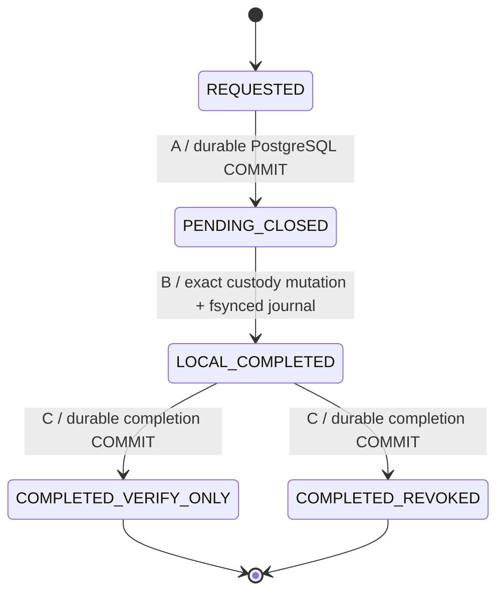

# Stage 9: Durable Custody Lifecycle Fencing V2

Ten dokument opisuje wersjonowany protokół administracyjny, który zamyka
DB-authoritative eligibility przed wykonaniem nieodwracalnego przejścia
rzeczywistego `LocalSigningCustody`. Dotyczy wyłącznie
`ROOT_PROOF_SIGNING` oraz `HISTORY_ATTESTATION_SIGNING` w odizolowanej,
kwalifikowanej granicy PostgreSQL Atomic Commit. Nie stanowi kwalifikacji
produkcyjnej emisji ani zmiany zamrożonych kontraktów M0.5.

`ATOMIC_ISSUER_READY=NOT_READY` oraz
`PRODUCTION_LIFECYCLE_ISOLATION=BLOCKED` pozostają obowiązkowe. Istniejące
lokalne wejścia administracyjne nadal mogą wykonać lifecycle bez tego
protokołu. Ich pełne odizolowanie, aktywacja następcy i trust activation
wymagają osobnej, jawnej kwalifikacji.

## Źródła i granice audytu

Codebase Memory nie jest dostępne w tym środowisku. Ustalenia wynikają z
celowanych wyszukiwań `rg` w `bot_core`, `scripts`, `deployment`, odpowiednich
testach i dokumentach oraz z bezpośredniej kontroli źródeł. Nie jest to dowód
kompletności graph index ani wszystkich możliwych wywołań administracyjnych
spoza repozytorium.

Sprawdzone źródła obejmują:

- [LocalSigningCustody](../../bot_core/local_signing_custody.py), w tym
  `_transition_exact_locked()`, oba publiczne transition APIs,
  `_custody_lock()`, provisioning i planned freshness rotation/recovery.
- [Atomic Commit V1](../../bot_core/postgresql_atomic_root_proof_commit.py),
  [schema](../../bot_core/postgresql_atomic_root_proof_schema.py),
  [migration](../../bot_core/postgresql_atomic_root_proof_migration.py) oraz
  [qualification](../../bot_core/postgresql_atomic_root_proof_qualification.py).
- [CHA issuance custody](../../bot_core/cha_root_proof_signing_custody.py),
  [pre-account lifecycle](../../bot_core/postgresql_preaccount_credentials.py),
  [Root Proof recovery](../../bot_core/root_proof_issuer_recovery.py) i
  [native Windows custody filesystem](../../bot_core/windows_custody_filesystem.py).
- Zamrożone [production substrate selection](cryptohunter_product_architecture/m05_account_genesis_root_proof_issuer_production_substrate_selection_contract.json),
  [independent issuer](cryptohunter_product_architecture/m05_account_genesis_independent_root_proof_issuer_contract.json),
  [issuer implementation readiness](cryptohunter_product_architecture/m05_account_genesis_root_proof_issuer_implementation_readiness_contract.json)
  i [physical persistence/crash atomicity](cryptohunter_product_architecture/m05_account_genesis_physical_persistence_crash_atomicity_contract.json).

## Istniejące wejścia i drogi obejścia

| Wejście | Rzeczywiste działanie | Relacja do V2 |
| --- | --- | --- |
| `transition_local_signing_credential_lifecycle()` | Rozwiązuje exact current/retained credential pod wyłącznym custody lock, porównuje generation, wykonuje one-way transition i crash-safe replace. Nie wymaga DB intent ani admin operation ID. | Pozostaje legacy lokalnym admin bypass; blocker produkcyjnej izolacji. |
| `transition_local_signing_lifecycle()` | Odczytuje bieżący role credential pod tym samym lock i wywołuje `_transition_exact_locked()` z odczytaną generation. | Ten sam blocker; samo nazwanie API offline/admin nie ustanawia DB-authoritative autoryzacji. |
| `_transition_exact_locked()` | Zachowuje identity, public key, key version i secret reference, zwiększa generation o jeden. | V2 używa istniejącego mechanizmu zamiast nowego systemu kluczy. Jest prywatnym helperem, nie niezależnym DB authorization portem. |
| `provision_local_signing_authority()` | Tworzy rzeczywisty seed w native keyring i lokalne metadata `ACTIVE`, generation 1, pod lock. | Nie daje prawa do produkcyjnego BIND; aktywacja nowego credential jest poza V2. |
| `rotate_local_freshness_signing_authority()` / `_recover_rotation_locked()` | Tylko freshness-finalization i CHA-freshness-proposer roles; journaling R0–R7, old retained oraz successor ACTIVE, publication przez current-record replace. Recovery zachowuje już wykonane one-way zmiany old key. | Inna authority i inny protokół; nie służy do Root Proof/history successor activation. |
| `OfflineIssuanceCustodyAdministrator.transition_lifecycle()` w CHA custody | Oddzielny lifecycle STAGED/ACTIVE/VERIFY_ONLY/REVOKED lokalnego signer-a signed CHA attempts. | Poza zakresem dwóch issuer signing roles; nie zastępuje ich close. |
| Pre-account `transition_lifecycle()` | Własny admin principal, credential rows, alias advisory lock i generation/revision CAS. | Własna semantic authority. Atomic issuer używa jej exact locking helperów. |
| V1 `approve_commit()` | Raw test-admin approval może wskazać inny, wcześniej provisioned ACTIVE fence tej samej roli i generation. V1 commit sam nie wyprowadza fence key z faktycznych retained signer bytes. | V2 blokuje tę możliwość przy INSERT decyzji przez pinned `guard_lifecycle_decision_fences()`; cała transakcja przegrywającego BIND/history jest wycofana. |
| V1 `provision_fence()` / `transition_fence()` | Test-admin może utworzyć PENDING_CLOSED i opublikować ACTIVE bez durable local custody completion; generation może zwiększyć podczas ponownej aktywacji. | Jawna migracja V2 odwołuje ich admin EXECUTE i zakłada ALWAYS trigger odrzucający legacy provisioning/reaktywację. Bazowa implementacja i regresje V1 pozostają osobno. |
| Root Proof recovery/orchestration | Odczytowe assessment i reconciliation; publiczne signing/BIND/transport/finalization gates pozostają zamknięte. | Recovery report nie mutuje custody ani nie otwiera eligibility. |

Celowane wyszukiwanie nie wykazało w `bot_core`, `scripts` ani `deployment`
produkcyjnego wywołania obu publicznych local transition funkcji poza ich
definicjami. Są jednak importowalnymi API administracyjnymi; brak obecnego
callera nie usuwa możliwości ominięcia V2. Administrator z prawem zapisu
lokalnych metadata albo keyring nie jest odizolowany samym typem DTO.

## Wersjonowana migracja i qualification

V2 jest jawną migracją istniejącego, odizolowanego Atomic Commit V1.
[Lifecycle schema](../../bot_core/postgresql_custody_lifecycle_schema.py)
instaluje marker `lifecycle_metadata` z
`schema_identity=cryptohunter.custody_lifecycle.postgresql`, `schema_version=2`
i `migration_id=DURABLE_CUSTODY_LIFECYCLE_FENCING_V2`. Oryginalny marker
Atomic Commit V1 pozostaje w wersji 1. Nowe owner-owned tabele to
`lifecycle_credentials`, `lifecycle_operations`, `lifecycle_completions` oraz
`lifecycle_authority_secret`. Aktualny SQL contract 3 dodaje również
immutable `lifecycle_sql_contract`, zachowując `lifecycle_metadata.schema_version=2`
oraz wszystkie wcześniejsze V2 SQL definitions. Credentials, request i completion są immutable;
secret ma osobny SHA256 pin. Migracja instaluje ACL i reviewed function inventory,
wersjonuje pinned catalog manifest i nadaje nowy deployment hash.
[Qualification](../../bot_core/postgresql_custody_lifecycle_qualification.py)
przypina wynikowy manifest i exact role OIDs. Dotychczasowe znaczenie V1
nie zostaje po cichu zmienione; stara kwalifikacja odrzuca migrowany katalog.
`BOUNDARY=ISOLATED_TEST_ONLY` jest utrwalonym markerem i wymaganiem qualification.

`migrate_custody_lifecycle_v2()` działa przez odrębny direct-login bootstrap
administrator w jednej jawnej transakcji, porównuje retained application bytes
i reviewed V1 sources. Po jej COMMIT odrębne admin/writer connections przechodzą
postqualification. Odmowa tego późniejszego probe nie cofa migracji i nie dowodzi
rollbacku. Restart administratora używa read-only
`requalify_existing_custody_lifecycle_v2()` z autentyczną bootstrap authority
oraz expected physical identity; zwykły runtime nie wybiera nowego pin ani
nie pobiera MAC secret z DB.

Pozostają trzy odrębne principals: schema owner `NOLOGIN`, direct-login
lifecycle administrator i direct-login issuer writer. Guardy odróżniają
`session_user` od owner `current_user`; `SET ROLE` nie zamienia niepowiązanego
loginu w autentycznego administratora. Writer nie otrzymuje direct DML/DDL,
admin EXECUTE ani owner membership. Funkcje `SECURITY DEFINER` mają
`SET search_path=pg_catalog` oraz statyczny SQL. Exact ACL, definitions,
relation inventory i role OIDs należą do pinned manifestu. Admin i writer
otrzymują wyłącznie `SELECT` na `lifecycle_metadata`; nowy
`lifecycle_sql_contract` pozostaje owner-only. Admin i writer dostają jedynie
boolean `EXECUTE` na `qualify_lifecycle_enrollment_v3()`. Nie otrzymują odczytu
`lifecycle_authority_secret`, intent ani completion tables. Live qualifier
porównuje exact schema identity/version, migration ID, admin/owner OIDs,
SHA256 authentication key i `ISOLATED_TEST_ONLY` marker z trusted deployment
na obu direct-login połączeniach. SHA256 pin nie ujawnia secretu i nie jest
samodzielnym completion admission.

Migracja odwołuje legacy fence administration EXECUTE. Nie wprowadza V2 API
publikującego ACTIVE ani zmieniającego generation tego samego klucza w celu
jego reaktywacji. Istniejące ACTIVE test fences są historycznym stanem
izolowanego testowego bootstrapu; nie są custody-authenticated produkcyjnym
nadaniem uprawnień. Enrollment sprawdza tę samą kanoniczną derivation fence,
której używa V1 issuer: pełny początkowy signing snapshot dla Root Proof i
exact credential material dla history signer. Nie wystarcza dowolny fence
o zgodnej role/generation. Kolejne operacje zachowują pierwotny enrolled
fence key; lifecycle generation jest osobnym CAS. Sam schema version 2
nie oznacza kwalifikacji produkcyjnej.

Samo poprawne enrollment nie wystarcza do ochrony finalnego commitu: stare
raw `approve_commit()` mogło skierować pakiet na inny istniejący ACTIVE fence.
Dlatego V2 instaluje pinned ALWAYS BEFORE INSERT trigger
`lifecycle_decision_credential_fences` na `decisions`, wykonujący
`guard_lifecycle_decision_fences()`. Root fence jest wyprowadzany z
oryginalnego `credential_snapshot` w retained RESERVED envelope BYTEA.
History fence jest wyprowadzany z oryginalnej `signing_credential_identity`
w canonical head BYTEA po sprawdzeniu dokładnej `ATTESTATION_DOMAIN`.
Owner-owned parser facades zachowują kanoniczne bajty i istniejące ACL.
Pakiet musi wskazać te dokładne signer fences; dowolny alias jest odrzucany
przed utrwaleniem nowej decyzji, a transakcja wycofuje cały nowy BIND/history.
Gdy pakiet wskazuje prawidłowe fences, V1 final transaction już utrzymuje ich
row locks do COMMIT i sprawdza bieżące ACTIVE/generation. V1 SQL source
definitions pozostają niezmienione; guard jest jawnym dodatkiem inventory V2.

Regresja aliasów używa rzeczywiście ACTIVE root i alternatywnego ACTIVE
fence obu signer roles, genuine wcześniej przygotowanych retained bytes
oraz dokładnego SQL error `actual retained signer custody fence cannot be aliased`.
Odmowa zachowuje pełny wcześniejszy snapshot. Osobny multiprocess scenariusz
sprawdza canonical fence przy PENDING_CLOSED, jeszcze przed local revoke,
i dokładny error `DB-authoritative lifecycle fence closed`; nie opiera tej
odmowy na późniejszym stale history predecessor. Guard dotyczy nowych decyzji.
Exact replay istniejącej decyzji nadal zwraca jej immutable historyczny wynik,
nie tworząc nowego BIND. Testowe cryptographic approval i wcześniejsze
przygotowanie pozostają zaufaną, odizolowaną granicą V1; ten guard nie
ustanawia produkcyjnego crypto/signing pipeline.

## Statyczna granica importów i issuer transport

Test `_assert_local_issuance_execution_ownership()` z
[testu signed immutable attempt](../../tests/architecture/test_stage9_root_proof_signed_immutable_attempt_contract.py)
używa `_source_imports()` do zamknięcia graph importów. `ImportFrom` dodaje
zarówno wskazany module, jak i child symbols; AST obejmuje również
`TYPE_CHECKING` oraz opcjonalne `try/except` imports. Dodane
`from bot_core import local_signing_custody as custody` w coordinatorze
wprowadziło jawną krawędź do całej fasady `bot_core`, a dalej ścieżkę:

```text
bot_core.postgresql_custody_lifecycle
→ bot_core
→ bot_core.auto_trader
→ bot_core.auto_trader.app
→ bot_core.observability
→ bot_core.observability.server
```

`bot_core.__init__` ma `.auto_trader` import pod `TYPE_CHECKING`;
`auto_trader` re-eksportuje app, a observability re-eksportuje metrics server.
Ostatni moduł importuje `http`/`http.server`, więc konserwatywna closure
zgłasza `issuer transport bypass`. Rzeczywisty source tego modułu obsługuje
Prometheus metrics; jego serwer startuje przez osobne `start_http_server()`
i nie transportuje retained issuance request. Jest to rozszerzenie
statycznej analizy poprzez fasadę, nie nowy pipeline issuer transport.

Minimalna poprawka to `import bot_core.local_signing_custody as custody`:
graph wskazuje dokładny child module. Reguły testu architektury, zakazane transport
imports i zamrożone kontrakty pozostają niezmienione; nie ma wyjątku dla
observability server. Bezpośredni submodule import nie stanowi obietnicy,
że Python nigdy nie inicjalizuje parent package; naprawia konkretną jawną
krawędź w review graph. Nowe moduły nie dodają innych analogicznych
produkcyjnych facade imports.

Porównanie z niezmienionym gate na `main` (`2c1ebd47`) i pierwotnym PR
(`882fa02c`) daje:

| Źródła | Consumers | Reachable modules | Gate / observability server |
| --- | ---: | ---: | --- |
| main: 1174 pliki | 34 | 99 | PASS / nieosiągalny |
| PR przed poprawką: 1178 plików | 38 | 474 | FAIL / osiągalny |
| direct import: 1178 plików | 38 | 103 | PASS / nieosiągalny |

Pierwszy zgłoszony transport module może zależeć od kolejności iteracji
zbioru; raport macOS wskazał metrics server, odtworzenie może wskazać inny
moduł tej samej rozszerzonej closure. Nie zmienia to źródłowej przyczyny.
Pełny test signed immutable attempt wraz z nowymi negatywnymi regresjami
importów dał `146 passed`.

## Signer enrollment w końcowym COMMIT

Pierwotny `guard_lifecycle_decision_fences()` z SQL contract 2 sprawdzał
kanoniczną tożsamość root/history fences, lecz nie odczytywał
`lifecycle_credentials`. `install_custody_lifecycle_authority()` wymagał
niepustego zestawu enrollment; nie wymagał enrollment wszystkich signerów
istniejących immutable approved candidates. V1 `commit_root_proof()`
sprawdzał rzeczywiste ACTIVE/generation tych kanonicznych fences i całe
retained BIND/history linkage, również bez sprawdzenia enrollment.
W rezultacie samo istnienie właściwego, historycznie provisioned ACTIVE
fence nie stanowiło dowodu udziału signera w administracyjnym V2. Pominięty
credential nie miał dostępnego V2 close, ponieważ admin request validator
wymaga własnego immutable `lifecycle_credentials` record.

Nie wolno utożsamiać kanonicznego fence z enrolled custody. Finalna granica
musi wymagać oddzielnych root/history enrollment records, ich exact roli,
pełnej credential identity, public key material i kanonicznej tożsamości.
Trust activation pozostaje własnym fence i nie otrzymuje fikcyjnego
local signing custody enrollment.

Jawna addytywna migracja `DURABLE_CUSTODY_V2_SIGNER_ENROLLMENT_V3` ustanawia
`SQL_CONTRACT_VERSION=3`; nie zastępuje wcześniej kwalifikowanej funkcji
`guard_lifecycle_decision_fences()` ani źródeł V1/V2 w miejscu. Nowa funkcja
`guard_lifecycle_decision_enrollment_v3()` jest owner-only
`SECURITY DEFINER SET search_path=pg_catalog`, wykonywana przez nowy pinned
ALWAYS BEFORE INSERT trigger `lifecycle_decision_signer_enrollment_v3`.
Wyprowadza oba fence keys z tych samych oryginalnych canonical bytes,
wymaga obu corresponding `lifecycle_credentials` records, porównuje pełny
Root Proof snapshot z enrollment i pełną history signer identity z jej
enrollment. Embedded `fence_key` obu bindings musi odpowiadać właściwemu
wierszowi; history enrollment generation musi odpowiadać generation pakietu
sprawdzanej na bieżącym DB fence. Dla obu ról wyprowadza public-material fingerprint z enrolled
raw 32-byte public key i wymaga równości z podpisaną credential identity.
History head zawiera complete opaque credential/version identity oraz ten
fingerprint; guard nie dopisuje nowego pola do zamrożonego formatu.
Brak enrollment albo jakakolwiek niezgodność odrzuca INSERT i wycofuje cały
atomic write set. Writer nie dostaje bezpośredniego odczytu lub DML na
credentials, intent, completion ani secret tables.

`lifecycle_sql_contract` zachowuje exact predecessor contract 2 catalog
snapshot oraz jego digest i administracyjny catalog SHA256 pin. Nowy manifest
przypina dodatkową relation, trigger, function definition, ACL i SQL version.
`qualify_lifecycle_enrollment_v3()` zwraca tylko boolean po sprawdzeniu
markeru, source/catalog pins oraz digest archived predecessor snapshot;
chroniona tabela revision nie jest udostępniana writerowi ani adminowi.
`upgrade_custody_lifecycle_signer_enrollment_v3()` odbywa się przez
autentyczną bootstrap authority; retained application
records, administrative operations/completions, keys i role OIDs zachowują
wcześniejsze znaczenie. Wersja historyczna 2 służy wyłącznie izolowanemu
odtworzeniu podatności i kwalifikowanemu wejściu do jawnego upgrade; nie jest
aktualnym final-commit enrollment contract. Domyślne migration,
reconstruction i live qualification wymagają revision 3. Historical contract 2
wymaga osobnego jawnego parametru i nie może utworzyć nowego lifecycle
administrator runtime przez zwykłą kwalifikację. Upgrade oraz świeża migration
revision 3 biorą table locks w kolejności `decisions → fences`, zgodnej z
issuer read-decisions-before-fences, przed conservation snapshot i DDL.
Exact retry historycznej decyzji pozostaje
odczytem immutable oryginalnych bajtów, bez nowej emisji lub BIND.

## Wykonane próby PostgreSQL dla enrollment

Dwa niezależnie zbudowane genuine lineages na PostgreSQL 16 odtworzyły lukę:
jedno pomijało Root Proof signer, drugie history signer. Historyczny jawny
SQL contract 2 zatwierdził właściwy retained signed proof mimo
`ACTIVE(generation=1)` na canonical fence bez corresponding enrollment.
W obu przypadkach zachowano dwie revisions subject entitlement history
z BOUND oraz po jednym authenticated issuer history record, attestation i
decision. To rzeczywisty durable COMMIT, nie wniosek z samej analizy źródeł.

Jawny upgrade do SQL contract 3 zachował dokładny snapshot wcześniej
zatwierdzonego write set. Exact retry odzyskał oryginalne payload, signature
oraz envelope bytes. Następnie odrębny, prawidłowo retained candidate został
odrzucony przez `CheckViolation` z dokładnym powodem
`both actual signer fences require custody enrollment`; snapshot pełnego
atomic write set oraz oddzielny snapshot fences, enrollment, operations i
completions pozostały niezmienione.

Fixture pomiędzy obserwacją starego commitu i odmową nowego candidate
odtwarza wyłącznie fizyczne issuance tables przez izolowaną bootstrap
admin authority. Nie zmienia fences, enrollment, administrative lifecycle
records, retained signed bytes ani lokalnego custody. Jest to konstrukcja
regresji, nie aplikacyjny recovery protocol. Oba scenariusze przeszły wraz z 31 existing lifecycle regressions na
default contract 3: finalny przebieg dał `33 passed, 1 warning`.
Szczegóły i odrębne historyczne wyniki są zapisane poniżej.

## Exact administrative operation state machine

`administrative_operation_id` identyfikuje niezmienne żądanie, a nie numer
próby HTTP ani nowy credential. `prepare_custody_lifecycle_request()`
przygotowuje descriptor bytes, które administrator zachowuje do exact retry;
`CustodyLifecycleRequest` jest tylko żądaniem.
`DurableCloseAuthorization` jest in-process capability wydanym po
pozytywnym durable DB observation, a nie caller-owned DTO. Exact request
wiąże fizyczną authority,
fence, pełną credential identity i role, public key material, key version,
expected lifecycle generation/state oraz terminal target. Replay z tym samym
ID i innymi parametrami kończy się konfliktem. Inne ID nie może przejąć
trwającej operacji tego fence.



`REQUESTED` opisuje zamiar administratora przed durable close; nie jest
nową eligibility. `LOCAL_COMPLETED` opisuje autentyczny trwały journal w
custody, podczas gdy DB fence wciąż pozostaje `PENDING_CLOSED`. Brak journal
ani completion w DB nie powoduje automatycznego powrotu do ACTIVE.
`REVOKED` jest terminalny. Dozwolone są wyłącznie `ACTIVE → VERIFY_ONLY`,
`ACTIVE → REVOKED` oraz `VERIFY_ONLY → REVOKED`.

### Phase A: durable close

[Trusted coordinator](../../bot_core/postgresql_custody_lifecycle.py)
korzysta z kwalifikowanego direct-login admin principal. PostgreSQL blokuje
rzeczywisty fence przez `SELECT ... FOR UPDATE`, porównuje exact predecessor
i identity, odrzuca inną aktywną operację, zapisuje immutable intent i
ustawia `PENDING_CLOSED` w jednej transakcji. Punktem linearizacji zamknięcia
jest trwały COMMIT tej transakcji.

Dopiero pozytywne potwierdzenie tego COMMIT albo autorytatywne rozstrzygnięcie
tej samej operacji pozwala wejść w Phase B. Recovery close blokuje ten sam
fence przed odczytem operation. Dzięki temu czeka na poprzedni backend,
który po śmierci klienta mógł jeszcze kończyć COMMIT. Zwykły brak wiersza w
niezsynchronizowanym odczycie nie dowodzi rollbacku.

### Phase B: genuine custody mutation

[Custody lifecycle evidence](../../bot_core/local_signing_lifecycle_evidence.py)
udostępnia `durable_transition_local_signing_credential_lifecycle()` oraz
`verified_durable_signing_lifecycle_completion()` i korzysta z istniejących
identity checks, wyłącznego `_custody_lock()`, CAS
oraz `_transition_exact_locked()`. Zachowuje public key material, credential
identity, role, key version i secret reference, zwiększa lifecycle generation
o jeden i wykonuje wyłącznie dozwolony one-way transition.

Journal w `.signing-lifecycle-operations/<sha256(operation-id)>.json` ma
`schema=cryptohunter.production-local-signing-lifecycle-operation`,
`schema_version=2`, descriptor base64, exact before/after metadata i stan
`INTENT` albo `COMPLETE`. Każdy osobno przekazany argument mutation musi
odpowiadać descriptorowi
authorized close: path/security, role, identity, operation ID, generation i
target. Rzeczywiste predecessor metadata muszą także zachować exact public
key, key version i predecessor state. Exact journal wiąże operation ID,
qualified close identity oraz predecessor i final metadata. Jest zapisywany trwale w kwalifikowanym custody directory.
Replay odczytuje faktyczny stan pod lock: wykonuje mutację tylko z exact
predecessor; exact final state pozwala dokończyć publikację evidence bez
ponownego nieodwracalnego transition. Inny stan, generation, key lub journal
kończy się odmową. Symlink, nieprawidłowa ownership/permissions i zmieniona
identity
nie stają się dowodem completion. Przejście retirement/revoke modyfikuje
metadata; nie używa prywatnego klucza ani nie potwierdza dostępności jego
sekretu w native keyring.

Journal i potwierdzenie bieżącego custody są źródłem completion admission.
Caller-provided hash ani sam dataclass/DTO nie są takim źródłem. Osobny
owner-protected MAC secret wiąże dokładne completion bytes przy publikacji;
nie jest prywatnym signing key i nie ustanawia nowego systemu custody.

### Phase C: completion publication

Koordynator ponownie weryfikuje immutable close, exact durable journal i
rzeczywisty stan custody. Utrzymuje lokalny lock podczas osobnej transakcji
publication. PostgreSQL blokuje właściwy fence, wymaga tej samej operacji i
expected predecessor, weryfikuje HMAC-SHA256 z domain
`CryptoHunter/CustodyLifecycleCompletion/V2\0`, zachowuje immutable
completion i publikuje wyłącznie VERIFY_ONLY albo REVOKED. Punktem
linearizacji jest trwały completion COMMIT.

DB completion zachowuje oryginalne `canonical_evidence` BYTEA i exact
authentication tag, a evidence obejmuje request, exact observed metadata i
SHA256 całego reread local journal. SQL weryfikuje poświadczenie trusted
koordynatora; nie odczytuje lokalnego filesystemu.

Zatwierdzony completion nie nadaje prawa do nowego BIND pod tym credential.
Lost response rozstrzyga exact replay oryginalnej operacji. Completion MAC
nie wystarcza do ACTIVE, nowego credential ani successor activation, bo
V2 nie ma takiej ścieżki SQL.

## Blokady, trwałość i śmierć klienta

| Operacja | Kolejność i czas życia blokad | Punkt trwałości |
| --- | --- | --- |
| Atomic issuer COMMIT | Sorted root/history/trust fence row locks; następnie pre-account namespace advisory lock i sorted credential helper locks; następnie własne entitlement lineage/history locks. Backend utrzymuje locks do COMMIT/ROLLBACK. Prywatne signing i local custody nie odbywają się w tej transakcji. | Jeden fizyczny COMMIT write set decyzji, BIND i signed history. |
| Phase A | Jeden exact DB fence FOR UPDATE; bez lokalnego custody lock podczas close. | COMMIT intent + PENDING_CLOSED. |
| Phase B | Wyłączny custody file lock; brak otwartej transakcji close; reload exact metadata i journal. | Metadata temp fsync → replace → parent directory fsync; immutable journal fsync i directory durability. |
| Phase C | Wyłączny custody file lock → jeden exact DB fence FOR UPDATE; do publication COMMIT local lock nie zostaje zwolniony przez żywy koordynator. | COMMIT immutable completion + terminal eligibility. |

V2 nie wprowadza ścieżki DB-fence-lock → oczekiwanie na custody-lock.
Phase A kończy transakcję przed B; issuer nie bierze custody-lock. Phase C
bierze tylko jeden fence i nie próbuje przejąć pozostałych signer/trust fences.
To zapobiega cyklowi sprzecznej kolejności DB/custody locks w tych wejściach.

Na POSIX `_custody_lock()` używa rzeczywistego `flock` shared/exclusive.
Na Windows byte-range primitive serializuje również readers i ma istniejący
pięciosekundowy limit acquisition; limit nie skraca operacji holdera.
Blokada systemu plików nie jest PostgreSQL transaction lock. Po SIGKILL,
awarii interpretera lub zamknięciu descriptorów OS zwalnia lokalny lock,
podczas gdy PostgreSQL backend może jeszcze wykonywać SQL lub COMMIT.

To rozróżnienie jest istotne w dwóch miejscach: po wysłaniu close COMMIT
Phase B musi czekać na autorytatywne rozstrzygnięcie; po wysłaniu completion
COMMIT fence pozostaje już zamknięty niezależnie od wyniku. Zwolnienie
custody lock nie cofa durable PENDING_CLOSED ani nie nadaje ACTIVE.

Fsync i PostgreSQL `fsync`/`synchronous_commit`/`full_page_writes` są
wymaganiami runtime/storage qualification. Test process kill i restart
PostgreSQL nie dowodzi odporności dysku na utratę zasilania ani niezależnej
anti-rollback domeny. Native Windows qualification wymaga osobnego
wykonania na chronionym lokalnym NTFS; Linux tests nie stanowią dowodu
Windows durability. Wspólny full-host rollback nadal pozostaje poza
gwarancją tego lokalnego protokołu.

## Crash, unknown result i concurrency

| Moment awarii | Bezpieczny stan / recovery |
| --- | --- |
| Przed durable close | Brak uprawnienia do mutation; exact retry A musi rozstrzygnąć lub utworzyć intent. |
| Close COMMIT, utracona odpowiedź | Unknown; fence-locked exact recovery czeka na wynik wcześniejszego backendu przed B. |
| Po close, przed mutation | PENDING_CLOSED; journal może jeszcze nie istnieć; restart powtarza exact operation. |
| Podczas mutation | Pod lock sprawdzić predecessor albo exact final state; nie powtarzać mutacji w ciemno. |
| Mutation zakończona, brak DB completion | PENDING_CLOSED; odczytać durable journal i current custody, następnie C. |
| Completion COMMIT, utracona odpowiedź | Exact completion replay odzyskuje oryginalny record; nie wykonuje nowego lifecycle step. |
| Restart PostgreSQL/admin procesu | Piny authority oraz exact operation pozostają wymagane; brak dostępu oznacza fail-closed. |
| Inne ID, zmieniony request, stale generation | Konflikt; brak mutation albo ponownego otwarcia. |
| Próba REVOKED → ACTIVE/VERIFY_ONLY | Odmowa; V2 nie ma activation API. |

W multiprocess race issuer i administrator synchronizują się na tym samym
rzeczywistym DB fence. Jeżeli issuer wygra przed close, jego immutable
decyzja pozostaje autorytatywna i exact replay może ją odczytać także po
revocation. Jeżeli close wygra, nowy issuer COMMIT odmawia. SERIALIZABLE
serialization failure jest odmową wymagającą exact retry; nie upoważnia do
zmiany request, mutacji custody ani utworzenia nowego attempt.

Wymagane testy korzystają z rzeczywistego PostgreSQL 16 i niezależnych
procesów, a nie mocków DB locks. Integration fixture korzysta z istniejącego
testowego zastąpienia native-keyring seam; real metadata, CAS, OS locks, fsync
i PostgreSQL pozostają wykonywane. Nie jest to kwalifikacja rzeczywistej
usługi OS keyring ani hardware custody. Raport wykonania testów należy do PR;
opis scenariusza w tym dokumencie nie oznacza zaliczenia niewykonanego
crash/power-loss/Windows/hardware qualification.

## Rzeczywiste gwarancje i pozostające blokery

Protokół daje DB-first ordering na własnej kwalifikowanej ścieżce: trwałe
PENDING_CLOSED poprzedza local mutation; completion zachowuje tę samą exact
operację i terminalny stan; brak evidence nie otwiera eligibility; writer
ani niepowiązany login nie mogą użyć admin funkcji lub direct DML do
sfabrykowania completion. MAC bez exact local journal i current-state check
nie jest trusted coordinator admission.

Gwarancja autentycznej lokalnej mutation zakłada nieprzejęty administrator,
owner-protected MAC secret, chronione custody filesystem/native keyring oraz
kwalifikowany deployment. Osoba z uprawnieniami schema owner/superuser,
sekretem MAC albo możliwością dowolnego zapisu local custody może podważyć
założenia. Python exact types i sealed capability nie są granicą przeciwko
kodowi wykonującemu się z pełnymi prawami tego samego administratora.
Nie wolno przedstawiać tego deploymentu jako odpornego na przejęcie hosta.

Pozostają jawne blokery:

- Legacy local transition/provision APIs i filesystem administration nie są
  globalnie odizolowane od nowego protokołu.
- Zachowane, wcześniej provisioned test ACTIVE fences nie dowodzą qualified
  production activation. Żaden V2 completion nie zastępuje tej kwalifikacji.
- Planned Root Proof/history key rotation, successor activation, trust
  activation i history successor reproposal wymagają osobnych protokołów.
- Produkcyjny issuer pipeline, nowe RESERVED/STAGED adapters, checkpoint
  advance, CHA finalization, transport i AccountGenesis COMMITTED są poza
  zakresem; publiczne issuance gates pozostają zamknięte.
- Zamrożone `separate_semantic_owners_schemas_roles_credentials_namespaces_transactions_and_lifecycles=true`
  wymaga wcześniejszej reconciliation; V2 nie usuwa tej niejednoznaczności.

Zamrożony lifecycle zachowuje kompromitowaną generation i public key;
retained REVOKED record nie oznacza zaufania do samego starego podpisu ani
nie zmienia kierunku history recovery. Physical AccountGenesis commit,
FreshnessAuthority i checkpoint pozostają odrębnymi decyzjami.

Przykładowy revoke ma przebieg:
`ACTIVE(g=1) → PENDING_CLOSED(g=1, operation=op-1)` w DB;
następnie custody `REVOKED(g=2)` i exact durable local completion;
na końcu immutable DB completion `op-1` oraz fence `REVOKED`.
W żadnej fazie tego przebiegu V2 nie publikuje nowego ACTIVE.

`PRODUCTION_LIFECYCLE_ISOLATION=BLOCKED`.
`ATOMIC_ISSUER_READY=NOT_READY`.

## Wyniki lokalnej walidacji poprawki SQL contract 3

Finalne wykonanie po zamrożeniu źródeł i testów, obejmujące oba missing-enrollment
proofs oraz 31 istniejących lifecycle regressions, zakończyło się
`33 passed, 1 warning` w 1645,75 s na rzeczywistym PostgreSQL 16.15.
Oba niezależne lineage potwierdziły rzeczywisty commit starego contract 2,
zachowanie oryginalnych decyzji po upgrade oraz odmowę nowego prawidłowego
candidate z pełnym rollbackiem na contract 3.

Wzmocniony test trzech procesów sprawdził dokładny SQL error
`DB-authoritative lifecycle fence closed` kolejno dla `PENDING_CLOSED`,
`VERIFY_ONLY` i `REVOKED`. Pierwsza odmowa nastąpiła jeszcze przy rzeczywistym
lokalnym custody ACTIVE. Zatwierdzona wcześniej decyzja pozostała jedyną
decyzją, a jej exact retry zachował payload/signature/envelope byte-identical.

| Zakres bieżącej poprawki | Wynik |
| --- | --- |
| PostgreSQL 16: missing ROOT/HISTORY enrollment i lifecycle contract 3 | 33 passed, 1 warning; 1645,75 s |
| Ponowne PostgreSQL Atomic Commit V1 regressions | 58 passed; 386,25 s |
| Admin API (67), frozen transport (121), import regressions (25) | 213 passed; 46,57 s |
| Odrębny frozen transport + import regressions | 146 passed; 31,08 s |
| Ruff i dokładny workflow formatter | PASS; formatter 66 files |
| Skonfigurowany mypy Linux / Win32 | PASS; 302 files na platformę, finalny narrow check 2 files na platformę |
| Diff coverage względem origin/main, niezmieniony próg 70% | PASS; 87%, 840 changed lines, 107 missing |
| `git diff --check` | PASS |

Coverage połączono wyłącznie z bieżących unit i PostgreSQL runs. Mierzy
wykonanie Python, nie coverage gałęzi samych SQL functions. Częściowo
pokrywających się zakresów testów nie sumowano.

Historyczna iteracja `882fa02c`, przed poprawką importów i obowiązkowego
enrollment, miała odrębne szersze wyniki: 31 PostgreSQL V2 tests w 600,84 s,
58 PostgreSQL V1 tests w 672,83 s, custody/evidence/freshness/native locking
215 passed z 9 platform skips, admin/new architecture 67 passed, frozen
Stage 9/M0.5 architecture 1090 passed i Atomic V1 contracts/boundary 240 passed.
Jej połączony diff coverage wynosił 89%. Te historyczne wyniki nie są
zastępowane sumą z bieżącym przebiegiem i nie ustanawiały enrollment
qualification; lukę odtworzono w rzeczywistych testach obecnej poprawki.

Nie uruchomiono całej wielogodzinnej macierzy CI ani bramek sprzętowych.
Nie zmieniono timeoutów, coverage scopes ani progu 70%. Rzeczywiste
metadata/CAS/locks/fsync i PostgreSQL nie były mockowane; istniejący
native-keyring test seam pozostaje zastąpiony w fixture. Te wyniki nie są
kwalifikacją produkcyjnej izolacji ani power-loss.

`CODE_READY_FOR_REVIEW=YES`.
`DB_CUSTODY_LIFECYCLE_TESTED=YES`.
`PRODUCTION_LIFECYCLE_ISOLATION=BLOCKED`.
`ATOMIC_ISSUER_READY=NOT_READY`.
