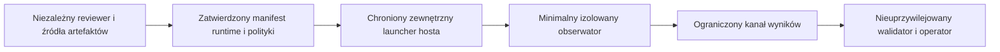

# Stage 9 — niezależne dowody instalacji i projekt zaufanego obserwatora

Data analizy: **2026-10-27 (UTC)**. Repozytorium: `Dudzian/Dudzian`.
Punkt odniesienia: `2502b7fd014509a4d7d3b113b2ed6fd351e75e79`.
Zakres: inwentaryzacja dowodów i projekt; bez implementacji lub uruchomienia
uprzywilejowanego obserwatora. Zakończone prace nad budżetami skanera nie są
ponawiane.

## Decyzja

**Nie ma obecnie zweryfikowanego, kompletnego, niezależnego inventory obu
historycznych instalacji.** Istnieją konkretne źródła pozwalające odtworzyć
część oczekiwanych bajtów: obiekty Git, locki i wskazane w nich oficjalne wheels.
Nie zamyka to pochodzenia całego venv, runtime systemowego ani lokalnych
manifestów. Dostępne CI nie dostarcza dowodu pełnej instalacji Stage 41B.

Nie powstaje plik wejściowy `--evidence` ani jego zaufany pin. Załączone
inwentarze badawcze są częściowe i nie stanowią atestacji. Hash receipt lub drzewa
obliczony na Dellu może służyć porównaniu, lecz nie jest niezależną kotwicą.

Niezmienne ograniczenia:

```text
qualification = BLOCKED
full_confirmation = false
coexistence_authorized = false
preflight_exception = false
physical_test_status = PHYSICAL_TEST_PENDING
status = IN_PROGRESS
production_status = PRODUCTION_NO_GO
```

`no_other_installations` pozostaje bez zmian. Istniejące instalacje Stage 41B
pozostają zachowane. W tej pracy nie wykonano `sudo`, kodu jako root,
fizycznego `--execute`, zmiany `/proc`, jednostek, uprawnień ani progów CI.

## 1. Dostarczony wynik fizyczny

Poniższe dane pochodzą od operatora. Nie uzyskano bajtów raportu ani dostępu do
Della; nie wykonano niezależnego przeliczenia jego SHA-256.

Plik: `coexistence-stage9-3212-20261027T161528Z-oadjjI.json`.
Zgłoszony SHA-256:
`00b8da80503bf366f491f4caf835d87f5e11788a6d3428fe62877b480809619c`.

| Pole | Wartość |
| --- | ---: |
| `checked_pid_count` | 272 |
| `observed_thread_count` | 1048 |
| `per_pid_limit_count` | 0 |
| `sweep_budget_limit_count` | 0 |
| `skipped_pid_count` | 0 |
| `kernel_thread_pid_count` | 145 |
| `empty_kernel_maps_pid_count` | 145 |
| `identity_unstable_pid_count` | 0 |
| `bindings_unstable_pid_count` | 33 |
| `unavailable_pid_count` | 185 |
| `matched_pid_count` | 0 |
| `installation_metadata.observed_entry_count` | 2354 |

`installation_metadata.stable=true`, `integrity_verified=false`,
`provenance_verified=false`, `evidence_pin_verified=false`.
Kategorie procesów mogą się nakładać. Nie wolno sumować ich jako rozłącznych
populacji ani utożsamiać 185 niedostępnych PID ze 185 odmowami dostępu do maps.
Zero trafień przy niedostępności i niestabilnych bindings nie dowodzi braku
referencji. Stabilne `lstat` nie weryfikuje zawartości plików. Brak limitów
potwierdza zgłoszony wynik tego przebiegu; nie usuwa pozostałych luk.

## 2. Dowody już dostępne niezależnie od Della

### Git i dokumentacja

Oba commity są dostępne jako obiekty Git w repozytorium; ich drzewa potwierdzono
również przez GitHub API:

| Commit instalacji | Drzewo Git |
| --- | --- |
| `782816540373d7b31f426dab645ad115320d1234` | `b12d65c2a8a65d855d8ccf820dee0eb76e8bdca6` |
| `26e17e7c23ea6cc1b265d57bfda1a1e6589d9e3f` | `7c960047467b9f08b93bba8504e0dffa8be121d4` |

GitHub zwraca dla obu `verification.verified=false`, `reason=unsigned`.
Historyczne commity są niepodpisane; nie określa się ich metadanych jako
podpisanych. Rozdzielić następujące właściwości:

- **Poprawność Git OID:** przeliczenie identyfikatora z typu, długości i surowych
  bajtów obiektu potwierdza zgodność z zadanym OID.
- **Integralność obiektów:** sprawdzenie commit/tree/blob i powiązań ścieżek
  wiąże treść z zadanym commitem w modelu hashy Git. Nie uwierzytelnia wydawcy.
- **Autentyczność źródła:** wymaga osobnego zaufania do kanału i tożsamości
  dostawcy. GitHub i kontrola konta/repozytorium pozostają założeniami źródła.
- **Niezależna akceptacja commita:** wymaga zapisu akceptacji konkretnego SHA
  przez niezależnie uwierzytelnionego maintainera/reviewera; ta analiza jej
  nie poświadcza.
- **Kryptograficzna atestacja:** wymaga zweryfikowanego oświadczenia, jego
  subject digest, tożsamości wystawcy i polityki zaufania. Poprawny OID,
  integralność obiektów i ludzka akceptacja same nie tworzą takiej atestacji.

W obu commitach identyczne są:

| Plik | Git blob | SHA-256 |
| --- | --- | --- |
| `scripts/prepare_stage41b_environment.py` | `495df31565f90cce815c9be563e5fa02e3a965e3` | `25795ca00233e4375a95f11b6e26f62fb59961ff1a2fa10cc6c901b26a0858a4` |
| `deployment/stage41b-wheel-lock.json` | `55741ceb65ff8001bb273d99011b5513b6a1a05b` | `15df09370145602e748f43b28e56dcdf9ab8aac3cb8360721eadaafddb1e99c6` |
| `deployment/stage41b-requirements.lock` | `95c557da7c037e46590f619dcd290f09ff074921` | `674a127722ecd5a4e305673bbdf2b0b30f2ab58fbd4b95bd2cad3fdc46c0e0e0` |

`selected_source()` wybiera 716 plików na commit: 711 plików Python z `bot_core`
i 5 jawnych ścieżek. W tym wybranym zbiorze między commitami różni się tylko
`scripts/qualify_stage41b_signer_isolation.py`. Można odtworzyć dokładne bajty
tych źródeł; nie jest to inwentaryzacja całego venv. Maszynowy
[częściowy wykaz źródeł i locków](evidence/stage9_independent_source_subset_2026-10-27.json)
zawiera ścieżki, Git blob IDs, SHA-256, rozmiary i jawne luki dowodu.

[Runbook Stage 41B](stage9_stage41b_operator_runbook.md) opisuje osobny build
bez roota, Git proof, offline installation i osobne bramki kwalifikacji.
[Architektura Stage 41B](stage9_stage41b_physical_signer_isolation.md) jawnie
pozostawia systemowy Python i stdlib w TCB. Historyczny
[receipt operatora](evidence/stage41b_dell_operator_physical_receipt_2026-10-24.md)
sam wskazuje, że jest transkrypcją i że oryginalnych raportów nie załączono.
Jego zapis w Git zachowuje treść oświadczenia, ale nie uwierzytelnia pomiaru.

### Wheels i wynik budowania

`build_bundle()` nie buduje własnego wheel projektu. Pobiera 10 już zbudowanych
archiwów z dokładnych adresów `files.pythonhosted.org`, bez resolvera, sdist,
pip install lub build hooków. Lock ustala CPython 3.12 / linux-x86_64:

| Dystrybucja | Wersja |
| --- | --- |
| cffi | 2.1.1 |
| cryptography | 50.0.2 |
| jaraco.classes | 3.4.0 |
| jaraco.context | 6.1.2 |
| jaraco.functools | 4.6.0 |
| jeepney | 0.9.0 |
| keyring | 25.7.0 |
| more-itertools | 11.2.1 |
| pycparser | 3.12 |
| SecretStorage | 3.5.0 |

Lock zawiera pełne nazwy archiwów, URL i SHA-256. `wheel_members()` sprawdza
digest archiwum, metadane i kompletny RECORD oraz odrzuca m.in. traversal,
symlinki, `.pth`, `.pyc` i `.data`. RECORD sam w sobie nie uwierzytelnia wydawcy;
kotwicą bajtów jest zaakceptowany niezależnie lock. Odzyskanie archive bytes,
przeliczenie hashy i walidacja członków nadal wymagają wykonania przez zaufany
nieuprzywilejowany proces. W tej analizie nie pobrano tych 10 archiwów.

Jeżeli na Dellu są dodatkowe lub lokalnie wygenerowane wheels, nie wynikają one
z tego zamkniętego formatu. Wymagają własnych źródeł, wejść builda, trusted
buildera i dowodu wyniku; nie można ich uznać na podstawie nazwy commita.

### Historyczne GitHub Actions

Odczyt REST `actions/runs?head_sha=<sha>&per_page=100&page=1` bez filtra eventu
zwrócił po 7 runów, łącznie 14. Odczytano listę artefaktów każdego runa:
72 rekordy, maksymalnie 11 na listę; żadna lista nie osiągnęła rozmiaru strony.
To kompletny wynik tych dostępnych zapytań, nie dowód istnienia wszystkich
usuniętych historycznych runów lub artefaktów. Snapshot zawiera osobny
[inwentarz CI](evidence/stage9_independent_ci_evidence_2026-10-27.json).

| Commit / event | Run CI | Linux wheelhouse artifact | Wygasa (UTC) |
| --- | --- | --- | --- |
| `7828165` push | [40013926497](https://github.com/Dudzian/Dudzian/actions/runs/40013926497) | 12527781826 | 2026-10-30 19:50:48 |
| `7828165` PR | [40013932681](https://github.com/Dudzian/Dudzian/actions/runs/40013932681) | 12526929653 | 2026-10-30 19:51:08 |
| `26e17e7` push | [39931271992](https://github.com/Dudzian/Dudzian/actions/runs/39931271992) | 12491791973 | 2026-10-30 09:27:11 |
| `26e17e7` PR | [39931277836](https://github.com/Dudzian/Dudzian/actions/runs/39931277836) | 12491049951 | 2026-10-30 09:24:18 |

Digest ZIP push 7828 podany przez API i log uploadu:
`sha256:d25c7d12cdda343f23e6644662fa2b0e0105fa6c8a9e6d2f07c46f131907c55c`.
Digest ZIP push 26e:
`sha256:a23c43bb7904805b8aaa60642366995e0b231193be4c25eafd9b03a13452b217`.

[Historyczny workflow](https://github.com/Dudzian/Dudzian/blob/782816540373d7b31f426dab645ad115320d1234/.github/workflows/ci.yml#L122)
używa Python 3.11 i `requirements-desktop.lock`. Log
[joba 120621593796](https://github.com/Dudzian/Dudzian/actions/runs/40013926497/job/120621593796)
potwierdza Python 3.11.17, pobieranie zależności i manifest 129 wheels.
Nie jest to build venv Stage 41B na CPython 3.12; m.in. wheel cffi cp312 z jego
locka nie jest zastępowalny artefaktem cp311. Sukces testów CI nie poświadcza
bajtów istniejącej instalacji. `Platform deployment tracks` ma failure; nie
deklaruje się wszystkich workflow jako zielonych.

Connector pobrał ZIP 12527781826 do File Service (427764074 bajty), lecz nie
udostępnił go do lokalnego przeliczenia dostępnym downloaderem. Nie zbadano
bajtów ZIP ani manifestu; zgodność metadanych i logu nie zastępuje tego kroku.
W 72 nazwach artefaktów nie znaleziono pełnego Stage41B venv lub projektowego
wheel Stage41B. SBOM workflow skanuje repo `path: .`, nie zainstalowany venv.
Zapytanie releases zwróciło `[]`.

Stan atestacji to **UNKNOWN**: connector odrzucił endpoint attestations jako
nieobsługiwany (400), co nie jest odpowiedzią GitHub o braku atestacji.
W obu inwentarzach `cryptographic_attestation=false` opisuje wyłącznie te
pliki badawcze: nie są atestacją i nie zawierają zweryfikowanej atestacji.
`attestations.state=UNKNOWN` opisuje nierozstrzygnięte istnienie i ważność
atestacji zewnętrznych. Brak zweryfikowanej atestacji nie dowodzi jej
nieistnienia; żadna z tych wartości nie ustanawia zaufanego pinu.
Późniejsze pozyskanie atestacji wymaga sprawdzenia subject digest, issuer,
repo/workflow/ref, builder identity i materiałów, a także przyjętej polityki
zaufania. Podpis na nieodpowiednim artefakcie nie zamknie luki Stage 41B.

Artefakty warto zabezpieczyć przez zaufany proces przed podanymi terminami
retencji. Nie zmieniano retencji ani nie uruchamiano nowych workflow.

## 3. Co można odtworzyć, a czego brakuje

| Element | Możliwość odtworzenia i luka |
| --- | --- |
| 716 wybranych źródeł i locki / commit | Dokładne bajty z obiektów Git; wymagana niezależna akceptacja SHA. Częściowe hashe nie są inventory instalacji. |
| `bundle.json`, Git proof | Deterministyczne z raw commit, wybranych tree/blob i kanonicznego JSON instalatora; możliwe do niezależnego odtworzenia. Nie uruchomiono buildera. |
| `preparation-origin.json` | Deterministyczne z `stage=41B_TEST_ONLY` i pełnego commita. |
| 10 wheel archives i ich rozpakowani członkowie | Warunkowo odtwarzalne po pozyskaniu dokładnych archiwów, SHA-256, RECORD, kontroli layoutu i wersji ABI; bytes jeszcze niezweryfikowane w tej pracy. |
| `venv/bin/python*`, aktywatory, `pyvenv.cfg` | Nieodtwarzalne dokładnie z samego Git/locka: brak historycznych pakietów Ubuntu Python, patchlevel, szablonów i pełnych wejść tworzenia venv. |
| Systemowy Python, stdlib, loader i native libs | Brak niezależnie uwierzytelnionego zestawu dokładnych `.deb`, signed repository metadata i profilu runtime. Lokalny system nie może sam poświadczyć własnego pochodzenia. |
| `installation.json` i pełny wykaz katalogów/plików | Receipt jest lokalnie wygenerowany. Można wyprowadzić go dopiero z kompletnych niezależnych oczekiwanych bytes i deterministycznej procedury; teraz brak takich wejść. |
| Lokalne dodatkowe artefakty | UNKNOWN do czasu bezpiecznej zamkniętej inwentaryzacji i osobnego wyjaśnienia pochodzenia. Nie wolno zgadywać oczekiwanych hashy. |
| Raporty fizyczne / hash raportu | Oświadczenia operatora można zachować i później porównać z pozyskanymi bajtami; nie można odtworzyć historycznego pomiaru lub jego niezależnej autentyczności. |

`venv.EnvBuilder(with_pip=False, symlinks=False)` korzysta z lokalnego Pythona.
`verify_installation()` porównuje kopię interpretera z lokalnym
`/usr/bin/python3.12`. To nie uwierzytelnia pochodzenia żadnej z tych kopii.
Wymóg Python 3.12 nie ustala pełnego runtime. Także root:root, brak symlinków,
zgodny receipt i brak zmian pomiędzy dwoma pomiarami nie zamykają tej luki.

Potrzebny jest zachowany zaufany kompletny artefakt/historyczny inventory albo
niezależnie uwierzytelniony snapshot dokładnych pakietów systemowych i wszystkich
wejść instalacji. Rebuild w innym środowisku daje nowy wynik, nie dowód
historycznej instalacji. Różnic nie wolno usuwać przez edycję starych instalacji,
receipt, pomijanie plików, normalizację nieuzgodnioną ze ścisłym schematem ani
podmianę interpretera. Jeżeli źródła brakują bezpowrotnie, pełne pochodzenie
tych instalacji pozostaje niewykazane.

## 4. Projekt zaufanego obserwatora — bez implementacji



### Weryfikacja przed uruchomieniem

Oddzielić zaufanie do obserwatora od zaufania do obserwowanej instalacji.
Nie wykonywać historycznego interpretera, bootstrapu, modułów ani wheels z
badanych katalogów. Obecny CLI jawnie odmawia EUID 0 przed importem control code;
zachować tę odmowę. Nie dodawać flagi privileged-mode lub acknowledgement.
Import obecnego modułu wciąga runtime Source/CCA i harness Stage 41B do TCB;
przyszły helper powinien mieć osobny minimalny zbiór zależności.

Zewnętrzny launcher musi uwierzytelnić zaakceptowany manifest kodu, runtime,
zależności i polityki **zanim** uruchomi Python. Weryfikator również musi mieć
zaufane pochodzenie; nie może startować z home ani z badanej instalacji.
Wymagać oddzielnego źródła pinu/klucza reviewera, kontroli tożsamości wydawcy,
wersji/polityki, odwołania i ochrony przed rollback. Samopomiar w Pythonie
nie uwierzytelnia wcześniej wykonanych startup imports.

Weryfikacja obejmuje interpreter, stdlib, moduły native, loader, wszystkie
biblioteki i konfigurację dynamicznego linkera, launcher, policy i dependency
closure. Wymagać chronionych ancestorów, braku zapisu przez operatora/role,
wykluczenia nieoczekiwanych plików, symlinków i hardlinków oraz bezpiecznego
snapshotu bytes. Samo `O_NOFOLLOW` chroni finalny komponent, nie całą ancestry.
Projekt musi związać odczytane deskryptory/immutable image z faktycznie
wykonywanymi bytes i zabezpieczyć cały czas życia przed podmianą po weryfikacji.
Właściciel root i hash z tego samego katalogu nie zastępują kotwicy zewnętrznej.

### Interpreter i importy

Preferowany wariant to osobny minimalny runtime obserwatora używający wyłącznie
zweryfikowanej stdlib, uruchamiany w trybie `-I -S -B` z jawnie zamkniętą
ścieżką modułów. To założenie projektu, nie instrukcja zmiany historycznego
venv. Na CPython 3.12 `-S` zmienia rozpoznawanie venv, a samo `-I` nadal
pozwala na przetwarzanie systemowego site, `.pth` i `sitecustomize`.

Nie dziedziczyć CWD, `PYTHONPATH`, user site, konfiguracji home, pluginów,
zmiennych loadera ani nieznanych FD. Launcher ustala minimalne środowisko,
absolutne ścieżki i chroniony CWD. Polityka importów musi objąć namespace
packages, archiwa, bytecode i moduły native; `-B` nie uniemożliwia czytania
wcześniej istniejącego `.pyc`. Testować faktyczne origins ładowanych modułów.
Jeżeli konieczne są zewnętrzne zależności, rozszerzyć niezależnie weryfikowany
manifest przed ich dopuszczeniem, bez resolvera działającego przy starcie.

### Minimalne uprawnienia i izolacja

Nieuprzywilejowany koordynator obsługuje wejście i prezentację. Osobny helper
ma zamknięty odczytowy protokół, stałe dwa commity i zakres instalacji;
nie przyjmuje ścieżek, poleceń, kodu, nazw modułów lub dowolnych PID do wykonania
od operatora. Nie ma operacji instalacji, cleanup, sygnałów lub autoryzacji.

Uprawnienia dobiera się dopiero po analizie wymagań i zaufania runtime.
`CAP_SYS_PTRACE` nie jest capability tylko do odczytu: rozszerza także możliwość
ingerencji i dostępu do pamięci. `CAP_DAC_READ_SEARCH` też jest szerokie;
nie gwarantuje dostępu przez kontrole ptrace/LSM. Nie nadawać capabilities
interpreterowi, operatorowi ani instalacjom. Brak dopuszczalnego profilu kończy
się BLOCKED, bez zmiany hidepid, Yama, LSM, dumpability, sudoers lub `/proc`.

Przyszły profil powinien ograniczyć bounding/permitted/ambient capabilities,
włączyć NoNewPrivileges, odciąć sieć i urządzenia, ograniczyć pamięć/czas/FD,
zabronić nowych exec, mount, setns/unshare i mutacji po starcie. Seccomp/LSM
muszą ograniczyć m.in. ptrace, process_vm_readv/writev, pidfd_getfd, sygnały do
procesów, zapisy plików i dostęp poza
zamkniętym zakresem. Seccomp sam nie filtruje bezpiecznie ścieżek open.
Read-only filesystem sam nie zabrania sygnałów lub modyfikacji innego procesu.
Nie instalować w tym etapie profilu, unit, helpera ani capability.

### Przestrzenie nazw i zakres obserwacji

Launcher hosta musi zaufanie związać obserwatora z wymaganym host PID i user
namespace oraz rzeczywistym procfs tego hosta. Porównanie self z `/proc/1`
nie dowodzi hosta: oba mogą być w kontenerze. Zapisać scope, boot identity,
namespace identities i tożsamość źródła ich potwierdzenia. Prywatny mount
namespace jest dopuszczalny tylko z wiernym, potwierdzonym widokiem host procfs
i badanych instalacji, bez maskowania wymaganych źródeł.

Nowy PID/user namespace, `PrivateUsers`, `ProtectProc=invisible/ptraceable`,
`ProcSubset`, hidepid lub kontener mogą ograniczyć widoczność; nie wolno z takiego
widoku wnioskować o całym hoście. Bieżące `_procfs_visibility()` sprawdza mountinfo
i hidepid z aktualnej perspektywy, a nie zaufane pochodzenie namespace.
Projekt sandboxu wymaga osobnego przeglądu konfliktu izolacji z kompletnością.
Obserwator nie zmienia namespace procesów docelowych ani ustawień dostępu.

Więcej uprawnień nie zapewni atomowego snapshotu. PID reuse, exit/exec, TID,
mapowania i deskryptory mogą się zmieniać. Przyszły reader powinien wiązać PID,
starttime, boot/scope, pidfd gdzie dostępne i ponawiać obserwację. pidfd nie
zamraża procesu ani mapowań. Nie zatrzymywać procesów dla uzyskania zgodności.
Zmiana, brak dostępu lub niepełna enumeracja oznaczają niepewność; pozytywne
trafienie musi przetrwać późniejsze błędy. Nawet kompletny ograniczony snapshot
nie dowodzi historycznego ani przyszłego braku referencji.

### Wynik, prywatność i audyt

Wynik przekazywać po uprzednio otwartym jednokierunkowym pipe albo zamkniętym
lokalnym protokole z uwierzytelnieniem peera. Nieuprzywilejowany operator sam
zapisuje odebrane bytes; helper nie otwiera jego ścieżki i nie podąża za symlinkiem.
Nie przekazywać proc FD, pidfd, innych uprawniających deskryptorów ani surowych
odczytów. Zamknięcie kanału, timeout, przerwanie i nadmiar danych blokują wynik.

Wersjonowany schemat obejmuje tylko run-id/nonce, digest manifestu obserwatora
i polityki, dokładne commity, zakres hosta, czas/boot, liczniki, stałe reason
codes, kompletność i zachowane blokady. Walidator odrzuca nieznane/duplikowane
klucze, nieprawidłowe typy, nadmierne długości/liczniki, replay i obcy scope.
Nie przyjmuje `full_confirmation=true` ani żadnej autoryzacji z tego etapu.
Nonce/digest sam nie uwierzytelnia nadawcy; pochodzenie zapewnia zaufany launcher
i kanał, a dla eksportu niezależnie uzgodniony mechanizm uwierzytelnienia.

Nie czytać `/proc/*/mem`, environ, argv/cmdline, keyringów, credential contents,
pamięci procesu lub treści otwartych plików aplikacji. Z maps, status i cgroup
wyciągać wyłącznie niezbędne korelacje i stałe przyczyny; nie publikować surowych
ścieżek, nazw kont, adresów ani tekstu wyjątków. Znane publiczne pliki instalacji
można hashować w osobnym zamkniętym verifierze; nie rozszerzać tego na dowolne
FD procesu. Hashe wrażliwych wartości również mogą je ujawniać przez zgadywanie.
Wyłączyć core dumps i ograniczyć logi, retencję oraz dostęp do szczegółów audytu.

Audyt zachowuje tożsamość reviewera, użyte trust roots, repo/tree/blob i artifact
IDs, wyniki weryfikacji bytes, wersję launchera/runtime/policy, scope, przebieg
i przyczyny odmowy. Digest eksportu umożliwia wykrycie zmiany, lecz nie jest
niezależną atestacją hosta. Kompromitacja host root/kernel/firmware jest poza
gwarancją lokalnego obserwatora i wymaga innego zewnętrznego mechanizmu zaufania.

## 5. Główne zagrożenia

| Zagrożenie | Wymagana kontrola / granica dowodu |
| --- | --- |
| Circular trust: receipt uwierzytelnia pliki, pliki receipt | Oczekiwane bytes i kotwica poza Dellem; niewyjaśnione pliki blokują. |
| Git SHA lub zielone CI utożsamione z instalacją | Osobno source, artifacts, transforms, runtime i zamknięty inventory. |
| Podmiana po hash check / import startup | Zewnętrzny chroniony launcher, zweryfikowana cała ancestry i immutable runtime. |
| Złośliwy wheel/ZIP/manifest | Unprivileged parser, limity, digest, RECORD, closed schema, brak wykonywania payloadu. |
| Python site/.pth/native loader injection | Kontrolowany runtime/import closure i startup przed przyjęciem danych. |
| Nadużycie szerokich capabilities | Osobny minimalny helper, LSM/seccomp, brak generalnego IPC, testy odmów. |
| Ukryty procfs/container | Zaufana kotwica host namespace i jawny scope; niepewność blokuje. |
| PID reuse, wyścigi, błąd po pozytywnym match | Identity/lifetime binding i zachowanie pozytywnych obserwacji. |
| Ujawnienie sekretów lub kanał zapisu jako root | Minimalizacja odczytu, redakcja, pre-opened pipe, brak operator paths i FD transfer. |
| Sfałszowany/replay wynik | Uwierzytelniony kanał, nonce, scope, digests i niezależna kontrola eksportu. |
| Root/kernel przejęty | Lokalny observer nie stanowi dowodu przeciw takiemu przeciwnikowi. |

## 6. Etapy, kolejność i kryteria zakończenia

Każdy etap ma osobny review i dowód; ukończenie jednego nie podnosi Stage 9 do GO.

| Etap | Praca | Konkretne kryteria zakończenia |
| --- | --- | --- |
| 1A — inwentaryzacja | Git, locki, dokumentacja, CI, klasyfikacja luk | Oba SHA/tree i hashe bootstrap/locków; 14 runów/72 rekordy z zakresem i retencją; osobno operator claims, odczytane bytes, metadata-only i UNKNOWN; brak fikcyjnego pinu. Ta analiza dostarcza ten zakres. |
| 1B — pozyskanie i odtworzenie | Zachowanie CI przed retencją, 10 wheels, historyczny runtime, deterministic transforms | Archiwa pobrane z niezależnego źródła, przeliczone digests i sprawdzone członkostwo; weryfikacja ewentualnej atestacji; dokładne uwierzytelnione pakiety Ubuntu/runtime i profil venv; dwie niezależne rekonstrukcje bytes/layout zgodne lub jawnie nierozwiązana luka. Nieukończony. |
| 2 — projekt techniczny | TCB, launcher, import closure, host scope, IPC, minimalne prawa | Review architektury i threat modelu; zamknięte schematy/operacje; wybrany runtime; macierz wymaganych odczytów a kontrola praw; wyjaśnione konflikty sandbox/procfs; zaakceptowane testy negatywne i zakres audytu. Ten dokument jest propozycją do review. |
| 3 — bezpieczne elementy bez uprawnień | Parser manifestów/wyników, verifier offline, fixtures, testy | Osobny PR bez helpera/caps/root/host scans; odmowy dla złych podpisów/digestów, duplikatów, traversal, symlink/hardlink, extra/missing files, limitów, replay/scope i secret markers; istniejące bramki jakości przechodzą bez obniżania progów. Implementację rozpocząć po ustaleniu kontraktu i źródeł. |
| 4 — łańcuch zaufania | Niezależna akceptacja kodu i pełnego runtime | Zewnętrznie uwierzytelniony, wersjonowany manifest i trust roots; kompletny dependency closure; review launchera i polityki; odporny na podmianę chroniony pakiet. Brak jakiejkolwiek pozycji = BLOCKED. To warunek rozpoczęcia części uprzywilejowanej. |
| 5 — przyszły helper | Oddzielny review implementacji i profilu | Dopiero po etapie 4; dowód minimalnych praw, import origins, namespace scope, redakcji i ograniczonego IPC. Najpierw statyczna analiza i testy bez uprawnień. Uprzywilejowane próby wymagają osobnego przyszłego zakresu/autoryzacji. Obecnie odłożony. |
| 6 — przyszła kwalifikacja fizyczna | Zatwierdzony obserwator na Dellu, bez modyfikacji starych instalacji | Pełny niezależny inventory obu instalacji, uwierzytelniony runtime obserwatora, potwierdzony host scope, brak nierozwiązanych luk i stabilna obserwacja w określonym oknie, bez wycieku. Brak źródła runtime lub niekompletna obserwacja utrzymuje BLOCKED. Nie jest to zgoda na fizyczny --execute. |

Etap 3 może powstać jako niezależny PR wyłącznie dla elementów bez uprawnień.
Ta praca nie wymaga zmiany zachowania programu; dostarcza dokumentację i
inwentarz badawczy. Nie implementuje ani nie testuje części uprzywilejowanej.
Nawet późniejsza pozytywna obserwacja nie zmieni automatycznie
`no_other_installations`, zgody coexistence, preflight lub statusu produkcji.

## 7. Metoda, weryfikacja i ograniczenia tej pracy

Wnioski o bezpieczeństwie sprawdzono w rzeczywistych źródłach:

- `scripts/prepare_stage41b_environment.py`: `selected_source`, `source_proof`,
  `build_bundle`, `wheel_members`, `install_bundle`, `verify_installation`.
- `deployment/stage9_stage41b_coexistence.py`: `_inventory`, `installation`,
  `evidence`, `_installation_metadata`, `diagnose`.
- `scripts/diagnose_stage9_stage41b_coexistence.py`: odmowa EUID 0 przed control imports.
- `deployment/stage9_source_cca_test_runtime.py`: import closure i `_procfs_visibility`.
- Historyczne `.github/workflows/ci.yml`, `scripts/packaging/build_wheelhouse.py`,
  log wymienionego joba oraz dokumentacja Stage 41B.

Codebase Memory wymagane przez `AGENTS.md` nie jest dostępne w tym środowisku:
brak toola i executable. Użyto `rg`, bezpośrednich odczytów i obiektów Git;
nie deklaruje się kompletności indeksu ani nie opiera decyzji na grafie.
Shell działał jako UID 1000. Brak połączenia do session proxy uniemożliwił git
fetch; dostęp do GitHub uzyskano przez connector. Lokalny dokładny snapshot
punktu odniesienia odtworzono z pobranych blobów i metadanych API commita
`2502b7fd014509a4d7d3b113b2ed6fd351e75e79`, uzyskując tree
`5e59e58c603411b36e083497398e90f549b813bf` i dokładny commit SHA. Zgodność OID
tej kopii analitycznej nie poświadcza autentyczności źródła, niezależnej
akceptacji ani kryptograficznej atestacji historycznych instalacji na Dellu.
Nie zmienia też statusu `unsigned` dwóch historycznych commitów wskazanego wyżej.

Nie wykonano instalatora, verifiera historycznej instalacji, testów fizycznych
ani kodu obserwatora. Własny skrypt stdlib poza repo, korzystający z
`git ls-tree` i `git cat-file --batch`, ponownie porównał wszystkie 716 źródeł
każdego commita: zamknięty zbiór ścieżek, blob IDs, tryby, rozmiary i SHA-256
są zgodne. Sprawdzono parse obu JSON, liczbę 14 runów / 72 rekordów artefaktów,
powiązanie runów z SHA, format ich digestów i wszystkie 5 lokalnych linków
dokumentu. `git diff --check` zakończył się pomyślnie. To walidacja danych
badawczych; nie uwierzytelnia wheels, runtime ani instalacji na Dellu.
Kontrole dokumentacji i JSON nie kwalifikują hardware.
Obowiązkowy `python -m pre_commit run ruff-format --all-files` uruchomiono;
zakończył się exit 1: `No module named pre_commit`. Ruff, Betterleaks i PowerShell
również nie są dostępne, więc Tier A nie został zaliczony. PR dokumentacyjny
pozostaje draft z jawną luką walidacji, zgodnie z `AGENTS.md`; CI nie wolno
osłabiać lub przedstawiać jako zaliczonego. Nie zmieniono kodu wykonawczego,
dlatego nie uruchamiano jego testów ani privileged smoke tests.
