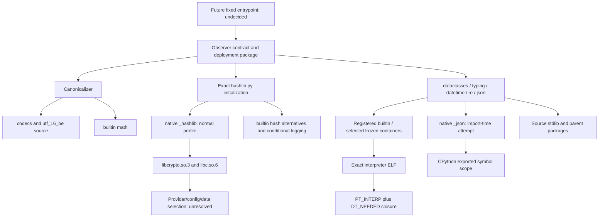

# Stage 9 / 3A — Observer Python import closure V1

Analysis date **2026-10-29 UTC**; repository baseline
`cad53867231a1a6e49ea770c07043b417af84449`. This appendix accompanies the
[runtime reconciliation](stage9_observer_3a_cpython_runtime_closure_v1.md) and
[exact Ubuntu build materials](stage9_observer_3a_cpython_build_materials_v1.md).
It is a static source analysis, not a run of the Dell interpreter or Observer.
No target module was imported to discover this graph.

## Evidence scope

`VERIFIED_FROM_EXACT_BUILD` below means an import request or branch was read in
the extracted **3.12.3-1ubuntu0.17** package source, or in the corresponding
quilt-applied Ubuntu source. Package provenance and its acceptance limits are
recorded in the build-materials appendix. It does not mean that the branch ran
on the Dell, that the future image has the right files, or that the project has
accepted the runtime. `VERIFIED_FROM_STATIC_ELF` classifications of embedded
containers and extension files come from the companion static tables.

Repository source coordinates below are at the baseline above:
[C: contract](../../deployment/stage9_observer_contract.py),
[J: canonicalizer](../../deployment/canonical_json.py),
[P: Trusted Observer plan](stage9_trusted_observer_contracts_and_implementation_plan.md),
and [T: existing tests](../../tests/test_stage9_observer_contract.py).
Codebase Memory was unavailable; direct source reads and targeted static
searches were used. No structural-index completeness claim is made.

**`OBSERVER_DESIGN_UNDECIDED`:** C is a library of structural parsers, not a
production entrypoint. It ends with `parse_proposed_bundle`; it has no `main`
or host collector. P:602–609 distinguishes this module from the planned offline
verifier; P:316 proposes an absolute `.py` entrypoint with `-I -S -B`. Therefore
`ENTRYPOINT → C` is a design edge, not an already implemented launch path.
Final entrypoint, wrapper diagnostics, file reads, verifier adapters and approved
error handling must be reconciled when their source is fixed.

## Direct contract scope

The source facts in this table are directly visible at the cited coordinates;
their classification is **`NOT_YET_PROVEN` for execution in an accepted target
image**. They are the starting requirements, not unknown repository imports.

| Repository source | Import / operation | Consequence for closure |
| --- | --- | --- |
| C:7–16 | Eager `__future__`, `hashlib`, `json`, `re`, `dataclasses`, `datetime`, `typing`, `deployment.canonical_json` | Resolve these at module initialization, before a parser accepts any data. There are no deferred import statements in C. |
| `deployment/__init__.py`:1 | Package initializer contains only a docstring | Pin this real source file as the parent package; do not assume the dotted import bypasses it. |
| J:3–5 | Eager `__future__`, `json`, `math`, `typing` | The module's “dependency-free” description means no third-party dependency; it does not mean no native/stdlib closure. `math` is needed even when float values will be refused. |
| C:265–295, 309–310 | Strict UTF-8 decode, `json.loads`, duplicate-key/integer hooks, `ValueError`/`UnicodeError`/`RecursionError` handling | Include decoder and refusal paths. `ParsedContract.as_dict` also invokes JSON decoding. Refusal does not itself import logging. |
| C:154–170, 347–348, 2167–2169 | Numeric `datetime(...)`, `timezone.utc`, comparisons | No call here to `strptime`, `strftime`, local-time conversion, `zoneinfo` or `datetime.now`; do not add their data solely because the datetime library supports them. |
| C:353, 380–382, 918, 1784–1789 | `hashlib.sha256(...).hexdigest()` | SHA-256 is the contract's explicit algorithm, but importing `hashlib` initializes more than that one algorithm. |
| J:20–21, 26–29, 39, 45 | `json.dumps` for strings, `math.isfinite`, dictionary-key `utf-16-be`, final UTF-8 encode | Codec lookup and JSON accelerators can be reached by ordinary valid documents; float refusal still uses native `math.isfinite`. |
| C:364–367, 2126–2131 | Signing-preimage construction and synthetic bundle checks | Neither performs Ed25519 verification. A signature-shaped JSON string is not a cryptographic operation. |
| T:2718–2736 | Test source permits only stdlib plus the shared canonicalizer and rejects direct `open`/`eval`/`exec`/`__import__`/`compile` calls in C | This is a useful architecture guard, not an import-closure proof. Stdlib code can generate code, import other modules or consume configuration internally. |

## Exact-library import map

All Python coordinates in this section refer to exact DEB members under
`/usr/lib/python3.12/`; C coordinates refer to quilt-applied Ubuntu source.
The rows are **`VERIFIED_FROM_EXACT_BUILD` for source behavior**. They separate
unconditional imports, import-time attempts with fallbacks, and callable paths
which are not used by the current contract. A module being available builtin
or frozen does not imply it is requested by C; availability inventory and
required imports are separate sets.

| Requester / source coordinates | Required source behavior and native/embedded boundary |
| --- | --- |
| `hashlib.py`:169–192, 241–248 | Attempts `_hashlib` at import time, then imports `pbkdf2_hmac` and `scrypt` from it if available. Iterates **all** guaranteed algorithm names, not just SHA-256. `_hashlib` is a native `.so` in this build. |
| `hashlib.py`:73–141 | BLAKE2 is deliberately routed to `_blake2`; other constructors can fall back to `_sha1`, `_md5`, `_sha2`, `_sha3` after OpenSSL attribute/availability failures. These names are registered builtin in the inspected executable. Successful import can therefore request `_blake2` even though C uses only SHA-256. |
| `hashlib.py`:241–248 | A missing constructor's `ValueError` imports `logging` and calls `logging.exception`. This is a real import-initialization error path; do not prune it merely because the normal SHA-256 operation succeeds. |
| `json/__init__.py`:106–108; `json/decoder.py`:3–10; `json/scanner.py`:3–10; `json/encoder.py`:3–16 | Imports `json.decoder`, `json.encoder`, `json.scanner`, `re`, `codecs`; attempts `_json` for string decoding/encoding, scanner and encoder. Each has a Python fallback. `_json` is a `.so`, not a builtin in this build. The canonicalizer's string encoding can use its C string encoder. |
| `re/__init__.py`:124–127, 338; `re/_compiler.py`:13–16; `re/_parser.py`:15; `re/_constants.py`:18 | Imports `enum`, `functools`, `copyreg`, `re._compiler`, `re._parser`, `re._constants`, `re._casefix`; uses builtin `_sre`. These are needed by fixed regexes and JSON library regexes, not only by attacker-selected regex text. |
| `dataclasses.py`:1–11 | Eagerly imports `re`, `sys`, `copy`, `types`, `inspect`, `keyword`, `functools`, `itertools`, `abc`, `_thread`. Thus using one dataclass does not give a closure limited to the decorators' spelling. |
| `copy.py`:51–53; `weakref.py`:12–26; `_weakrefset.py`:5–6 | Imports `weakref`, `copyreg`, `_weakrefset`, `_collections_abc`, `types`, `itertools`, `sys`, and builtin `_weakref`. |
| `inspect.py`:144–162 | Eagerly imports `ast`, `dis`, `collections.abc`, `enum`, `importlib.machinery`, `linecache`, `os`, `tokenize`, `token`, plus the shared support modules. These remain import requirements even when a particular parser never asks inspect to read source. |
| `ast.py`:27–31; `dis.py`:3–9; `opcode.py`:18–21; `tokenize.py`:27–42 | `ast → _ast`, `dis → opcode → _opcode`, `tokenize → _tokenize`; all three native support modules are builtin in the inspected executable. `dis` and `tokenize` also import `io`; tokenize imports `codecs`, `collections`, `functools`, `itertools`, `re`, `token`. |
| `linecache.py`:8–11; `importlib/__init__.py`:12–62; `importlib/machinery.py`:3–15 | `linecache` imports `tokenize`, `os`, `sys`, `functools`. Importlib initialization prefers the frozen bootstrap aliases and imports `warnings`; `machinery` exposes the same bootstrap/importer objects. Synthetic source filenames and frozen `__file__` do not prove disk execution. |
| `typing.py`:22–43 | Eagerly imports `abc`, `collections`, `collections.abc`, `copyreg`, `contextlib`, `functools`, `operator`, `re`, `sys`, `types`, `warnings`, and builtin `_typing`. Importing only `Any` or `cast` does not bypass module initialization. |
| `datetime.py`:1–6 | Prefers builtin `_datetime`, with a Python `_pydatetime` fallback on `ImportError`. `_pydatetime.py`:11–14 imports `time`, `math`, `sys`, `operator`. This is a conditional branch, not evidence that `_pydatetime` executes with the pinned builtin. |
| `functools.py`:17–22, 225–228, 265–268, 341–344, 641–644; `collections/__init__.py`:29–56, 339–354, 539–543 | Shared support imports include `abc`, `collections`, `reprlib`, `types`, `keyword`, `operator`, `_collections_abc`, `itertools`, `_weakref`, `_thread`; accelerated operations attempt `_functools` and `_collections`. These names are builtin. |
| `contextlib.py`:2–8; `os.py`:25–103; `posixpath.py`:13–18; `genericpath.py`:6–7; `stat.py`:191–195 | Support reaches `os`, `posixpath`, `genericpath`, `stat`, `abc`, `_collections_abc`; on this Linux build the OS branch is `posix` and `_stat` is builtin. The `nt`/`winreg` alternatives in the same sources are platform branches, not Linux runtime requirements. |
| `operator.py`:22, 413–419; `abc.py`:85–90; `warnings.py`:564–575; `io.py`:52–58 | Support prefers builtin `_operator`, `_abc`, `_warnings`, `_io`. Some sources contain Python fallbacks (`_py_abc` etc.); selecting those requires a supported fallback profile, not silent substitution. |

The source-side normal-support set therefore includes real `.py` candidates
`__future__`, `hashlib`, `json` and its three children, `re` and its four
children, `dataclasses`, `datetime`, `typing`, `copy`, `copyreg`, `weakref`,
`_weakrefset`, `inspect`, `ast`, `dis`, `opcode`, `token`, `tokenize`,
`collections`, `collections.abc`, `enum`, `functools`, `types`, `keyword`,
`reprlib`, `contextlib`, `warnings`, `importlib`, `importlib.machinery`,
`linecache`, and codec package files. `abc`, `codecs`, `io`, `os`, `stat`,
`posixpath`, `genericpath`, `_collections_abc`, and bootstrap/importer names
must be classified using the actual frozen tables and fixed launch policy,
not by the presence of their `.py` copies. **`NOT_YET_PROVEN`:** this source
set is not an accepted exhaustive runtime manifest or a proof of effective
finder selection. It deliberately retains conditional branches below.

**`VERIFIED_FROM_EXACT_BUILD`:** dataclass construction also generates method
source and invokes `exec` inside the trusted stdlib (`dataclasses.py`:449–475).
C's decorators at lines 299, 2018 and 2079 reach dataclass processing during
module initialization. This is an in-memory transform of trusted class/stdlib
definitions, not permission to execute inspected installation code or an
additional `.pyc` file. Pinning only C while ignoring the dataclasses source
would miss executable behavior before a parser is called.

## Codecs, initialization and refusal paths

**`VERIFIED_FROM_EXACT_BUILD`:** `_PyCodecRegistry_Init` imports `encodings`
(`Python/codecs.c`:1509); `Objects/unicodeobject.c`:15179–15235 and
15297–15326 look up filesystem/stdio codec names during initialization.
`encodings/__init__.py`:31–33 imports `codecs`, `sys`, `encodings.aliases`;
its registered search function imports `encodings.<normalized-name>` at
lines 71–104. These are source/configuration-controlled imports before or
during ordinary operations, not arbitrary external plugin permission.

**`VERIFIED_FROM_EXACT_BUILD`:** the canonicalizer's `key.encode("utf-16-be")`
is not satisfied by the exact C fast path for bare UTF-16. In
`Objects/unicodeobject.c`:3524–3566 the optimized name must terminate after
`16`; `utf-16-be` goes through the codec registry. Therefore
`encodings/utf_16_be.py` and the authenticated alias/search machinery are
required source candidates for nonempty object-key sorting. Final UTF-8
encode and input UTF-8 decode have C fast paths, but that does not eliminate
the startup codec package or whichever filesystem/stdio codec the fixed
launch profile selects. **`BUILD_SPECIFIC_UNVERIFIED`:** exact filesystem and
stdio selection in the future launch namespace, allowed source-cookie
encodings, locale coercion and source lookup paths are not established by
the package inventory alone.

**`VERIFIED_FROM_EXACT_BUILD`:** if hashlib constructor initialization reaches
the logging path, `logging/__init__.py`:26–44, 2280 additionally imports
`traceback`, `string`, `threading`, `time`, `atexit` and shared modules.
`traceback.py`:3–8 imports `textwrap` and `linecache`; traceback formatting
can import `ast` and `unicodedata` at lines 590 and 647. The latter is builtin
in this executable. Python fallback `_threading_local` is conditional on
`_thread._local` being unavailable (`threading.py`:1641–1644). Logging to a
closed/default stream is a behavior of that failure path; it is not an
approved Observer reporting channel.

**`NOT_YET_PROVEN`:** normal builtin registration and a permitted OpenSSL
configuration can narrow which fallbacks execute, but source presence alone
does not prove all initialization errors are impossible. Until a closed
profile explicitly refuses before unsupported imports, retain the failure
branches as conditional requirements. Do not automatically add every callable
in an imported library: current C does not call datetime's `strptime` (the
`_strptime` import is in `_datetimemodule.c`:5217), weakref finalization APIs,
pickle APIs, regex `\\N{...}` parsing, or inspect/dis command-line tools.
Changing the entrypoint or error renderer reopens that reachability analysis.

## Native extensions and crypto alternatives

| Candidate | Classification / disposition |
| --- | --- |
| `_hashlib.cpython-312-x86_64-linux-gnu.so` | **`VERIFIED_FROM_EXACT_BUILD`**: eagerly attempted by the unchanged exact `hashlib.py`; **`VERIFIED_FROM_STATIC_ELF`**: dependency on `libcrypto.so.3` and `libc.so.6`. Treat as required for the normal unmodified Ubuntu import profile. A builtin-only hashing profile is **`OBSERVER_DESIGN_UNDECIDED`**; the existence of `_sha2` does not authorize deleting the OpenSSL branch. |
| `_json.cpython-312-x86_64-linux-gnu.so` | **`VERIFIED_FROM_EXACT_BUILD`**: eagerly attempted and used when available; Python fallbacks exist. **`VERIFIED_FROM_STATIC_ELF`**: no `DT_NEEDED` does not make it standalone; unresolved CPython API symbols need the interpreter's exported symbol scope. Do not infer exclusion merely from fallback availability. |
| `math`, `_datetime`, `_typing`, `_opcode`, `_ast`, `_tokenize`, `_sre`, `_blake2`, `_sha2` etc. | **`VERIFIED_FROM_STATIC_ELF`**: registered embedded modules in the inspected executable, not additional extension-file requirements. Their code and any ELF requirements bind to that container. See full tables for registration proof; a `PyInit_*` symbol alone is insufficient. |
| `_ssl`, `libssl.so.3`, `legacy.so` | **`NOT_YET_PROVEN`** as required by these two repository modules: neither directly requests TLS or the legacy provider. Do not add them because they exist in the measured 47-file inventory; do not remove them from any already accepted future profile without provider/configuration and call-path proof. |
| Third-party `cryptography`, `jsonschema`, GPG tools, existing Windows verifier | **`OBSERVER_DESIGN_UNDECIDED`** for a future verifier, not required by the current structural parser. P:609 and 623 explicitly separate the offline crypto/toolchain and warn against importing the existing broad verifier into the minimal Observer. No cryptographic verification backend is selected by parsing signature text. |

**`OBSERVER_DESIGN_UNDECIDED`:** a reviewed builtin-only profile could avoid
OpenSSL loads only with evidence for its exact code/import policy and all
initialization/error branches. This PR changes no such policy or code.
An OpenSSL profile needs provider/configuration/environment/default-directory
analysis even for SHA-256: importing `_hashlib` initializes algorithm names
and requests constructors during `hashlib` import. Default-provider code being
built into libcrypto does not prove that external providers or configuration
are unused. Provider selection and effective loader paths remain separate
from the static `DT_NEEDED` graph.

## Partial dependency graph and design boundary

The diagram combines import, container, ELF and configuration relations with
different labels; it is not a serialized manifest or loader resolution proof.
The complete registered builtin/frozen availability inventory must still be
bound as required by P:189–200, independently of which names this call path
requests. **`NOT_YET_PROVEN`:** source graph reachability does not fix actual
`sys.path`, duplicate candidates, `.pyc` consumption, module search order,
OpenSSL configuration, or ELF symbol resolution in the launch namespace.

**`OBSERVER_DESIGN_UNDECIDED`:** preserve the current DAG restriction.
C:1202–1218 checks declared graphs iteratively; C:1680–1709 includes interpreter,
loader, optional binary roles and native imports in the ELF check. No SCC is
implemented here. A real provider `dlopen` edge plus a reverse `DT_NEEDED`
edge can challenge the profile, but this source map does not prove that the
Observer needs such a cycle. Keep that question blocked for separate review.

## Selected exact source identities

**`VERIFIED_FROM_EXACT_BUILD`:** these hashes were computed from the extracted
package members used above. They identify reviewed bytes; they do not replace
the signed package chain, source-to-binary correspondence or independent
acceptance. All paths are relative to `/usr/lib/python3.12/`.

| Member | SHA-256 |
| --- | --- |
| `hashlib.py` | `6dbdebf270868b391080e21dc9687eddfaf321c965ad979f68d3f5c423c613ab` |
| `datetime.py` | `ef20dc6b3554cd585dddffdc573f1f9a7a54c522f2a3fb4576c44edbb1e14238` |
| `dataclasses.py` | `0e449d55d6206b0022f541ba32be88fafc934ff71d9aa65f31f101ca6147f2ae` |
| `typing.py` | `c45d935c17234b1d6ae42d2d5499d3e03b4e2548fae0c4fce15477e23502214d` |
| `inspect.py` | `13945f061d93cf7b8f812d2afc279ff0b3aea799c7146b1c0c58c6e644bbc3e1` |
| `tokenize.py` | `a39cd5ee895abc085117448fba78ccc18bea3faf073ac18c5365b26e0dd1fe7c` |
| `encodings/__init__.py` | `78c4744d407690f321565488710b5aaf6486b5afa8d185637aa1e7633ab59cd8` |
| `encodings/aliases.py` | `6fdcc49ba23a0203ae6cf28e608f8e6297d7c4d77d52e651db3cb49b9564c6d2` |
| `encodings/utf_8.py` | `ba0cac060269583523ca9506473a755203037c57d466a11aa89a30a5f6756f3d` |
| `encodings/utf_16_be.py` | `3357196f3fa52433326a6626880e34964e00c5570aee50e9a0a0a7c6d86f6e4f` |
| `json/__init__.py` | `d5d41e2c29049515d295d81a6d40b4890fbec8d8482cfb401630f8ef2f77e4d5` |
| `json/decoder.py` | `9f02654649816145bc76f8c210a5fe3ba1de142d4d97a1c93105732e747c285b` |
| `json/encoder.py` | `af7bd40a0d0d0a3e726a9b4b3a2a543019f6ab97a340d0162a9c29ca9da97869` |
| `json/scanner.py` | `8604d9d03786d0d509abb49e9f069337278ea988c244069ae8ca2c89acc2cb08` |

No production contract, architecture decision or qualification state changes.
The remaining runtime/design evidence belongs in the primary report's gap and
findings registers; this appendix supplies source-derived import requirements.
