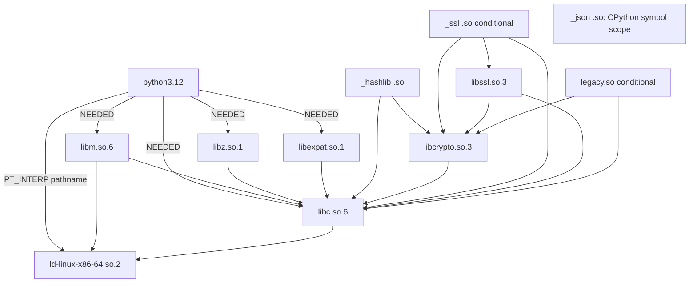

# Stage 9 / 3A — exact Ubuntu CPython build and runtime reconciliation V1

Date: **2026-10-29 UTC**. Baseline: current `main`
`cad53867231a1a6e49ea770c07043b417af84449`. Scope: Ubuntu Noble amd64
`python3.12 3.12.3-1ubuntu0.17`, the existing parser/canonicalizer and the
unapproved Trusted Observer plan. This is an additive documentation review;
the [earlier minimal-runtime analysis](stage9_observer_3a_minimal_cpython_runtime_scope_v1.md)
and historical evidence remain unchanged.

**`VERIFIED_FROM_EXACT_BUILD` / `VERIFIED_FROM_STATIC_ELF`:** exact Ubuntu
archive payloads now establish **60 builtin registrations**, frozen tables
with **3 bootstrap / 15 stdlib / 11 test entries**, and the physical placement
of the parser's C dependencies. `math`, `_datetime`, `_typing`, `_opcode`,
`_sha2`, `_sha3`, `_md5`, `_sha1` and `_blake2` are builtin in these exact
bytes. `_hashlib` and `_json` are separate native extensions. Availability
does not make every module required by the future Observer.

**`NOT_YET_PROVEN` / `OBSERVER_DESIGN_UNDECIDED`:** this does not close the
Observer's complete runtime, accepted image, execution-visible resolution,
provider policy or source-to-binary reproducibility. Conditional documentation
merge records narrower verified facts; Stage 3A and production remain blocked.

## Evidence classes and navigation

| Required label | Scope in this packet |
| --- | --- |
| `VERIFIED_FROM_EXACT_BUILD` | Direct static inspection of source/configuration/package members belonging to exact signed-index version/architecture records, under the explicitly described archive-key bootstrap. It is not independent project approval or a reproducible-build claim. |
| `VERIFIED_FROM_STATIC_ELF` | Direct reading of the extracted ELF bytes, including actual registration/frozen records and dynamic metadata. Physical Dell identity is a separate operator claim. |
| `SUPPORTED_BY_UPSTREAM_SOURCE` | Mechanism explained by upstream references; never silently substituted for Ubuntu patches/output. Exact Ubuntu source is used where available. |
| `BUILD_SPECIFIC_UNVERIFIED` | Missing actual build invocations, build logs/buildinfo, reproducible derivation, unexamined build variants or physical-host linkage. |
| `OBSERVER_DESIGN_UNDECIDED` | Future entrypoint, operation set, crypto verifier, launch/search/provider policy or other unapproved architecture choice. |
| `NOT_YET_PROVEN` | Completeness, independently accepted expectations, effective path/symbol selection, lifetime protection, host/run identity or qualification not demonstrated. |

The Dell triage account additionally retains the required evidence-origin tag
**`OPERATOR_REPORTED_AND_CHAT_REVIEWED`**. The archive itself remains unavailable
to Codex; its manifest was not independently replayed in this environment.
The [exact uploaded request](evidence/stage9_observer_3a_cpython_request_v1.txt)
is preserved byte for byte. It is text evidence, not the missing archive.

**Review correction, 2026-10-29 — `OPERATOR_REPORTED_AND_CHAT_REVIEWED` /
`BUILD_SPECIFIC_UNVERIFIED`:** the original request's **13/13** statement was
imprecise. The independent review of the original archive in the operator
conversation reports **15 regular files in total**, comprising **14 checked
files plus the manifest file**; **14 manifest entries, 14/14 verified,
0 mismatches**. Archive identity remains
`stage9-elf-triage-rNlpy9.tar.gz`, SHA-256
`0a26027f9bf94149fe2b36d3fbba1fdb6e5393e2016c9bd9956463b154005b0f`.
The reported manifest-file SHA-256 is
`f52859c04f703bfe6ba36190229e7b18ac1543df5c443d589a549835177c3fdb`;
local Dell readelf is **2.42**. These corrected results are supplied by the
review request, not independently observed by Codex. The historical uploaded
text retains its original erroneous count and original digest. This correction
neither authenticates the absent archive nor changes qualification status.

1. [Build materials, patches, pyconfig, SOABI, flags and confirmed lists](stage9_observer_3a_cpython_build_materials_v1.md).
2. [Actual entrypoint/import/error/backend/data map](stage9_observer_3a_cpython_import_closure_v1.md).
3. [P0/P1/P2/P3 register, security interpretation and minimal Dell plan](stage9_observer_3a_cpython_findings_v1.md).
4. [Archive signature/index/package/source verification](evidence/stage9_observer_3a_cpython_archive_sources_v1.md), [verification JSON](evidence/stage9_observer_3a_cpython_archive_verification_v1.json), [additional runtime-library checks](evidence/stage9_observer_3a_cpython_library_packages_v1.json).
5. [Decoded ELF registration/frozen/metadata records](evidence/stage9_observer_3a_cpython_static_tables_v1.json), [preliminary typed graph](evidence/stage9_observer_3a_cpython_elf_graph_v1.json), [raw selected ELF output](evidence/stage9_observer_3a_cpython_readelf_v1.txt).
6. [Integrity, development checks and merge conditions](evidence/stage9_observer_3a_cpython_validation_v1.md), [packet manifest](evidence/stage9_observer_3a_cpython_reconciliation_v1.sha256).
7. [PR #3224 correction and Windows SCM investigation](../audits/pr3224_archive_correction_windows_scm_2026-10-29.md).

## What independently matches the Dell account

**`VERIFIED_FROM_STATIC_ELF`:** the independently downloaded package members
have exactly the three SHA-256/Build ID pairs below. The SHA-256 values also
match the historical Ubuntu provenance report. This verifies properties of
identical downloaded bytes; it does not authenticate the operator, original
archive, Dell filesystem aliases, measurement context or active runtime.

| Extracted object | SHA-256 | Build ID |
| --- | --- | --- |
| `usr/bin/python3.12` | `e50d468e8b0adfb05733f5b87b3cff34829c4a8c1aea50c865aa8bdfe4bb150f` | `337d65cf00021797985cc9f77c0cc334a9fbeb38` |
| `_hashlib.cpython-312-x86_64-linux-gnu.so` | `8dc6cda6dd9495b95a2bfb5b26e8cf06b72f36dc0213d958b9277a958287f0fe` | `33c38727eb4140c55f853fd9e534856569024762` |
| `_json.cpython-312-x86_64-linux-gnu.so` | `ca8e35c58f7bc8e27258c4af43651c941413bc6318903621253485b0395758a3` | `f24fcec743f7d42ed6c90ccc0ef455c4d4ab99a9` |

**`VERIFIED_FROM_EXACT_BUILD`:** this session verified the current
`noble-updates` InRelease signature, compressed and uncompressed binary/source
index hashes/sizes (**4/4**), exact CPython binary packages (**4/4**, including
analysis-only `libpython3.12-dev`), source control/archives (**3/3**) and four
additional runtime-library packages (**4/4**). All eight DEBs were extracted,
never installed or executed. The seven runtime-package DEB digests match the
previous operator report. Today's metadata is a different snapshot and does
not retroactively validate historical freshness.

**`NOT_YET_PROVEN`:** the acquired keyring's fingerprint agrees with the
previous official-source review, but its bootstrap channel and freshness/time
policy still require project acceptance. A successful signature is conditional
on that root. Current InRelease has no `Valid-Until`; its 2026-10-29 date and
cloud clock do not supply an approved replay policy. Build IDs corroborate
output identity, not compiler invocation or source reproducibility.

## Registration and frozen contents

**`VERIFIED_FROM_STATIC_ELF`:** the static parser dereferenced exported
`PyImport_Inittab`, mapped virtual addresses through file-backed `PT_LOAD`
ranges and decoded 16-byte `_inittab` entries until the null sentinel.
Ordered names and every initializer pointer match exact generated `config.c`:
**60/60**, including null special registrations `builtins` and `sys`.
The other 58 callbacks comprise **56 `PyInit_*` functions**, `PyMarshal_Init`
and `_PyWarnings_Init`. Symbol counting alone would miss this distinction.

```text
_bisect _csv _datetime _heapq _opcode _pickle _random _socket _statistics
_struct array binascii cmath math select _elementtree pyexpat _blake2 _md5
_sha1 _sha2 _sha3 unicodedata _posixsubprocess fcntl grp spwd syslog zlib
atexit faulthandler posix _signal _tracemalloc _codecs _collections errno
_io itertools _sre _thread time _typing _weakref _abc _functools _locale
_operator _stat _symtable pwd marshal _imp _ast _tokenize builtins sys gc
_warnings _string
```

**`VERIFIED_FROM_STATIC_ELF`:** the same process dereferenced the three
frozen-table pointers and decoded the exact 32-byte `_frozen` layout from the
matching package header. Names, package flags, sizes, code pointers and
payload SHA-256 are retained in JSON. Names/order also match exact Ubuntu
`Python/frozen.c`. Lists count records, including aliases, rather than unique
code payloads:

| Table | Confirmed records |
| --- | --- |
| Bootstrap (3) | `_frozen_importlib`, `_frozen_importlib_external`, `zipimport` |
| Stdlib (15) | `abc`, `codecs`, `io`, `_collections_abc`, `_sitebuiltins`, `genericpath`, `ntpath`, `posixpath`, `os.path`, `os`, `site`, `stat`, `importlib.util`, `importlib.machinery`, `runpy` |
| Test (11) | `__hello__`, `__hello_alias__`, `__phello_alias__`, `__phello_alias__.spam`, `__phello__`, `__phello__.__init__`, `__phello__.ham`, `__phello__.ham.__init__`, `__phello__.ham.eggs`, `__phello__.spam`, `__hello_only__` |

**`VERIFIED_FROM_EXACT_BUILD`:** source-level alias mappings and importer
generation are documented in the build appendix. The ELF parser does not
extract `_PyImport_FrozenAliases`; it is not an exported symbol here.
**`OBSERVER_DESIGN_UNDECIDED`:** frozen stdlib availability does not prove its
selection under future `PyConfig`/`-X frozen_modules`/startup flags. Bootstrap
and codec initialization, source fallback, `site`, `runpy` and test-module
reachability require a selected launch profile. Embedded test records are
not a proposal to import them or authorize removal from unchanged bytes.

## Required and conditional native extensions

**`VERIFIED_FROM_EXACT_BUILD`:** exact `hashlib.py`, `json/`, `dataclasses.py`,
`inspect.py`, `typing.py`, `datetime.py` and codec sources establish the paths
in the [import appendix](stage9_observer_3a_cpython_import_closure_v1.md).
The existing library has no Observer executable entrypoint. Its direct and
indirect imports are a lower bound if reused unchanged, not a final image.

| Module / placement | Requirement and remaining condition |
| --- | --- |
| `_hashlib` / `.so` | `VERIFIED_FROM_EXACT_BUILD`: `hashlib` attempts this at import, probes OpenSSL methods and guaranteed constructors, and can fall back to registered builtin hash modules. For ordinary unchanged successful OpenSSL import it is selected; removing it would choose another path and needs an approved profile. Its own ELF requires libcrypto/libc. |
| `_json` / `.so` | `VERIFIED_FROM_EXACT_BUILD`: decoder/scanner/encoder try it, with Python fallbacks. Available unchanged bytes normally select it. It has no DT_NEEDED but unresolved CPython API symbols; it is not standalone or irrelevant. Backend selection/allowed absence remains `OBSERVER_DESIGN_UNDECIDED`. |
| `math`, `_datetime`, `_typing`, `_opcode`, `_tokenize`, `_ast`, `_sre`, `_struct`, hash fallbacks / builtin | `VERIFIED_FROM_STATIC_ELF`: present in interpreter registration table. No separate `.so` is required for these exact names/build. Their C initialization and the interpreter's global ELF dependencies still belong to closure. |
| `_ssl` / `.so`, libssl | `OBSERVER_DESIGN_UNDECIDED`: no inclusion argument from the two parser sources alone. TLS or future crypto adapters could change this. Exact ELF inspected for conditional graph only; not a safe-removal conclusion. |
| `legacy.so` / OpenSSL provider | `OBSERVER_DESIGN_UNDECIDED`: available and inspected; no proof the Observer needs it. Effective configuration/API/environment/provider paths must determine whether it can load. |
| `_ctypes`, archive/DB/compression/other installed extensions | `OBSERVER_DESIGN_UNDECIDED`: no blanket runtime inclusion from disk presence. Some library fallback branches (e.g. traceback/linecache/lazy archive helpers) need further bounded analysis if supported by the chosen operations. No blanket deletion follows. |

**`VERIFIED_FROM_EXACT_BUILD`:** the two selected runtime Python packages
contain **46** core lib-dynload `.so` files. The evidence JSON inventories them
plus the interpreter and eight libraries/provider (**55 ELF objects**).
The physical 47-extension inventory additionally reported `_gdbm` from a
different source package. These counts have different scopes. Neither 46 nor
47 is the minimum required image, nor a full closure verification for all
those modules' descendant libraries.

## Preliminary ELF graph

**`VERIFIED_FROM_STATIC_ELF`:** below are all ordered DT_NEEDED tokens for the
12 selected objects. Eight library/provider package members and four Python
objects independently match the twelve historical object SHA-256 values.
The adjacent JSON binds each node to path label/digest/Build ID and records
the edges. SONAME-to-file associations are candidate package-member mappings,
**not measured loader search results**.

| Requesting object | DT_NEEDED in original order |
| --- | --- |
| `python3.12` | `libm.so.6`, `libz.so.1`, `libexpat.so.1`, `libc.so.6` |
| loader `ld-linux-x86-64.so.2` | none |
| `libm.so.6` | `libc.so.6`, `ld-linux-x86-64.so.2` |
| `libz.so.1.3` | `libc.so.6` |
| `libexpat.so.1.9.1` | `libc.so.6` |
| `libc.so.6` | `ld-linux-x86-64.so.2` |
| `_hashlib` | `libcrypto.so.3`, `libc.so.6` |
| `_json` | none |
| `libcrypto.so.3` | `libc.so.6` |
| `_ssl` | `libssl.so.3`, `libcrypto.so.3`, `libc.so.6` |
| `libssl.so.3` | `libcrypto.so.3`, `libc.so.6` |
| `legacy.so` | `libcrypto.so.3`, `libc.so.6` |



**`VERIFIED_FROM_STATIC_ELF`:** the unchanged interpreter's startup needs
libm, zlib, expat and libc even if the application never imports math/zlib/
pyexpat. They are link dependencies of its bytes. `PT_INTERP` is separately
`/lib64/ld-linux-x86-64.so.2`; copying the loader elsewhere does not rewrite it.
The selected 19 DT_NEEDED edges plus one executable PT_INTERP edge form a DAG.
The libc ELF also contains PT_INTERP metadata; that is retained in JSON but
is not an additional kernel-loader event when libc is loaded as a DSO.

**`NOT_YET_PROVEN` / `OBSERVER_DESIGN_UNDECIDED`:** Python native-import
dlopen events and CPython symbol resolution are separate relations. No reverse
`_json → python` DT_NEEDED or loader-actor edge is invented. A possible
libcrypto-provider dlopen followed by legacy.so's real dependency back to
libcrypto would create a mixed-edge cycle if required. Its necessity is not
proved. The present DAG model stays intact; no SCC or policy change is made.

## Security disposition and preserved state

**`VERIFIED_FROM_STATIC_ELF`:** exact interpreter is x86_64 ET_EXEC,
non-PIE, GNU_RELRO, nonexecutable GNU_STACK, no RPATH/RUNPATH or dynamic
BIND_NOW. This limits main-executable randomization and leaves lazy-binding
hardening weaker than a full RELRO/NOW profile; it does not disable every
other ASLR region or prove exploitation. Source/default RTLD_NOW for native
imports is distinct from startup ELF BIND_NOW. `_json` requires the executable
CPython API export scope despite having no ELF needed tokens.

**`VERIFIED_FROM_STATIC_ELF`:** selected literal strings in the exact libcrypto
identify `OPENSSLDIR="/usr/lib/ssl"`,
`ENGINESDIR="/usr/lib/x86_64-linux-gnu/engines-3"` and
`MODULESDIR="/usr/lib/x86_64-linux-gnu/ossl-modules"`, plus `OPENSSL_CONF`,
`OPENSSL_CONF_INCLUDE` and `OPENSSL_MODULES` names. Raw excerpts are retained.
These are compiled path literals, not proof of effective configuration,
symlink targets, environment values or selected providers.

**`NOT_YET_PROVEN` / `OBSERVER_DESIGN_UNDECIDED`:** accepted dispositions for
these hardening facts, exact loader cache/preload/default/hwcaps/environment
and namespace mapping, OpenSSL configuration/includes/providers, source and
codec integrity, independent expected-image acceptance, lifetime protection
and host/run attestation remain open. The findings appendix gives priorities
and a recovery-first static plan. New Dell execution is unnecessary for facts
already settled by these identical package bytes; missing local layout/config
must be requested only after reusing retained evidence and selecting scope.

```text
stage_9=IN_PROGRESS
qualification=BLOCKED
CONTRACT_APPROVED=NO
STAGE_3A_COMPLETE=NO
PRODUCTION_QUALIFIED=NO
production_status=PRODUCTION_NO_GO
runtime_attestation=MISSING
host_pid_namespace=UNVERIFIED
```

**`NOT_YET_PROVEN`:** documentation merge readiness depends on this PR's raw
diff, integrity checks and exact-HEAD CI. No automatic merge, physical
qualification, target execution, production-contract change or Stage 3B is
authorized or performed by this packet.
