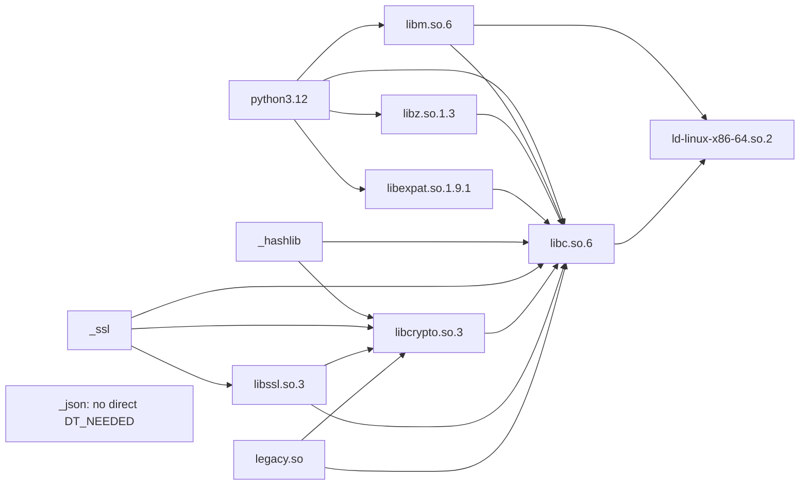

# Stage 9 / 3A — Dell local ELF observation report V1

Report revision: **V1**, 2026-10-28. Repository baseline: `main`
`5f8f5688f41330236f84650949e4571f9173e9a1` (merged PR #3218).
Disposition: **OBSERVED_LOCAL; qualification BLOCKED; PROPOSED_UNAPPROVED**.

The operator supplied a summary of terminal observations from a physical Dell.
This report analyzes that summary; Codex did not collect or independently
authenticate the measurements. It is neither a signed measurement nor evidence
of a complete installation or runtime. No observation becomes `TRUSTED`,
`AUTHENTICATED` or `QUALIFIED` through inclusion here.

## Evidence identity and relationship to Stage 3A

The exact uploaded UTF-8 input, originally `Wklejony tekst.txt` (9227 bytes), is
preserved as [operator-supplied source R1](evidence/stage9_observer_3a_dell_local_elf_source_r1.txt).
Its SHA-256 is
`621040d74091e70cc1407a624947839206c9a1004a98020bcbf55090bc02753f`.
It contains the operator's observations and task instructions, **not the original
raw terminal transcripts**. Collection time, exact command outputs, tool versions,
capture chain and independent witnesses were not supplied. The report date is
not an asserted measurement date. Retaining bytes identifies the supplied
account; it does not authenticate the account or authorize its embedded text.

This is an additive follow-up to the historical
[Stage 3A review package R1](stage9_observer_3a_review_package.md), especially
decisions D1–D4, the [eight-contract audit](stage9_observer_3a_contract_audit.md),
[ELF qualification analysis](stage9_observer_3a_elf_qualification.md) and
[prepared Dell procedure](stage9_observer_3a_dell_readonly_diagnostics.md).
The earlier ELF document's Debian cloud-host measurements remain separate from
these Dell observations; neither inventory is an independently selected image.

All 22 entries of the [historical R1 manifest](evidence/stage9_observer_3a_review_r1.sha256)
remain unchanged and verify against this baseline. None of its pinned files is
edited. A separate [local-report V1 manifest](evidence/stage9_observer_3a_dell_local_elf_report_v1.sha256)
binds this report, the exact supplied source, the CI snapshot and the unchanged
R1 manifest. It excludes itself. Verify from the repository root:

```bash
sha256sum --check docs/architecture/evidence/stage9_observer_3a_review_r1.sha256
sha256sum --check docs/architecture/evidence/stage9_observer_3a_dell_local_elf_report_v1.sha256
```

The final PR HEAD identifies the additive revision. Its selection and any digest
pin still need an independent channel; a manifest cannot authenticate itself.
No approval signature, acceptance record or attestation is generated.

## Classification and observed installation

| Class | Meaning in this report |
| --- | --- |
| `OBSERVED_LOCAL` | Operator-reported static ELF metadata, paths, dependency names, hashes, package versions, symbol and configuration excerpts. Even these facts have not been independently remeasured. |
| `INFERRED_CONDITIONAL` | Derived or conditional conclusions: the reported subgraph is a DAG; `PyInit__datetime` suggests a builtin; requiring a libcrypto-to-legacy dynamic load could introduce a cycle. |
| `UNVERIFIED` | Target-image equivalence/completeness, all CPython modules and dynamic loads, effective launch and loader resolution, authenticated package/build provenance, continuous integrity, external trust and independent approval. |

The reported installation is a **Dell Latitude 5490**, Ubuntu **24.04.5 LTS**,
x86_64 / amd64, with Ubuntu CPython package **3.12.3-1ubuntu0.17**.
`/usr/bin/python3.12` is reported as ELF64 **EXEC**, Build ID
`337d65cf00021797985cc9f77c0cc334a9fbeb38`.
Its `PT_INTERP` pathname is `/lib64/ld-linux-x86-64.so.2`.
No interpreter `RPATH` or `RUNPATH`, and no direct interpreter `DT_NEEDED`
for `libpython3.12.so`, were reported. These absences concern this inspected
interpreter only; they do not exclude later loads or tags in other objects.
Build ID and package version are identifiers, not authenticated provenance.

The OpenSSL package is reported as **libssl3t64:amd64 3.0.13-0ubuntu3.16**.
Neither this local package set nor copying its files defines the target Observer
image, which must be independently selected, built and qualified.

## Supplied SHA-256 inventory

Every digest below is `OBSERVED_LOCAL`. All 13 are syntactically 64 lowercase
hexadecimal characters; this checks transcription shape, not file identity.
An object label without an absolute path is deliberately not a claimed canonical
path. No `_datetime` digest was supplied.

| Reported object or file | SHA-256 |
| --- | --- |
| `/usr/bin/python3.12` | `e50d468e8b0adfb05733f5b87b3cff34829c4a8c1aea50c865aa8bdfe4bb150f` |
| `ld-linux-x86-64.so.2` | `c20a2dc8917c755f02b94049356320fe1f62ac7d9f8994731f807d9df39302da` |
| `libm.so.6` | `fce00b6f25f459cf4ae0b7fae4257909a1a8a86f9149e7c029a5d617baf1ccd0` |
| `libz.so.1.3` | `f61677c7bdb7c2aa2a243ea781bfd16afcb361cede7b4ef76127a9d8eb9a5242` |
| `libexpat.so.1.9.1` | `286682ecbc5e59a638963b1a4e6351e65eb32fcf4bdcb9cb7569b6a61fe06a8d` |
| `libc.so.6` | `3a15d66867d83762c7f2f1e37359cb8f6c5743edb369c65285cb0b1c4f7498bf` |
| `_hashlib` extension | `8dc6cda6dd9495b95a2bfb5b26e8cf06b72f36dc0213d958b9277a958287f0fe` |
| `_ssl` extension | `80c755c80688b92e0f32af9168a605f1283256077f35d30f6cf518252f2a6660` |
| `_json` extension | `ca8e35c58f7bc8e27258c4af43651c941413bc6318903621253485b0395758a3` |
| `libcrypto.so.3` | `6866ed711dab8927e1bf82bf1cd30e828bdfc34f3cc1e83b1c9eb01ce6c37d9a` |
| `libssl.so.3` | `a40e7b67489bbd257e432c700ff8f6a1ad796425b5eccecdc2930127fdd86624` |
| `/usr/lib/x86_64-linux-gnu/ossl-modules/legacy.so` | `e639c7121825222dc720bd38aa1fca3ddcedd7d1213dc72ce006b8ccf541b547` |
| `/etc/ssl/openssl.cnf` | `529815b0dd4bd6608bafeeb3d410b0683374e61aef792b3e3f38b3767d26f747` |

`DT_NEEDED` request tokens, SONAME metadata, resolved object identity and canonical
absolute paths are different information. In particular the supplied account maps
`libz.so.1` to basename `libz.so.1.3`, and `libexpat.so.1` to basename
`libexpat.so.1.9.1`. It does not provide independent `DT_SONAME` header evidence,
full canonical paths, complete alias chains, device/inode identity or a resolution
transcript. Extension absolute paths/suffixes and most library canonical paths
are also missing. The graph below uses these reported mappings as labels only.
It does not approve any host symlink for the Observer image. V1 inventories admit
regular files/directories, not implicit symlink or hardlink variants.

## Partial ELF graph: three distinct relations

Arrows point from requester to dependency. This adjacency table is the complete
set **reported in the supplied summary**, not a claim about all dependencies in
the installation. Each destination denotes its exact request token; `libz` and
`libexpat` nodes use the reported basename mappings above.

| Requesting object | Reported direct `DT_NEEDED` tokens |
| --- | --- |
| `python3.12` | `libm.so.6`, `libz.so.1`, `libexpat.so.1`, `libc.so.6` |
| `ld-linux-x86-64.so.2` | none |
| `libm.so.6` | `libc.so.6`, `ld-linux-x86-64.so.2` |
| `libz.so.1.3` | `libc.so.6` |
| `libexpat.so.1.9.1` | `libc.so.6` |
| `libc.so.6` | `ld-linux-x86-64.so.2` |
| `_hashlib` | `libcrypto.so.3`, `libc.so.6` |
| `_ssl` | `libssl.so.3`, `libcrypto.so.3`, `libc.so.6` |
| `_json` | none |
| `libcrypto.so.3` | `libc.so.6` |
| `libssl.so.3` | `libcrypto.so.3`, `libc.so.6` |
| `legacy.so` | `libcrypto.so.3`, `libc.so.6` |

This is **12 named ELF objects and 19 reported `DT_NEEDED` edges**.
The following compact diagram draws only those static edges:



| Separate relation | Evidence and disposition |
| --- | --- |
| `python3.12 --PT_INTERP--> /lib64/ld-linux-x86-64.so.2` | Reported program-header pathname; not a twentieth `DT_NEEDED` entry. Kernel interpreter lookup requires its own exact execution-visible mapping. |
| `libcrypto.so.3 --dlopen?--> legacy.so` | Hypothetical, not observed. Excluded from both the 19-edge table and diagram. |
| Interpreter imports of `_hashlib`, `_ssl`, `_json` | No actual import/load event supplied. Their static metadata does not prove loading by any Observer run; no such arrows are added. |

A dependency-first layering demonstrates acyclicity of the reported static graph:

```text
0: ld-linux, _json
1: libc
2: libm, libz, libexpat, libcrypto
3: python3.12, _hashlib, libssl, legacy
4: _ssl
```

Every dependency is in an earlier layer. Adding the separate reported
interpreter-to-loader `PT_INTERP` relation also preserves acyclicity. Shared
`libc`/`libcrypto` descendants are not cycles. No loader-to-libc reverse edge
is supplied. `_json` having no direct `DT_NEEDED` does not prove independence
from process symbols, Python ABI or later runtime behavior.

The DAG conclusion is a derivation from `OBSERVED_LOCAL` metadata, hence
`INFERRED_CONDITIONAL`. It is not qualification of a complete runtime graph.

## OpenSSL provider and configuration analysis

The supplied `legacy.so` metadata establishes only the reported outgoing static
dependencies to `libcrypto.so.3` and `libc.so.6`. If a required path in libcrypto
actually loads that provider, the mixed graph could contain
`libcrypto --dlopen--> legacy --DT_NEEDED--> libcrypto`. No such call, provider
initialization or requirement of the target Observer was observed. The presence
of a provider file is not evidence of its selection. No SCC implementation or
relaxation of the current DAG follows from this hypothetical edge.

The reported configuration `/etc/ssl/openssl.cnf` has alias
`/usr/lib/ssl/openssl.cnf` referring to the same file, not a separately hashed
object. Its reported settings are:

```text
openssl_conf = openssl_init
[openssl_init]: providers = provider_sect
[provider_sect]: default = default_sect
no legacy = ... declaration
# activate = 1 remains commented
no active .include directives found in the checked file
```

A commented `activate` does **not** establish that the default provider is
disabled. The absence of `legacy` or active includes in this checked file does
not exclude provider API calls, alternate configuration, environment/module-path
selection or later application behavior. No actual provider enumeration or
default-provider activation state was supplied. Qualifying a DAG profile needs
proof that every required and error path either fits the accepted graph or
cannot load an excluded provider. Merely deleting the file or relying on this
configuration excerpt is insufficient.

## `_datetime` and CPython inventory

The operator reported no separate `_datetime.so` and a global
`PyInit__datetime` symbol in `/usr/bin/python3.12`: these are `OBSERVED_LOCAL`.
They suggest native code embedded in the executable (`INFERRED_CONDITIONAL`),
but do not alone prove builtin registration, complete build configuration or
actual import behavior (`UNVERIFIED`). V1 can represent an independently
confirmed builtin through `embedded_modules` plus its builtin import, binding
the exact build and interpreter container digest. No fictional `_datetime.so`,
per-module digest or extra ELF node is introduced.

The four investigated module names are not complete CPython inventory. Required
stdlib, builtin/frozen/native bootstrap, deferred and error-path imports, accepted
ABI suffixes and all native initialization dependencies remain to be reconciled
against independently expected build outputs.

## Compatibility with all eight contracts

Directly inspected sources are the [V1 proposal §§3.3–3.6](stage9_observer_3a_schema_proposal.md),
the [contract audit](stage9_observer_3a_contract_audit.md) and
[parser](../../deployment/stage9_observer_contract.py). Codebase Memory tools
and executable were unavailable; no index-coverage or exhaustive-repository
claim is made. The source, rather than an index, grounds these conclusions.

| Contract | Compatibility and remaining boundary |
| --- | --- |
| `ObserverManifestV1` | `_validate_proposed_runtime` permits empty `libpython_file_ids`, embedded builtin/frozen entries and declared native dependencies. `_proposed_acyclic` checks the declared binary graph separately from provenance. Local metadata is insufficient for complete files, sources, paths, sizes, roles or actual closure. Host aliases are not allowed image entries. |
| `AcceptancePolicyV1` | `_validate_proposed_acceptance_policy` binds target/sources, limits and reviewer records. Local hashes/package labels do not establish authenticated expected sources or external reviewer authority. All limits and thresholds stay unchanged. |
| `ObserverResultV1` | `_validate_proposed_observer_result` preserves synthetic/incomplete restrictions and fixed blocks. This terminal summary is not an Observer run/result and supplies no complete observation, counters or physical pass. |
| `LaunchPolicyV1` | `_validate_manifest_launch` requires matching ordered runtime/ELF/import projections and pins. None of the observations proves effective argv/environment, loader view, sandbox, credentials, resource limits or continuous protection. |
| `ObserverRunContextV1` | `_validate_run_context` checks declared nonce/run/scope/document bindings. No authenticated launcher, run ID, one-time nonce or trusted channel evidence was supplied. |
| `HostScopeBindingV1` | `_validate_scope_binding` checks declared scope structure. Local paths and symbols do not authenticate initial host PID namespace, procfs completeness or host identity; scope remains `UNVERIFIED`. |
| `OfflineVerificationResultV1` | `_validate_offline_result` preserves advisory synthetic output and `acceptance=UNVERIFIED`. This report is not an authenticated offline result. The existing raw/canonical exception and seven-input bundle boundary remain open review decisions. |
| `AcceptanceV1` | `_validate_acceptance` checks envelope/preimage structure. No independent signatures, externally accepted keys, revocation/checkpoint/time or actual cryptographic acceptance are supplied by these digests. |

Relevant parser boundaries: `_proposed_acyclic` (1202–1218), file variants
(1280–1286), embedded containers (1560–1582), dependency edges (1693–1709),
manifest/launch comparison (1732–1792), and `parse_proposed_bundle` (2115–2139).
The latter binds seven inputs, excluding the advisory offline output; it
performs no artifact, signature, launcher or host authentication.

No new confirmed contradiction was found in these inspected contracts.
The current untyped edge `{requester_file_id, needed, resolved_file_id}` lacks
tag kind/order/context; this is already documented as CA-P1-01 and the ELF
resolution-semantics gap. Typed distinctions in this report do not change the
V1 wire format. An unchanged absolute `PT_INTERP` requires a qualified mapping
or authenticated reproducible transformation: placing a loader inside an image
directory does not redirect kernel lookup. The interpreter's local EXEC link
mode, absent direct libpython and suggested builtin are expressible within the
existing design, subject to evidence. No speculative parser change is made.
Historical CA-P2-01–04 and CA-P3-01 remain unresolved; these observations do not
settle offline canonicalization/bindings, precedence, limits, replay/receipt/crash
protocols or the in-process immutability boundary.

## Missing evidence and DAG acceptance criteria

All items below remain `UNVERIFIED`; none is discharged by a local hash, a
well-formed manifest, a successful test, or acyclicity of this partial graph.

1. **Capture provenance:** original transcripts, exact commands/tool versions,
   collection time, inspected file identities and independent remeasurement.
2. **Authenticated Ubuntu materials:** selected suite/pocket/snapshot,
   architecture and exact package versions; externally accepted archive keys,
   signed InRelease or Release/Release.gpg, Packages digests and exact `.deb`
   hashes; freshness/expiry policy. Local dpkg/version strings are insufficient.
3. **Independent target build:** approved recipe/patches/toolchain and expected
   image inventory; source-to-output/reconstruction evidence, exact bytes/sizes,
   build IDs, paths, protected directory ancestry and permitted file types.
   Establish comparison with the Dell without adopting its installation as root.
4. **Full CPython inventory:** interpreter link mode, shared-libpython decision,
   builtin/frozen registration including `_datetime`, source/native modules,
   ABI suffixes, import roots, bootstrap, deferred/error paths and dependencies.
5. **Complete recursive ELF evidence:** exact headers, ordered dynamic tags,
   SONAMEs, request tokens, canonical objects and alias identity for every
   required object, including all native extensions, hwcaps and permitted
   optional/dynamic roles; symbol/version/ABI compatibility and load contexts.
6. **Actual loader policy:** execution-visible `PT_INTERP`, RPATH/RUNPATH and
   token semantics for every object, cache/default search, preload/audit/filter/
   auxiliary mechanisms, CPU/hwcaps selection, namespaces and already-loaded
   object reuse. Pin configuration or prove effective absence and no fallback.
7. **Bounded dynamic closure:** every allowed native initialization/import,
   provider/API/configuration path, computed `dlopen`, NSS/locale/encoding and
   error path. Establish whether legacy is required or effectively excluded.
   Static strings, a package inventory or one successful trace cannot prove this.
8. **Effective launch/lifetime integrity:** authenticated launch context,
   environment/FDs, sandbox/resource enforcement, immutable selected bytes and
   search candidates throughout delayed loads; no substitution, aliases,
   external/default fallback or integrity drift between check and use.
9. **Authenticated host/run scope:** initial PID namespace/procfs visibility,
   boot/process identity, trusted nonce/channel/receipt and run bindings;
   incomplete scope must remain blocked and retain prior positive observations.
10. **Independent trust and approval:** designated separate reviewers, externally
    accepted roots/keys, signatures/revocation/time/checkpoints/replay state,
    pinned contract decisions and independent acceptance. Resolve all existing
    P1/P2 items and retain approval outside the submitted bundle.
11. **Controlled qualification evidence:** after separate authorization, exact
    accepted-image positive and negative scenarios for missing/extra dependencies,
    same-SONAME substitution, wrong mapping/cache/hwcaps/provider/import, fallback,
    mutation, resource exhaustion and incomplete scope. No such run occurred here.

Accepting the **DAG restriction for one selected image** requires independent
acceptance of items 2–7, bidirectional reconciliation of its complete permitted
runtime with the manifest, and proof that the union of every permitted
`PT_INTERP`/`DT_NEEDED`/dynamic resolution edge remains acyclic in every approved
context. Preserve a separate acyclic provenance graph. Items 8–11 separately
block runtime/production qualification even if static image compatibility is
accepted. If a required real cycle is proved, stop that qualification and seek a
separately approved version/model and test matrix. Do not silently drop an edge,
disable required behavior, weaken completeness or implement SCC speculatively.

## Risk matrix

| Priority / ID | Finding and effect | Disposition |
| --- | --- | --- |
| P0 / DELL-P0-00 | No new confirmed P0 defect in this bounded review. This is not proof of absence. | Preserve all production and qualification refusals; do not promote observations. |
| P1 / DELL-P1-01 | Complete independently authenticated target build and effective ELF/import/dynamic closure are missing (CA-P1-01/03). Partial DAG cannot qualify the image. | Blocks image compatibility acceptance and final 3A approval; obtain missing evidence 2–8. |
| P1 / DELL-P1-02 | External authorities, host/run identity, signatures and continuous integrity are absent (CA-P1-02/03). | Blocks independent acceptance and runtime/production qualification; evidence 8–11. |
| P2 / DELL-P2-01 | Incomplete canonical paths/SONAME/aliases, `_datetime` registration and provider/configuration context; original capture provenance missing. | Resolve before using these observations as exact-image evidence; escalate to the P1 blocker wherever required closure depends on them. |
| P2 / DELL-P2-02 | Existing offline canonical/bundle, precedence, resource and replay/receipt/crash decisions (CA-P2-01–04) remain open. | No speculative parser fixes or retrospective approval; independent disposition required. |
| P2 / DELL-P2-03 | Hosted validation is unfinished; PR #3218 Platform contains an explicit production-readiness refusal. | Record actual run/job states; preserve the gate, investigate evidence separately, never report blanket PASS. |
| P3 / DELL-P3-01 | Report/graph labels and integrity links must not conflate aliases, host inventories or historical R1 with new evidence; CA-P3-01 remains. | Separate V1 manifest and typed report relations; keep historical R1 intact and in-process trust limitation explicit. |

## Hosted CI snapshot

The [CI evidence snapshot](evidence/stage9_observer_3a_dell_local_elf_ci_v1.json)
was normalized at **2026-10-28 19:09:28 UTC**, from run queries at 19:08 UTC,
superseding the earlier 18:08 observation. Main remains the baseline above;
PR #3218 is merged, head `8771b8ef5705461e6f2daaa378f1334d29818169`.
This task performs no merge. The exact-SHA API lists each contain seven runs,
attempt 1, `total_count=7`, `per_page=100`. New-PR CI belongs in its final
delivery report after its HEAD exists; these historical results cannot validate
a later HEAD. Unfinished, cancelled and skipped states are never PASS.

| Scope | Completed successes | Other states |
| --- | --- | --- |
| PR #3218 head | Style [40716454449](https://github.com/Dudzian/Dudzian/actions/runs/40716454449), Quality [40716454420](https://github.com/Dudzian/Dudzian/actions/runs/40716454420), CodeQL [40716454472](https://github.com/Dudzian/Dudzian/actions/runs/40716454472), Marketplace [40716454424](https://github.com/Dudzian/Dudzian/actions/runs/40716454424), PR CI [40716454733](https://github.com/Dudzian/Dudzian/actions/runs/40716454733) | Platform [40716454800](https://github.com/Dudzian/Dudzian/actions/runs/40716454800) completed/failure; push CI [40716440677](https://github.com/Dudzian/Dudzian/actions/runs/40716440677) in_progress with failed PostgreSQL job |
| Main `5f8f5688` | Style [40717819983](https://github.com/Dudzian/Dudzian/actions/runs/40717819983), CodeQL [40717821451](https://github.com/Dudzian/Dudzian/actions/runs/40717821451), Windows Build [40717820981](https://github.com/Dudzian/Dudzian/actions/runs/40717820981), Marketplace [40717820055](https://github.com/Dudzian/Dudzian/actions/runs/40717820055), Stress [40717821087](https://github.com/Dudzian/Dudzian/actions/runs/40717821087), Quality [40717820016](https://github.com/Dudzian/Dudzian/actions/runs/40717820016) | CI [40717821111](https://github.com/Dudzian/Dudzian/actions/runs/40717821111) in_progress; issuer-durability job reported failure with cause unresolved |

**Confirmed test-fixture failure, separate repair:** push CI job
[`122970984826`](https://github.com/Dudzian/Dudzian/actions/runs/40716440677/job/122970984826),
`Python tests (Ubuntu PostgreSQL qualification, remaining-security)`, failed
`test_offline_fixture_drains_stale_test_sessions_without_touching_owner`.
All `pg_terminate_backend(pid,5000)` result checks passed, but the subsequent
`pg_stat_activity` check returned a row and raised
`RuntimeError: disposable TEST database still has active sessions` at line 571.
Result: **756 passed, 17 skipped, 1 failed, 25469 deselected, 1312.57 s**.
Effective checkout was `8771b8ef5705461e6f2daaa378f1334d29818169`, Ubuntu
24.04.5, CPython 3.11.17, psycopg 3.3.6 and PostgreSQL 16.15. This is a
confirmed fixture failure, not a timeout, concurrency cancellation or intended
production refusal. Its exact cause requires source analysis and reproduction;
no stale-snapshot or race diagnosis is assumed here. The requested repair is
kept in a separate code PR, outside this additive documentation change.

**Expected production refusal:** Platform
[`linux-deployment-integration` job 122915369758](https://github.com/Dudzian/Dudzian/actions/runs/40716454800/job/122915369758)
failed `Enforce recorded Linux integration evidence`, exit 1 at 16:19:05 UTC.
It reports `CORE_REQUIRED_SUITES`, `LINUX_SYSTEMD_INTEGRATION`,
`LINUX_CLEAN_INSTALL` and `LINUX_REBOOT_LIFECYCLE_UPDATE` as
`MISSING_CURRENT_EVIDENCE`, then `LINUX_PRODUCTION_READY=NOT_READY`.
Direct inspection of [.github/workflows/platform-deployment.yml](../../.github/workflows/platform-deployment.yml)
and [platform_readiness.py](../../deployment/platform_readiness.py) confirms the
retained production refusal. Preserve it. This does not demonstrate a new
Observer code regression, infrastructure failure or timeout. The effective
synthetic merge checkout is `16472edaa9f4f9f55a038efa04c5b695ef7e64d5`,
Ubuntu 26.04.1 / CPython 3.11.17, not the Dell target.

**Other incomplete evidence:** Platform `core-macos` job 122915370214 is
cancelled; its log returned 404 BlobNotFound, leaving its cause unverified.
The Windows release gate failed cross-OS aggregation with missing
`evidence/core-macOS.json`; this downstream evidence failure is distinct from
the PostgreSQL fixture failure. Main CI issuer-durability job 122957865829
is reported failed by the jobs API while its step response still reports
in_progress; logs were unavailable. Its cause is unresolved and must not be
labelled a code, infrastructure or timeout failure without evidence.
Main Quality is now successful; its advisory history-secret skip is still
not a blocking-scan PASS.

Older CI runs [40713350113](https://github.com/Dudzian/Dudzian/actions/runs/40713350113)
and [40713251503](https://github.com/Dudzian/Dudzian/actions/runs/40713251503)
are cancelled, never PASS. The historical PR account attributes them to
concurrency supersession; current source has `cancel-in-progress: true` with
event/ref groups. Direct cancellation logs were unavailable, so that cause is
attributed to the historical account rather than newly proved. An empty
combined-status response is not check-success evidence. No rerun, manual
qualification or hardware workflow was dispatched.


## Recommended next qualification stage

1. Submit this additive observation report for independent issue review while
   retaining R1 and all open decisions. Designate the independent acceptance
   authority outside the bundle; do not use this report as that authority.
2. Select and authenticate one exact Ubuntu/CPython build snapshot; independently
   construct its expected image and module/file/ELF/configuration inventory.
3. Reconcile the Dell observations with that inventory without adopting host
   symlinks, paths or local configuration as approved image elements. Resolve
   `_datetime`, provider need/exclusion, absolute loader mapping and dynamic
   closure; prove all permitted resolution contexts fit the current DAG.
4. Assemble missing positive/negative qualification evidence and independently
   resolve P1/P2 contract decisions. Any later controlled runtime work requires
   its own scope/authorization; this PR does not activate Stage 3B or run it.
5. Independently accept the pinned contracts/materials and close 3A gates before
   considering any separately reviewed implementation/activation. Qualification
   of a static model alone grants no production permission.

No new Dell command script is delivered or executed here. If a subsequent
physical-Dell script follows repository changes, its **first phase** must be
safe synchronization through `cryptohunter-sync.service`. Before requesting
sync, verify branch `main`, a clean worktree and no active local tests that
could read files being updated; unknown/unsafe conditions stop the procedure.
If the service defers, stop and respect its decision; do not force `git pull`.
After successful synchronization require local HEAD equality with the correct
remote commit selected for that procedure (not this unmerged feature branch).
Keep that local synchronization status distinct from still-running hosted CI.
The historical diagnostic procedure is not evidence that these new preconditions
were met and must not be run unchanged after repository updates.

## Documentation validation

Development checks used CPython **3.11.16**, not the Dell interpreter. The
mandatory exact `python -m pre_commit run ruff-format --all-files` passed
without tracked reformatting; Tier A Ruff passed. Existing synthetic contract
tests: **869 passed in 3.60 s**. These tests execute parsers/fixtures, not the
Observer or physical diagnostics, and do not qualify CPython 3.12 or the host.
The report's 13 relative file links, 13 source-matched artifact digests,
12-node/19-edge diagram, DAG layers, JSON and both integrity manifests were
checked. Offline Betterleaks and final whitespace checks accompany the PR
delivery; no scanner suppressions, test exclusions or safety gates are changed.

## Readiness and immutable Stage 9 blocks

| Status | Disposition |
| --- | --- |
| `CODE_READY` | `PENDING_CI` for this documentation-only delivery; local validation and exact new-HEAD CI must be reported separately. No new executable behavior is delivered. |
| `CONTRACT_REVIEW_READY` | Independent issue review can proceed; **BLOCKED for final approval** pending exact-image evidence and P1/P2 dispositions. |
| `CONTRACT_APPROVED` | `NO` |
| `STAGE_3A_COMPLETE` | `NO` |
| `PRODUCTION_QUALIFIED` | `NO` |

```text
stage_9 = IN_PROGRESS
qualification = BLOCKED
full_confirmation = false
coexistence_authorized = false
preflight_exception = false
physical_test_status = PHYSICAL_TEST_PENDING
production_status = PRODUCTION_NO_GO
runtime_attestation = MISSING
host_pid_namespace = UNVERIFIED
```

No production permissions, Root Proof, Stage 41B, Stage 10, launcher code,
LIVE policy, trusted keys, safety limits or qualification states change.
No Observer, historical payload, physical diagnostic or Stage 3B is executed.
No SCC is implemented. No merge is performed.
