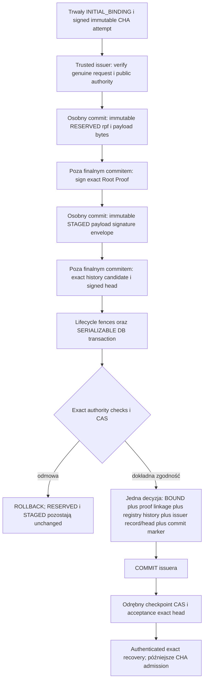

# Stage 9: kwalifikowana granica atomowego Root Proof Issuer

## Wynik i podstawa audytu

Wybrany model to jeden wąski, należący do niezależnego issuera koordynator
PostgreSQL 16 (`DB16`), działający w jednej fizycznej bazie i jednej transakcji
`SERIALIZABLE`. Zatwierdza dokładne zachowane proof bytes, decyzję entitlement
`UNBOUND -> BOUND`, registry history, issuer history i signed history head.
Checkpoint i trwała finalizacja CHA pozostają późniejszymi, odrębnymi krokami.
Ten PR wybiera granicę i dodaje wyłącznie kwalifikację oraz odczytowe sprawdzanie
spójności. Nie instaluje koordynatora SQL, nie zmienia grantów, nie podpisuje,
nie wykonuje BIND i nie udostępnia pełnej emisji.

Baza audytu to świeży `origin/main`
`555c94a4de6be69ddc4720d6f3d024bafda7ad91`, po merge PR #3110. Zgodnie z
[AGENTS.md](../../AGENTS.md) wnioski bezpieczeństwa sprawdzono w rzeczywistym
kodzie. Codebase Memory MCP ani callable CLI nie były dostępne; źródła dobrano
przez celowane wyszukiwanie. Nie jest to twierdzenie o kompletności nieobecnego
indeksu ani kwalifikacja rzeczywistego wdrożenia.

Zamrożone źródła prawdy pozostają bez zmian:

- [Independent issuer contract](cryptohunter_product_architecture/m05_account_genesis_independent_root_proof_issuer_contract.json):
  `bind_authorization_order`, `credential_rotation_recovery`,
  `issuer_bound_attempt_linkage` i `lost_response_reconciliation`.
- [Production substrate selection](cryptohunter_product_architecture/m05_account_genesis_root_proof_issuer_production_substrate_selection_contract.json):
  `production_local_substrate`, `authority_separation`, `least_privilege`,
  `migrations` i model zagrożeń.
- [Implementation readiness](cryptohunter_product_architecture/m05_account_genesis_root_proof_issuer_implementation_readiness_contract.json)
  oraz [physical persistence](cryptohunter_product_architecture/m05_account_genesis_physical_persistence_crash_atomicity_contract.json):
  gate dostępności, własność CHA i brak wspólnej transakcji issuer/CHA/freshness.
- [Admission binding](cryptohunter_product_architecture/m05_account_genesis_root_proof_admission_binding_contract.json):
  `RootProofAdmissionEvidenceV1` należy do CHA i jest atomowo zachowane dopiero
  z `PREPARED`; weryfikacja podpisu nie ustanawia emisji, freshness ani genesis
  `COMMITTED`. Winning attempt wskazuje faktyczny winner BOUND i jego immutable
  identity digest, a nie najnowszą lokalną próbę.
- [Topology resolution](cryptohunter_product_architecture/m05_account_genesis_authority_topology_resolution_after_binding_freeze.json)
  wraz z [ownership](cryptohunter_product_architecture/m05_account_genesis_authority_topology_and_ownership.json):
  issuer mintuje wyłącznie proof identity, CHA pozostaje jedynym semantycznym
  ownerem końcowej decyzji AccountGenesis i jego operation/account reservation.
- [Freshness CAS/finalization](cryptohunter_product_architecture/m05_account_genesis_freshness_authority_cas_finalization_contract.json):
  niezależny freshness owner zatwierdza własny successor. Checkpoint issuera
  nie zastępuje tej decyzji ani lokalnego atomowego domknięcia CHA.

## Rzeczywiste autorytety i transakcje

Nazwy ról entitlement, history, checkpoint, intent i retention są utrwalane
przez ich konfigurację provisioning, a następnie porównywane z katalogiem
PostgreSQL wraz z OID. Nazwa w konfiguracji lub równy tekst DSN nie jest
dowodem właściciela ani wspólnej fizycznej bazy.

| Autorytet i źródło | Owner, principal i API | Serializacja, trwałość i granica |
| --- | --- | --- |
| [Entitlement registry](../../bot_core/postgresql_entitlement_registry.py) | Odrębne schema/owner/runtime/admin. Obecny provisioning tworzy także owner jako `LOGIN`; nie należy przypisywać mu gwarancji `NOLOGIN`. Provider wymaga dokładnego direct login: `session_user = current_user =` utrwalona runtime albo admin rola. Nie dopuszcza żadnego członkostwa dotykającego tych ról. Runtime ma `SELECT` oraz wyłącznie `append_bind`; admin `provision/revoke/supersede`. Funkcje są owner-owned `SECURITY DEFINER`, `search_path=pg_catalog`; ich źródła, ACL i inventory są dokładnie kwalifikowane. Sam SQL entitlement nie ma guardu `session_user` analogicznego do history. | `compare_and_swap_bind()` otwiera własne połączenie i `SERIALIZABLE`. `append_bind` blokuje `lineages FOR UPDATE`, porównuje `current_revision`, wymaga `ACTIVE/UNBOUND`, zachowuje identity/provenance i dopisuje revision + 1. Revoke/supersede blokują ten sam lineage. PK history oraz unique entitlement lineage są bazodanowe. Brak osobnego unique indeksu na jedną decyzję `BOUND` per generation; SQL odrzuca wcześniejszy `BOUND` w całym lineage. `md5(state::text)` jest wyłącznie kontrolą przypadkowego uszkodzenia. Nie przechowuje signed proof bytes. |
| [Requester/claimant registries](../../bot_core/postgresql_preaccount_credentials.py) | Stałe, odrębne `cryptohunter_requester_*` i `cryptohunter_claimant_*`; sześć rozłącznych ról, owner `NOLOGIN`, runtime/admin `LOGIN`. Direct-login/OID, dokładne ACL, source i brak memberships są kwalifikowane. Runtime tylko czyta publiczne klucze i historię; admin uruchamia owner-owned `apply(jsonb)`. Właściciele mają wąskie peer read granty do kontroli aliasów, bez zamiany semantycznej roli. | Admin `apply` wymaga `SERIALIZABLE`, `fsync=on`, `synchronous_commit=on`, admin `session_user`, bierze wspólny `pg_advisory_xact_lock(hashtextextended(alias namespace,0))`, następnie `current_credentials FOR UPDATE`. Credential/key/version są immutable; append-only history zachowuje generation/revision i `ACTIVE -> VERIFY_ONLY/REVOKED`. Te odczyty nie są wspólną transakcją z BIND. |
| [Public issuance authority](../../bot_core/postgresql_root_proof_issuance_authority.py) | `PostgreSQLRootProofIssuanceAuthority.requalify()` wymaga dokładnych genuine typów entitlement/requester/claimant, trzech różnych schema i trzech różnych direct-login runtime ról. Sprawdza scope, capabilities i rzeczywisty materiał publicznych kluczy. | To agregat trzech odczytowych authority ports, nie owner wspólnego commitu. Każdy port otwiera osobne połączenie. `_COMPOSITION_LOCK` chroni tożsamość adaptera w procesie; nie serializuje BIND ani lifecycle. |
| [Signing intent](../../bot_core/postgresql_root_proof_signing_intent.py) i [schema](../../bot_core/postgresql_root_proof_signing_intent_schema.py) | Odrębny owner `NOLOGIN` i `issuer_writer LOGIN`. Funkcja wymaga dokładnego writer `session_user` i owner `current_user`, trwałych parametrów PostgreSQL, ścisłych grantów i źródła SQL. Writer należy do zaufanego issuera; nie jest credential CHA. | Własna transakcja zachowuje immutable `RESERVED`, issuer-owned `rpf_`, payload bytes, request/attempt/auth i signer snapshot. PK/unique obejmują attempt, root ID, operation, entitlement i account. Nie podpisuje i nie wykonuje BIND. Brak odczytu rekordu nie dowodzi braku wcześniejszej emisji. |
| [Retention](../../bot_core/postgresql_root_proof_retention.py) i [schema](../../bot_core/postgresql_root_proof_retention_schema.py) | Owner `NOLOGIN`, osobny runtime login z dokładnym `session_user/current_user` guardem wewnątrz funkcji `SECURITY DEFINER`. Runtime posiada własne wąskie SQL API; istniejący grant nie dowodzi izolacji od niezaufanego procesu. | Własna transakcja zachowuje immutable `STAGED`: oryginalne payload bytes, signature bytes, envelope bytes, identity i signer snapshot. PK/unique chronią attempt i root ID oraz operation/entitlement/account w scope. Nie przechowuje decyzji `COMMITTED`; `require_issued()` zawsze odmawia. Nie jest atomowy z BIND/history. |
| [Authenticated issuer history](../../bot_core/postgresql_authenticated_issuer_history.py) i [schema](../../bot_core/postgresql_issuer_history_schema.py) | Owner `NOLOGIN`, runtime/admin `LOGIN`; dokładna kwalifikacja OID, katalogu, physical definition, ACL i braku memberships. Runtime wykonuje `read_stream/append_record/retain_head`, admin provisionuje stream. Każda publiczna funkcja wymaga własnego runtime/admin `session_user`, owner `current_user` oraz durable PostgreSQL 16+. | `append()` i `retain_attested_head()` mają osobne transakcje. `streams FOR UPDATE`, predecessor digest CAS i sequence + 1; unique `(stream,event_identity)` i `(stream,operation,attempt,root_proof_id)`, PK `(stream,sequence)`. Replay porównuje exact payload. Jedna attestation per sequence. Read snapshot jest `REPEATABLE READ READ ONLY`; dotyczy tylko history. Nie zapisuje oryginalnego Root Proof envelope. |
| [Checkpoint authority](../../bot_core/postgresql_checkpoint_authority.py) i [schema](../../bot_core/postgresql_checkpoint_schema.py) | Owner `NOLOGIN`, odrębne runtime/admin direct logins, brak memberships, dokładne source/ACL/physical qualification. `commit_checkpoint` wymaga własnego runtime `session_user` oraz owner `current_user`; EXECUTE nie zastępuje weryfikacji kryptograficznej w trusted runtime. | Własna transakcja blokuje `checkpoints FOR UPDATE`, wykonuje revision CAS i zachowuje równocześnie exact checkpoint/acceptance/head/signature; PK `(checkpoint_id,revision)`. History i custody są sprawdzane wcześniej. Dwa odczyty lifecycle generation przed transakcją nie utrzymują lifecycle lock przez commit. `_highest_revision` jest obserwowanym floor procesu, nie niezależnym anti-rollback po restarcie. |
| [Local signing custody](../../bot_core/local_signing_custody.py) | Root-proof signer i history-attestation signer mają oddzielne role, credentials, materiał i lifecycle. `_custody_lock` jest rzeczywistą międzyprocesową shared/exclusive blokadą POSIX; Windows serializuje operacje blokadą wyłączną. `_sign_result()` zwraca podpis wraz z dokładnym `ACTIVE` snapshotem pod tą samą blokadą. | Podpis i admin lifecycle linearizują się w custody. `credential_snapshot()` zwalnia blokadę przed powrotem; obserwacja nie blokuje późniejszego revoke/rotation podczas DB commitu. Brak DB-authoritative lifecycle fence obejmującego commit issuera. Nie jest to hardware custody ani niezależna domena host rollback. |
| [Runtime](../../bot_core/root_proof_issuer_runtime.py), [orchestration](../../bot_core/root_proof_issuer_orchestration.py), [recovery](../../bot_core/root_proof_issuer_recovery.py) i [reconciliation](../../bot_core/root_proof_issuance_reconciliation.py) | Genuine `INITIAL_BINDING` i trwały signed CHA attempt są wejściem; provider wybiera wewnętrzny composition root. Publiczny caller nie wybiera portu, DSN, klucza, scope ani proof ID. Wyniki są odłączonymi raportami, bez capability. | Runtime ponownie sprawdza request bytes, podpisy, requester/claimant i entitlement. Reconciliation powtarza odrębne odczyty; zgodność próbek nie tworzy globalnego snapshotu. Orchestration blokuje signing/BIND/history/checkpoint/CHA finalize/replacement/transport. Recovery opisuje zapisy i pozostaje odczytowe. `EXACT_COMMITTED` starego classifiera nie dowodzi retained proof bytes. |

## Dlaczego obecne porty nie mogą wykonać atomowego commitu

`with transaction()` otaczające wywołania obecnych adapterów nie obejmuje ich
wewnętrznych połączeń. Ten sam host, ten sam serwer albo kilka DSN prowadzących
do tej samej bazy nie łączy tych commitów. Nie ma tu rozproszonej transakcji,
kompensacji BOUND ani prawa do odwrócenia już podjętej decyzji.

`SET ROLE` zachowuje `session_user`, więc nie spełnia direct-login qualification
i guardów history/checkpoint/intent/retention. Membership grant do istniejącej
roli powoduje odmowę kwalifikacji. Dodatkowy schema/table/function grant,
nowa funkcja lub podmienione `prosrc` łamią dokładne inventory, ACL i source
manifest. Sam `GRANT EXECUTE` nie sprawi, że nested history function zobaczy
oczekiwany history runtime jako `session_user`.

`_qualify_external_grants()` signing intent oraz retention odrzuca jawny
dodatkowy grant `EXECUTE` na `pg_catalog.pg_control_system()` poza własnym
schematem. Nie oznacza to, że odczyt zawsze wymaga takiego grantu: rzeczywista
instancja PostgreSQL 16.15 użyta w testach miała `proacl=NULL`, a domyślne
`PUBLIC EXECUTE` pozwalało wszystkim ośmiu direct-login rolom odczytać control
i database identity bez dodawania uprawnień. Ich genuine kwalifikacje przeszły.
Jeżeli wdrożenie odwoła to uprawnienie PUBLIC, brak dostępu oznacza `NOT_READY`;
nie wolno go naprawić przez nieprzejrzany explicit grant łamiący kwalifikację
intent/retention. Ewentualna zmiana read qualification musi należeć do jawnej
migracji, z zachowaniem izolacji writera od monitoring/bootstrap credentials.

`pg_control_system().system_identifier` oraz OID bieżącej bazy identyfikują
lineage klastra i namespace bazy. Physical replica, restore i sklonowany
`PGDATA` mogą zachować oba identyfikatory. Ich nierówność odrzuca kompozycję,
ale równość nie dowodzi jednego fizycznego primary, jednego owner connection
ani wspólnego COMMIT. Potrzebna jest kwalifikowana tożsamość deployment/service
oraz rzeczywiste uczestnictwo write set w jednej transakcji tego połączenia.
Obecne read-only probes sprawdzają dokładnie PostgreSQL 16; istniejące starsze
porty history/checkpoint dopuszczają wersję co najmniej 16.

Nie wolno uznać, że `PostgreSQLRootProofIssuanceAuthority` ma wspólny write
credential: jego kwalifikacja wymaga właśnie trzech rozłącznych ról. Nie wolno
również udostępnić CHA ownerów schematów, signing custody ani DB writera jako
skrótu do emisji. JSON credentials i raport preflight nie są principalem DB.

Konkretnym brakiem jest zamrożony krok
`8_ATOMICALLY_BIND_AND_PERSIST_IDENTICAL_SIGNED_PROOF_AND_HISTORY` oraz
linearizacja key eligibility wraz z entitlement BIND. Nowy design nie zmienia
payloadu, crypto domain, identity ani cardinality M0.5. Pole substrate
`separate_semantic_owners_schemas_roles_credentials_namespaces_transactions_and_lifecycles`
wymaga jawnego uzgodnienia zakresu fizycznej transakcji: koordynator obejmuje
własną decyzję issuera i jego podległe persistence APIs, przy zachowaniu
odrębnych semantycznych autorytetów requester/claimant, checkpoint, CHA i
FreshnessAuthority. Nie można z tego pola wyprowadzić zgody na dowolne łączenie
autorytetów ani cicho rozszerzyć istniejących grantów. Jeśli jego literalna
interpretacja wyklucza współdzielony commit issuer persistence, przyszła
migracja wymaga osobno przejrzanej reconciliation tego konkretnego konfliktu.

## Wybrany koordynator należący do authority

Docelowy trusted service `IndependentAccountGenesisRootProofIssuer` otrzyma
osobny direct-login writer. Osobny coordinator schema ma owner `NOLOGIN`;
writer nie ma DML, DDL, admin credentials, roli owner ani memberships. Jego
jedyne write wejście to fixed, owner-owned `SECURITY DEFINER` commit API z
`search_path=pg_catalog`, exact writer `session_user`, exact owner `current_user`
i pinned role OID. SQL nie przyjmuje nazwy schematu, funkcji, providera,
authority ani arbitralnego query od callerów.

Poszczególne schema pozostają własnością swoich semantycznych ownerów.
Coordinator owner otrzyma wyłącznie `USAGE` i `EXECUTE` na nowych, konkretnych
owner-owned helpers. Helper uruchamia się jako własny schema owner, więc jego
guard sprawdza `current_user = helper owner` oraz `session_user = issuer writer`.
ACL pozwala na wejście tylko coordinator ownerowi; writer nie może wywołać
helpera bezpośrednio. `current_user` wewnątrz nested `SECURITY DEFINER` nie jest
tożsamością caller funkcji. Nie udajemy, że ten guard zastępuje ACL.

Helpers nie są ogólnym append ani unchecked DML API: sprawdzają exact retained
attempt/intent/stage, fixed scope, CAS i całą domkniętą decyzję. Stare standalone
mutation API nie może pozostać drugą drogą produkcyjnego BIND albo dopisania
issuance event bez pełnego commitu; migracja musi zamknąć taki bypass i
zaktualizować kwalifikację jego ról. Publiczne rejestry requester/claimant
udostępnią wyłącznie właścicielskie, blokujące odczyty exact credential state;
koordynator nie provisionuje ani nie zmienia ich lifecycle.

Wszystkie elementy atomowego write set muszą znajdować się w jednej
kwalifikowanej fizycznej bazie PostgreSQL 16, ze spójnym `environment`,
`trust_domain`, profile i security epoch. Weryfikacja musi pochodzić z live
authority evidence oraz przypiętej tożsamości deployment/DB, nie porównania
DSN lub nazw providera. Authority qualification obejmie catalog OID, role
attributes, ACL, source fingerprints, constraints, inventory, durable settings
i tożsamość service, która utrzymuje writer poza procesem CHA. Nie wolno
odblokować writera tylko dlatego, że fixture lub konfiguracja tak go nazywa.

Nie ma dzisiaj takiego schema, commit helperów, wdrożonej izolacji writera ani
provider-owned dowodu pełnej kwalifikacji. Odczytowa kompozycja
`root_proof_atomic_composition.py` nie nadaje tych uprawnień i odmawia wykonania
commitu; dane evidence oraz raport consistency nie zastępują authority.

## Kolejność podpisywania i atomowy write set

Przyszła emisja wykorzysta istniejący trwały issuer-owned `RESERVED`. Dokładny
payload oraz `root_proof_id` są zatwierdzone przed podpisem. Podpis Root Proof
powstaje poza transakcją końcowego commitu, po czym exact bytes są niezmiennie
zachowane jako `STAGED`. Odzyskiwanie odczytuje oba rekordy; nie rekonstruuje
envelope z digestu i nie podpisuje ponownie pod bieżącym kluczem.

Również history record i jego signed head są przygotowane z dokładnego,
uwierzytelnionego predecessor snapshotu poza finalną transakcją. Finalny CAS
sprawdza ten predecessor. Jeżeli inna emisja zmieniła head, kandydat history
nie może zostać dopisany pod nową sekwencją; po dowiedzionym rollbacku można
przygotować successor względem nowego predecessor, zachowując to samo
`rpf_`, immutable Root Proof i signed request. Nie jest to ponowne podpisanie
Root Proof. Wynik nieznany najpierw wymaga rozstrzygnięcia poprzedniej decyzji.

`STAGED` pozostaje immutable; nie zmienia się jego bytes ani znaczenia przez
UPDATE. Nowy append-only commit marker wiąże istniejący stage i intent z
dokładną decyzją `BOUND`, original request/attempt, history sequence/digest,
signed head, signer identities/key versions i lifecycle generations. Oznacza
`COMMITTED` decyzji issuera dopiero po atomowym zachowaniu całego write set.
Wcześniejsze trwałe `STAGED` bez marker nie jest issued proof.

Finalny write set zawiera wszystkie exact signed bytes albo immutable,
unikalny DB link do ich istniejącego rekordowego `BYTEA`, chroniony FK i
właścicielskim API przed zmianą/usunięciem. Referencja zewnętrzna lub digest bez
trwale zachowanych bajtów nie spełnia tego warunku. Koordynator sprawdza byte
equality RESERVED payload = STAGED payload, signature/envelope, frozen root
proof domain, attempt/request identity oraz credential/key/material facts.

## Lock order, CAS i punkty linearizacji

Wybrany wariant wymaga nowej, DB-authoritative granicy lifecycle. Nie opiera
eligibility przy BIND na lokalnym `ACTIVE` snapshot ani na file lock trzymanym
przez klienta. Po śmierci procesu OS zwalnia taki lock, choć backend PostgreSQL
może nadal kończyć wcześniej wysłany COMMIT; revoke może wtedy nastąpić przed
decyzją BIND. To konkretny powód, dla którego nawet prawidłowa międzyprocesowa
blokada custody nie wystarcza do crash-safe linearizacji finalnego commitu.

Nowy owner-owned lifecycle fence wiąże role/credential identity, issuer lub
history authority, key version/material, trust-root generation oraz lifecycle
generation z autorytatywnym stanem dopuszczającym nową operację. Coordinator
writer tylko blokuje i czyta fence przez fixed helper; zapis należy wyłącznie
do odrębnego security/admin authority. Wszystkie revoke/rotation/activation
paths muszą przejść przez tę granicę. Dopóki istnieje nieuczestnicząca ścieżka
lokalnego admin transition, kwalifikacja odmawia emisji.

Publikacja zmiany używa trwałego stanu administracyjnego `PENDING_CLOSED`,
który nie jest nowym stanem semantycznego klucza M0.5 i nigdy nie dopuszcza
emisji. Najpierw admin zatwierdza zamknięcie eligibility i exact operation
fence w DB. Nieznany wynik tego COMMIT trzeba rozstrzygnąć przed dotknięciem
custody. Następnie wykonuje chronioną zmianę custody/bundle i zachowuje jej
immutable completion evidence. Dopiero kolejna admin transakcja może
opublikować dokładny ukończony successor `ACTIVE` i generation, po weryfikacji
tej samej administracyjnej operacji. Przy planned rotation poprzednik pozostaje
`VERIFY_ONLY`; przy compromise pozostaje `REVOKED`, bez możliwości reactivation.
Crash, niezgodne snapshots lub brak completion pozostawiają fence zamknięty.
Local signing nadal używa własnego custody lock, lecz nie tworzy DB eligibility.

Docelowa, jedna kolejność blokad dla emisji i uczestniczących ścieżek admin:

1. Rozpocząć `SERIALIZABLE`, durable transaction. Zablokować lifecycle fence
   rows dla issuer signer, history signer i deployment trust activation
   w stałym porządku namespace/authority identity. Locks muszą konfliktować
   z admin updates i być trzymane przez backend DB aż do COMMIT/ROLLBACK.
   Wymagać exact credential/material/version/generation i ukończonego `ACTIVE`;
   `PENDING_CLOSED`, `VERIFY_ONLY`, `REVOKED` lub różnica generation odmawia.
2. Zdobyć ten sam pre-account
   alias advisory xact lock, którego używa `apply(jsonb)`, następnie blokady
   requester/claimant current rows w stałym porządku schema/principal.
   Sprawdzić exact credential, role, public material, registry revision,
   lifecycle generation i `ACTIVE`. Admin transitions biorą advisory lock
   przed current row, więc nie mogą wygrać pomiędzy kontrolą i BIND.
3. Zablokować entitlement lineage. Sprawdzić immutable authority identity,
   product/action/scope, generation, expected revision i `ACTIVE/UNBOUND`.
   Revoke/supersede tego samego entitlement musi stosować tę samą blokadę.
4. Zablokować exact intent/stage oraz authority-owned decision slot w stałym
   porządku scope/attempt. Nieistniejący decision slot wymaga authority-owned
   trwałego serialization key lub unique insert z obsłużonym konfliktem;
   `SELECT FOR UPDATE` nie blokuje nieistniejącego rekordu.
5. Zablokować history stream i porównać sequence oraz predecessor digest.
   Zachować cały write set oraz marker; CAS każdej nowej decyzji musi mieć
   dokładnie jeden winner. Nie używać last-write-wins ani process mutex.

Finalna transakcja nie wywołuje signing, custody mutation, sieciowego
transportu ani CHA writes. Admin zamyka fence w osobnym potwierdzonym commicie
przed operacją custody; nie trzyma DB locks podczas tej operacji. Przyszłe
fixed admin API musi trwale serializować operation ownership i publication,
także przy retry po crash. Obecne `credential_snapshot()` oraz dwa odczyty
generation nie ustanawiają tej granicy. Prywatny klucz nie trafia do SQL.

Punktem linearizacji emisji jest COMMIT całego issuer write set. Requester i
claimant są ACTIVE w zablokowanym DB stanie, entitlement ma tę samą generation
i revision, a issuer/history signer i trust activation mają te same exact
authoritative ACTIVE fences w tej samej transakcji. Kto pierwszy zatwierdzi
issuer decision albo zamknięcie fence, ten wyznacza kolejność; nie wyznacza
jej zegar ścienny. Locks backendu DB utrzymują tę kolejność także po śmierci
klienta i nieznanym wyniku commitu.

Docelowe constraints obejmą unique immutable decision per
`(environment,trust_domain,entitlement_id,generation)`, unique `root_proof_id`,
scope-qualified attempt/operation bindings oraz FK exact intent/stage/history.
Istniejące unique history event tuple nie wyklucza drugiego proof ID dla tego
samego attempt; nie zastępuje unique decyzji per entitlement generation.
Arbitralny dodatkowy rekord `COMMITTED` albo kopia statusu w DTO nie ma tej
gwarancji. Constraint i CAS muszą być częścią kwalifikowanej definicji schema.

## Wynik nieznany i checkpoint po commicie

Utrata odpowiedzi po wysłaniu commit API oznacza `INDETERMINATE`. Serwis nie
przydziela drugiego proof ID, nie zmienia attempt, nie re-signuje i nie
kompensuje BOUND. Odzyskuje dokładną operation/attempt/entitlement generation
przez nowy, kwalifikowany odczyt decision marker, original bytes, registry
history i issuer chain. Taki odczyt musi rozstrzygać poprzedni commit wobec
tego samego DB serialization key; zwykły wcześniejszy snapshot `NOT_FOUND`
nie wyklucza wciąż trwającej transakcji.

| Zachowany stan | Dozwolone rozstrzygnięcie przyszłego protokołu |
| --- | --- |
| `RESERVED`, bez stage | Odzyskać exact root ID/payload. Brak podpisanych bajtów nie jest proof ani grantem na replacement. |
| Exact `RESERVED` i `STAGED`, bez marker | Zatwierdzony stage pozostaje kandydatem. Tylko świeża authority resolution i finalne ACTIVE/CAS fences mogą dopuścić ten sam kandydat do future commit. Read-only consistency nie podpisuje i nie wykonuje commitu. |
| Marker, BOUND, exact stage, registry history, issuer record/head zgodne | Istnieje zachowana decyzja issuera; odzyskiwanie zwraca byte-identical oryginał dopiero po wymaganej history/checkpoint authentication. Nie ma nowego BIND. |
| Marker bez dowolnej części atomowego write set albo BOUND bez marker | Sprzeczność: `CORRUPT/CONFLICT`, fail closed. Nie naprawiać przez zwykły append ani nowy proof. |
| Brak lub nieweryfikowalna authority, nieznane schema, konflikt topology lub lifecycle | `UNAVAILABLE/INDETERMINATE`; brak replacement i brak sukcesu emisji. |

Checkpoint nie jest częścią finalnej transakcji issuera. Po jej COMMIT history
może być ahead of checkpoint; jest to recovery point z oczekującym acceptance,
nie dowód braku BOUND i nie powód do nowego proof. Checkpoint advance ma własny
CAS i musi przyjąć exact retained signed head po uwierzytelnieniu predecessor
lineage i ACTIVE history signer w swoim punkcie acceptance. Ta operacja też
musi blokować authoritative lifecycle fence w tej samej transakcji DB co
checkpoint acceptance. Wybrany lokalny wariant wymaga checkpoint schema w tej
samej kwalifikowanej bazie, mimo że jego commit jest późniejszy. Checkpoint
w innej bazie/domenie bez równoważnej authority-owned linearizacji pozostaje
zablokowany; wcześniejszy odczyt fence nie tworzy rozproszonej transakcji.

Nieznany wynik checkpoint advance rozstrzyga się przez retained exact
checkpoint revision/head/signature/acceptance, używając istniejącego modelu
`resolve_advance()`, a nie nowego head albo domniemania po `NOT_FOUND`. Ahead,
rewind, fork, gap, inny head przy tej samej sequence i inny predecessor
acceptance digest są odmową. CHA pozostaje odrębnym ownerem swoich lokalnych
transakcji; issuer nie wykonuje `PREPARED`, finalize, Freshness CAS ani
post-issuance consume callback.

Po planowej rotacji do `VERIFY_ONLY` exact już BOUND recovery korzysta z
oryginalnego klucza i dowodu ACTIVE przy decyzji; nie podstawia obecnego klucza.
`REVOKED` wymaga niezależnie zaufanej lineage/history/checkpoint zachowanej przed
compromise lub niezależnie od niego. Sam podpis kompromitowanego klucza ani
rekord `STAGED` nie ustanawia tego zaufania. Jeśli signer został revoked przed
checkpoint acceptance i nie ma wymaganej niezależnej evidence, odzyskiwanie
odmawia; nie odnawia trust przez re-signing.

## Granice gwarancji i odblokowanie kolejnego PR

Obecna kwalifikowana kompozycja i consistency observation nie ustanawiają
atomowego commitu, globalnego snapshotu kilku autorytetów, wdrożonej izolacji
writera ani liniowej synchronizacji DB z local custody. Nie udostępniają
transportu issuera i nie zmieniają statusu historycznych freeze artifacts.
`root_proof_issuance_available=False` i `authorizes_operations=False` pozostają
obowiązkowe. Publiczna orkiestracja pozostaje execution-blocked.

Następny PR może wdrożyć jeden minimalny commit authority dopiero po jawnej,
versioned offline migracji: fixed coordinator i owner helpers, nowe ACL/source
manifests/physical inventory, zamknięcie standalone BIND/history bypass,
constraints i FK domknięcia, live proof jednej DB16 topology i trusted issuer
service isolation oraz DB-authoritative lifecycle fences i protokół
`PENDING_CLOSED` dla wszystkich issuer/checkpoint/admin ścieżek. Migracja
zachowuje IDs, dokładne canonical/signature bytes, generations,
scope, history i interpretation digestów; wymaga staging comparison,
authenticated completion oraz checkpoint activation. Unknown schema nie
uruchamia automatycznej migracji.

Implementację muszą zamknąć rzeczywiste DB race/crash/unknown-result testy:
jeden winner dla dwóch tuple, exact replay tego samego attempt, rollback
każdego elementu write set, crash przed i po COMMIT, retained byte-identical
recovery, zmiana lifecycle przed/during commit, admin lock order, stale
history/checkpoint CAS, zły principal, dodatkowy grant/membership, alias kluczy
i odłączenie DB/custody. Pomyślny mock albo compatibility provider nie zastąpi
live kwalifikacji. Ten PR nie uruchamia fizycznego Stage 10, TPM reset,
enrollment/custody mutation ani innych manualnych qualification gates.

`PRODUCTION_LOCAL` nadal zapewnia jedynie model jednego kontrolowanego hosta.
PostgreSQL, lokalne klucze i lokalny checkpoint nie są niezależnymi rollback
domains. Skoordynowany full-host rollback, privileged private-key extraction
i fizyczne przejęcie hosta pozostają poza gwarancją; nie uzyskuje się z nich
`PRODUCTION_SERVER_READY` przez zmianę etykiety lub samego providera.
