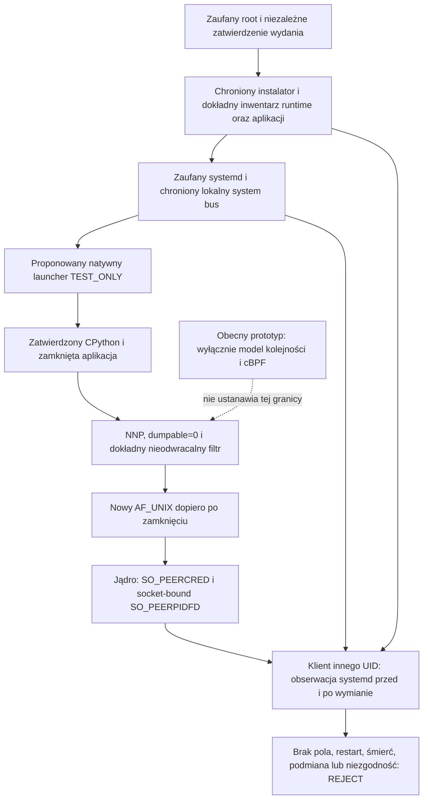

# Stage 9 — projekt TEST_ONLY zamknięcia procesu verifiera

Stan na 5 listopada 2026 r., baza `main`
`6b0eb5b92d3f083c1ea2a996b7213be6cf348bc2`, po PR #3251.
**REJECT pełnego wariantu A jako ustanowionej granicy bezpieczeństwa lub
kwalifikacji.** Dopuszczalny zakres tego projektu to analiza i model TEST_ONLY.
Nie ma zatwierdzonego natywnego launchera, dowodu zamknięcia importów ani
natywnego potwierdzenia tożsamości między UID. Stage 9 pozostaje
**IN_PROGRESS / PRODUCTION_NO_GO**, `STAGE9_PRODUCTION_READY=NO`, `NO MERGE`.

## Zakres i podstawa decyzji

Rozpatrujemy lokalnego napastnika pod UID runtime, innym UID, a także obcy
proces pod UID verifiera. Root instalacji, jądro, systemd, niezależne
zatwierdzenie wydania oraz zatwierdzone bajty launchera i runtime są zaufane.
Napastnik z root pozostaje poza tym modelem. Zatrzymanie procesu przez obce
procesy jest powodem odmowy i problemem dostępności, nie podstawą do
zaakceptowania odpowiedzi zastępczego handlera.

Wariant A zmieniałby podstawę dowodu z bieżącego odczytu obrazu procesu na
zatwierdzony start i egzekwowaną ciągłość. Nie jest to równoważna implementacja
obecnego wymogu. Nie można przyjąć tej zmiany wyłącznie dlatego, że klient
innego UID nie może odczytać `/proc/PID/exe`.

Są trzy nierozwiązane warunki odmowy:

1. Brak dowodu ochrony od samego początku startu przy aktywnym napastniku tego
   samego UID. `PR_SET_DUMPABLE=0` jako pierwsza czynność natywnego `main`
   ogranicza okno, ale go nie usuwa: wcześniej działa loader, a zwykły exec
   może przywrócić dumpable. Tracer mógł zmodyfikować stan przed zamknięciem.
2. Brak niezależnie zatwierdzonego, odtwarzalnego domknięcia interpretera,
   aplikacji, rozszerzeń natywnych i wszystkich późniejszych importów.
   Seccomp nie rozpoznaje wykonania kodu Python z bajtów już w pamięci.
3. Brak dowodu jądrowego dokładnego filtra i jego współpracy z aplikacją,
   wątkami, ABI, obsługą błędów oraz rzeczywistym klientem między UID.

Model nie usuwa tych braków. Dalsze badania są zasadne po osobnym review
założeń; bezpieczeństwo pełnego wariantu A pozostaje **REJECT**.

## Granica zaufania

Diagram opisuje projekt, nie wykonane wdrożenie. Odpowiedź serwera, plik
gotowości lub przekazany przez serwer hash filtra nie tworzą nowej zaufanej
krawędzi. `Seccomp: 2` i liczba filtrów nie poświadczają ich treści.

## Minimalny launcher do ewentualnego następnego etapu

Launcher powinien być małym natywnym programem osadzającym uprzednio
zatwierdzony CPython, a nie skryptem uruchamiającym dowolny Python z PATH.
Cały łańcuch ELF, loader, `libpython`, biblioteki systemowe i aplikacyjne
muszą pochodzić z zatwierdzonego, chronionego inwentarza. Nie proponuje się
nowego podpisu ani pinów w tym etapie. Kolejność jest wymogiem projektu:

1. **Chroniony start.** Systemd uruchamia dokładny launcher z ustalonym
   argv, cwd, UID/GID, grupami i minimalnym środowiskiem, bez zmiennych
   `LD_*`, `PYTHON*`, wyboru modułu lub pluginu przez użytkownika.
   Nie ma socket activation, helpera z odziedziczonym listenerem ani
   potomków uruchomionych przez launcher. Osobna decyzja ma rozstrzygnąć,
   jak chronić okres przed pierwszym poleceniem launchera; sama kontrola
   `TracerPid=0` po fakcie nie dowodzi braku wcześniejszego ptrace.
2. **Wczesny dumpable.** Przed inicjalizacją Pythona ustawić
   `PR_SET_DUMPABLE=0`, sprawdzić wynik oraz `PR_GET_DUMPABLE` i rzeczywiste
   finalne credentials. Brak potwierdzenia kończy proces przed socketem.
   Dumpable=0 ogranicza zewnętrzny ptrace, `process_vm_*` i `pidfd_getfd`
   przez niezaufany proces. Nie odłącza automatycznie wcześniejszego tracera;
   jego przeszłych modyfikacji nie da się wykluczyć późną obserwacją.
3. **Oczyszczenie wejść.** Zamknąć wszystkie niezatwierdzone deskryptory,
   również 0, 1 i 2. Samo `close_range(3, ...)` nie wystarcza. Ewentualny
   kanał błędu lub `/dev/null` musi być oddzielnie zatwierdzony; przypadkowy
   socket jako stderr nie jest takim dowodem. Odmówić odziedziczonemu
   listenerowi i połączeniu; nie adoptować ich po sprawdzeniu samego typu.
   Niedostępna lub niepełna inwentaryzacja oznacza odmowę. Zaufany kod
   startowy musi także wykluczyć wcześniejsze współdzielone mapowania,
   obcych posiadaczy FD i zlecone operacje io_uring.
4. **Inicjalizacja zatwierdzonej aplikacji bez listenera.** Użyć jawnej
   konfiguracji osadzonego CPython: izolacja, ignorowanie środowiska,
   wyłączenie `site`, user-site i zapisu bytecode, stała lista ścieżek modułów
   bez cwd i katalogów zapisywalnych przez konta usługi. Samo `-I -s -B`
   nie jest równoważne wyłączeniu całego `site` i wykonania systemowych
   `.pth`. Najmniejszy kandydat wymaga zamrożonych albo w pełni
   zatwierdzonych modułów, bez dynamicznego discovery. Zweryfikować bajty
   przed pierwszym wykonaniem; wstępne importy nie mogą tworzyć listenera,
   procesów, wątków lub ringów.
5. **Ostateczne przygotowanie.** Załadować wszystkie potrzebne moduły,
   przygotować ograniczoną obsługę danych i błędów, zamknąć pomocnicze FD.
   Dopuścić wyłącznie pojedynczy wątek bez wcześniejszych dzieci i pracy
   asynchronicznej. Nie wykonywać produkcyjnego `service.main()` jako
   sposobu przygotowania: zawiera połączenie z PostgreSQL. Minimalny
   kandydat TEST_ONLY miałby tylko stały, ograniczony protokół danych.
6. **NNP i filtr.** Ustawić i potwierdzić `PR_SET_NO_NEW_PRIVS=1`.
   Założyć dokładny, przejrzany cBPF o domyślnej odmowie dla wybranego
   ABI, z synchronizacją TSYNC jako dodatkowym wymogiem, a nie zamiennikiem
   kontroli modelu wątków. Jakikolwiek niezerowy wynik, również identyfikator
   wątku zwrócony przy nieudanym TSYNC, oznacza natychmiastowe zakończenie.
   Nie stosować fallbacku, kontynuacji ani tylko ostrzeżenia w logu.
7. **Dopiero teraz socket/bind/listen.** Utworzyć nowy AF_UNIX w ustalonej,
   chronionej ścieżce. Żadna odnoga błędu nie może ominąć fazy 6.
   Nowa instancja nie adoptuje zastanego socketu. Dalsze syscall'e potrzebne
   do socketu i obsługi muszą być zawarte w przejrzanym profilu dopuszczeń.
   Dowód kolejności pochodzi z zaufanego kodu startu i kwalifikacji, nie z
   samodzielnego oświadczenia procesu, który ma być uwierzytelniony.

Po filtrze należy domyślnie odmawiać `prctl` w całości, `execve`, `execveat`,
`fork`, `vfork`, `clone`, `clone3`, `ptrace`, `pidfd_getfd`, `process_vm_*`,
zmian credentials, namespace i osobowości oraz niepotrzebnego `seccomp`.
Zakaz exec i zmian credentials zamyka też drogi ponownego ustawienia dumpable
przez zmianę obrazu lub poświadczeń. NNP jest nieodwracalne, ale samo nie
zakazuje uruchomienia innego programu ani podniesienia dumpable.

## Przekazywanie FD, io_uring i ABI

Klasyczny seccomp nie czyta struktur pod wskaźnikami, więc nie może bezpiecznie
odróżnić `sendmsg` z SCM_RIGHTS od dozwolonej wiadomości po sprawdzeniu samego
wskaźnika. Minimalny profil odmawia całych `sendmsg` i `sendmmsg`, a także
`recvmsg`/`recvmmsg`, których mały protokół nie potrzebuje. Zwykłe `read`/`write`
lub ograniczone operacje stream nie przekazują praw do FD. Zakaz potomków
obejmuje również tworzenie nowych wątków; pozostawienie `clone` tylko dlatego,
że biblioteka go oczekuje, wymagałoby nowego modelu.

Trzeba odmówić `io_uring_setup`, `io_uring_enter` i `io_uring_register`.
Filtrowanie samego `sendmsg` nie dowodzi zablokowania jego odpowiednika
zleconego przez io_uring. Zamknięcie odziedziczonego FD ringu nie dowodzi
braku wcześniejszych mapowań lub zleceń, zwłaszcza pracy SQPOLL. Zaufany start
musi wykluczyć ich powstanie przed filtrem, a po nim brak nowych ringów musi
być rzeczywiście egzekwowany. To osobny przypadek kwalifikacji.

Filtr musi najpierw sprawdzać architekturę. Na amd64 samo
`AUDIT_ARCH_X86_64` nie rozróżnia x86-64 i x32; potrzebna jest odmowa bitu
`__X32_SYSCALL_BIT`, wszystkich obcych architektur i nieznanych numerów.
ABI i sygnatury syscalli są częścią kontraktu, nie tłumaczeniem nazw w logu.
32-bitowy `socketcall` nie może stać się alternatywną ścieżką. Nowy kernel,
ABI, glibc, CPython lub rozszerzenie wymaga ponownej kwalifikacji profilu.

Domyślna odmowa zmniejsza powierzchnię przyszłych syscalli, lecz nie dowodzi
poprawności każdej dozwolonej operacji. Lista dopuszczeń dla całego obecnego
FreshnessVerifier nie powstała. Modelowy profil minimalny nie jest taką listą.
Jeżeli profil ogranicza nowe mapowania do braku `PROT_EXEC`, należy również
wykluczyć i zablokować zmianę osobowości `READ_IMPLIES_EXEC`; sam brak bitu
`PROT_EXEC` nie jest uniwersalnym dowodem braku nowej pamięci wykonywalnej.
Konserwatywne porównywanie pełnych 64 bitów argumentu syscalla w modelu może
też odmówić rzeczywistego wywołania glibc, które przekazuje parametr typu
`int` z innym górnym słowem. Model nie poświadcza zgodności natywnego ABI.

## Kod Python i granica gwarancji

Odmowa `openat` po inicjalizacji może blokować nowe importy plikowe;
nie usuwa `exec`, `eval`, tworzenia obiektów kodu, wcześniej załadowanego
`ctypes`, loaderów ani kodu zakodowanego w danych już w pamięci. Hook audytu,
usunięcie `__import__` lub zmiana `sys.path` w Pythonie nie tworzą
nieodwracalnej granicy względem przejętego interpretera.

Wymaganie „nie pozwala załadować niezaufanego kodu Python” wymaga więc
osobnego dowodu zamkniętej aplikacji: żadnego wykonywania danych wejściowych,
pluginów, niezatwierdzonych importów, deserializacji kodu ani rozszerzeń
o nieprzejrzanych skutkach. Odtwarzalny wykaz potrzebnych plików nie dowodzi
jeszcze bezpieczeństwa parsera. Jeżeli model wymaga odporności na dowolne
wykonanie kodu w pamięci, wariant A w tej postaci daje **REJECT**.

Nie przeprowadzono takiego audytu closure. Prototyp nie przyjmuje
produkcyjnych dokumentów ani kluczy, nie uruchamia FreshnessVerifier,
AccountGenesis ani PostgreSQL i nie wystawia żadnego endpointu.

## Konceptualne uwierzytelnienie klienta innego UID

Produkcja pozostaje bez zmian. Ewentualny osobny klient TEST_ONLY musiałby
czytać chroniony kontrakt instalacji i autentyczne lokalne metadane systemd,
bez dziedziczonego `DBUS_SYSTEM_BUS_ADDRESS` i bez danych z odpowiedzi serwera.
Przed pierwszym wysłaniem należy powiązać faktyczny AF_UNIX z
`SO_PEERCRED` oraz **socket-bound `SO_PEERPIDFD`**, właściwymi UID/GID,
MainPID/ExecMainPID, cgroup, start-time, boot ID i tym samym okresem usługi.
Późniejsze `pidfd_open(MainPID)` nie zastępuje uchwytu z socketu.

Ochrona ścieżki i inode socketu, brak podmiany kontraktu, kompletność odczytów
i życie PIDFD są obowiązkowe przed wymianą i po niej. Restart, śmierć procesu,
zmiana okresu, brak pola/prawa odczytu lub rozbieżność daje REJECT. Po
rozpoczęciu wysyłania niejednoznaczność pozostaje `OUTCOME_UNKNOWN` bez retry;
kontrola po odpowiedzi nie cofa wysłanych danych. Poprawny ślad PIDFD nie
atestuje treści filtra ani tego, który proces posiada później przekazany FD.

Zaufanie do dokładnego zatwierdzonego launchera i niepomijalnej kolejności
seal → listen byłoby nową przesłanką klienta. Należy ją osobno zatwierdzić
przed zaprojektowaniem integracji. Obecne `exe_sha256=None` nadal oznacza
odmowę, nie zgodę na tę nową przesłankę.

## Bezpośrednie konsekwencje dla istniejących źródeł

Przeczytano [propozycję cross-UID](stage9_cross_uid_verifier_identity_proposal.md),
[runbook natywny](../runbooks/stage9_cross_uid_native_identity.md) oraz
następujące źródła bazowego commitu:

- `freshness_runtime_ipc._check_server` wymaga zgodnego
  `executable_sha256`; `None` nie daje zatwierdzenia.
  `RuntimeFreshnessVerifierClient.verify_exact_candidate` kontroluje tożsamość
  przed pierwszym `sendall`, a późną niejednoznaczność mapuje na
  `OUTCOME_UNKNOWN`. Nie zmienia się tych reguł.
- `linux_service_ipc.capture_process_identity` potrafi jawnie zapisać brak
  executable tylko przy `allow_missing_executable=True`.
  `PinnedReadOnlyPeer` pobiera PIDFD z faktycznego socketu i sprawdza jego
  życie; nie zastępuje dowodu aplikacji.
- `freshness_service_identity.qualify_freshness_service_identity`,
  `expected_runtime_argv` i `_STATIC_PROPERTIES` wiążą konkretny program,
  podpisany runtime, efektywną jednostkę i proces. Natywny launcher lub
  dodatkowa polityka zmieniłyby ten kontrakt i wymagały osobnego review.
- `production_local_installer._trusted_bootstrap`, `_verified_runtime`,
  `preflight` i `install` chronią publikację zatwierdzonych materiałów;
  nie są dowodem ciągłości po starcie. `freshness_runtime_bootstrap.main`
  sprawdza materiały w `ExecStartPre`, a `verify_ed25519` korzysta z osobnego
  procesu OpenSSL. Takiej operacji nie można bezrefleksyjnie przenieść za
  filtr zabraniający procesów i exec.
- `freshness_verifier_entrypoint._verify_application` ponownie weryfikuje
  aplikację i uruchomiony interpreter przed importem usługi. `main` używa
  `importlib` i tworzy stałą przestrzeń `bot_core`; nie ustanawia seal.
- `freshness_verifier_service.main` otwiera PostgreSQL przed udostępnieniem
  socketu. `freshness_semantic_verifier.serve_local_unix_socket` wykonuje
  bind/chown/chmod/listen i dopuszcza usunięcie zastanego własnego socketu;
  nie jest implementacją tego launchera i nie jest uruchamiane w prototypie.
- Produkcyjna jednostka `cryptohunter-freshness-verifier.service` ma m.in.
  NNP, pusty zestaw capabilities i native ABI. Nie ma wymaganego zamknięcia
  procesu. Systemd musi wykonać początkowy exec usługi, więc proste dodanie
  zakazu wszystkich exec do tego samego wstępnego profilu nie rozwiązuje
  kolejności start → seal. Jednostka pozostaje bez zmian.

Narzędzia Codebase Memory nie były dostępne w aktywnym katalogu narzędzi;
nie wykonano zapytań grafu ani `check_index_coverage`. Wnioski opierają się na
bezpośrednim odczycie wymienionych źródeł; nie deklaruje się kompletności
nieistniejącego indeksu.

## Wariant A a AppArmor na Ubuntu Server 24.04

| Kryterium | Wariant A | AppArmor jako alternatywa |
| --- | --- | --- |
| Bezpieczeństwo i powierzchnia ataku | Mały nieodwracalny profil syscalli, brak nowego brokera. Ufa dokładnemu startowi i aplikacji. Luka startowa i wykonanie kodu w pamięci pozostają nierozstrzygnięte. | Etykieta i chroniona polityka mogą ograniczać pliki, exec, ptrace oraz komunikację AF_UNIX od startu. Sam profil nie mierzy kodu Python ani nie dowodzi, że wyłącznie MainPID obsługuje FD. |
| Złożoność implementacji | Natywny embedder, zamknięte importy, dokładny ABI i profil aplikacji. Brak łatwego przeniesienia standardowego bootstrapu z helperami za filtr. | Profile, przejście start → usługa, ścieżki, parser, features ABI, reguły AF_UNIX i aktualizacje polityki. Mniejsza liczba zmian w interpreterze nie usuwa dowodu delegacji. |
| Ubuntu Server 24.04 | Rodzina kernela 6.8 wspiera seccomp i SO_PEERPIDFD; konkretne kompilacje i backporty wymagają próby. Blokowanie clone wyklucza nowe wątki. | Noble dostarcza AppArmor 4. Rzeczywiste aktywne LSM, tryb enforce, parser i zestaw cech należy sprawdzić w konkretnej VM. Nie wolno przyjąć obsługi AF_UNIX wyłącznie na podstawie zainstalowanego pakietu. |
| Konsekwencje dla FreshnessVerifier | Zmiana sposobu startu, kontraktu tożsamości i dostępnych operacji. Aktualny serwis z PostgreSQL nie ma jeszcze profilu. | Zmiana kontraktu startu, własności polityki i ewentualna nowa obserwacja `SO_PEERSEC`. Istniejące odmowy klienta nadal obowiązują do osobnej integracji. |
| Niezależna kwalifikacja | Audyt bajtów BPF i launchera, odmowy rzeczywistego jądra, brak delegacji, tożsamość przed/po. Samo `Seccomp: 2` nie wystarcza. | Audyt skompilowanej/aktywnej polityki, etykiety, trybu i cech; rzeczywiste odmowy plików, exec, ptrace i delegacji. Sama etykieta nie wystarcza. |
| Zaufany instalator | W przyszłości dokładny launcher, ELF/CPython closure, profil, nowy kontrakt startu i osobno zatwierdzone bajty. Nie realizuje się tych zmian teraz. | W przyszłości root publikuje i ładuje dokładną politykę, wiąże ją z usługą, weryfikuje enforce/cechy i kontroluje aktualizację/wycofanie. To zmiana polityki systemu wymagająca osobnej zgody. |

Profil dziedziczony przez dziecko może utrzymywać ograniczenia, ale nie
gwarantuje braku fork ani zgodności faktycznego handlera z MainPID.
Reguły AF_UNIX ograniczają adresy, etykiety i operacje; nie analizują treści
wiadomości. Nie należy z ich nazwy wywodzić pełnej odmowy SCM_RIGHTS.
AppArmor ma hook odbioru pliku, lecz jego skuteczność dla konkretnych socketów
i odbiorców musi być osobno wykazana. `SO_PEERSEC`, jeżeli dostępne, nie
staje się automatycznie pomiarem aktualnego odbiorcy przekazanego FD.

Dokumentacja i gramatyka parsera upstream AppArmor **v4.0.1** zawierają
`sqpoll` i `override_creds`; nie są to wyłącznie reguły opisane w nowszej
rodzinie 4.1/4.2. Aktualnie publikowana strona man Noble także je opisuje.
To dowód istnienia składni, nie działania polityki w konkretnej VM.
`io_uring_rule::gen_policy_re` w tym samym v4.0.1 przy braku
`features_supports_io_uring` zwraca `RULE_NOT_SUPPORTED`, z ostrzeżeniem
o nieegzekwowaniu reguł. Wymagana jest zatem osobna weryfikacja dokładnego
kernela, features, parsera i aktywnej polityki; samo przyjęcie źródła profilu
nie wystarcza. Nawet obsługi tych dwóch uprawnień nie wolno traktować jako
ogólnej odmowy wszystkich operacji io_uring. Brak natywnych dowodów tych
własności pozostawia czysty wariant AppArmor **REJECT** dla tego celu.
Kierunek hybrydowy AppArmor od startu plus mały seccomp po inicjalizacji jest
tematem osobnego projektu, nie zatwierdzonym rozwiązaniem tego PR.

## Prototyp i decyzje wymagane przed kolejną próbą

[Moduł TEST_ONLY](../../scripts/diagnostics/stage9_verifier_seal_model.py)
modeluje kolejność oraz kompiluje i interpretuje ograniczony cBPF jako dane.
Nie instaluje filtra, nie wywołuje `prctl`/seccomp, nie osadza CPython,
nie uruchamia usługi ani nie tworzy socketu. Nie jest launcherem.
[Macierz adversarialna](../runbooks/stage9_verifier_seal_adversarial_matrix.md)
oddziela wynik modelowany od rzeczywistej odmowy jądra i NOT_RUN.
[Raport wykonania](../audits/stage9_verifier_seal_test_only_2026-11-05.md)
podaje faktyczne wyniki walidacji. Nie wykonano natywnych prób: brak osobno
zatwierdzonej jednorazowej VM.

Przed ewentualnym natywnym prototypem potrzebne są osobne decyzje o:

1. Akceptacji zmiany podstawy tożsamości i dokładnej granicy wobec RCE.
2. Ochronie startu wobec aktywnego procesu tego samego UID, zanim launcher
   zdąży ustawić dumpable; wykluczeniu wcześniejszego tracera i delegacji.
3. Pełnym zatwierdzeniu closure aplikacji, CPython, ELF i zależności.
4. Dokładnym profilu syscalli i modelu bez wątków, helperów i io_uring.
5. Niezależnej kwalifikacji odmów jądra i klienta w zatwierdzonej VM,
   z osobnym upoważnieniem do działań administracyjnych.

Nie zmieniają się poprzednie audyty, produkcyjny klient, instalator, unit,
AccountGenesis, podpisy, digesty, zamrożone piny ani
`deployment/stage9_current_status.json`. Pozostają blokady
`RUNTIME_IPC_APPLICATION_ADAPTER_UNAVAILABLE`,
`ACTUAL_RUNTIME_CLIENT_EXCHANGE_UNPROVEN`,
`RUNTIME_UNAUTHORIZED_IDENTITY_DENIAL_UNPROVEN` oraz
`DURABLE_CHALLENGE_REPLAY_PROTECTION_UNAVAILABLE`.

## Źródła platformy

- [Seccomp BPF — dokumentacja jądra](https://docs.kernel.org/userspace-api/seccomp_filter.html):
  NNP, składanie filtrów i ograniczona inspekcja argumentów.
- [PR_SET_DUMPABLE — Linux man-pages](https://man7.org/linux/man-pages/man2/PR_SET_DUMPABLE.2const.html):
  warunki zmiany dumpable i ograniczenia ptrace.
- [pidfd_getfd — Linux man-pages](https://man7.org/linux/man-pages/man2/pidfd_getfd.2.html):
  kopiowanie FD z kontrolą `PTRACE_MODE_ATTACH_REALCREDS`.
- [Linux 6.8 ptrace](https://github.com/torvalds/linux/blob/v6.8/kernel/ptrace.c):
  relacja tracera, kontrola dostępu do pamięci i dostęp do procesu.
- [AppArmor w Ubuntu Server](https://ubuntu.com/server/docs/how-to/security/apparmor/)
  oraz [składnia profili Noble](https://manpages.ubuntu.com/manpages/noble/man5/apparmor.d.5.html):
  profil, enforce, AF_UNIX, ptrace, rlimit i ograniczony zakres reguł io_uring.
- [Hooki AppArmor w Linux 6.8](https://github.com/torvalds/linux/blob/v6.8/security/apparmor/lsm.c):
  dziedziczenie kontekstu przy tworzeniu zadania i `file_receive`.
- AppArmor v4.0.1: [źródło dokumentacji](https://gitlab.com/apparmor/apparmor/-/raw/v4.0.1/parser/apparmor.d.pod),
  [gramatyka parsera](https://gitlab.com/apparmor/apparmor/-/raw/v4.0.1/parser/parser_yacc.y)
  i [generowanie reguł io_uring](https://gitlab.com/apparmor/apparmor/-/raw/v4.0.1/parser/io_uring.cc):
  obecność składni oraz odmowa generowania reguł przy braku wymaganych features.

Źródła platformy wyjaśniają ograniczenia projektu. Nie są dowodem konfiguracji
konkretnej Ubuntu VM ani kwalifikacją użytych w niej backportów.
