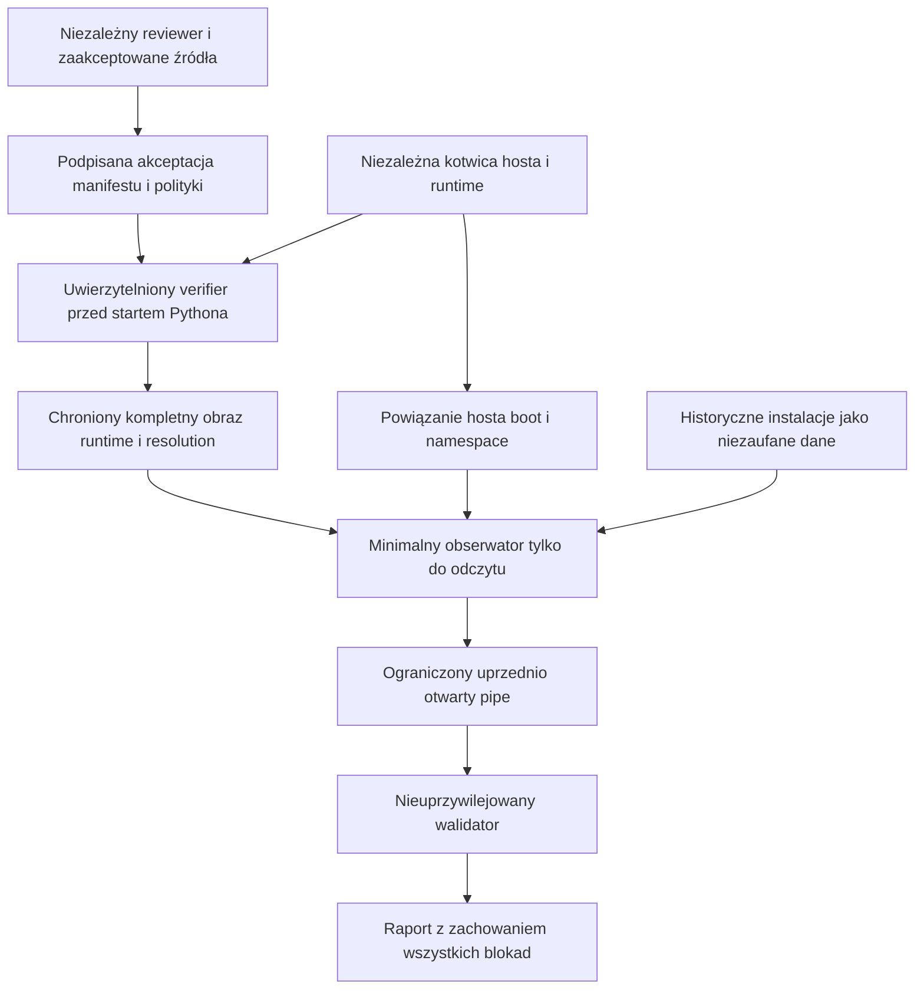

# Stage 9 — kontrakty zaufanego obserwatora i plan implementacji

Projekt do osobnego review, 2026-10-27 UTC. Linux / Ubuntu 24.04,
Dell Latitude 5490, repozytorium `Dudzian/Dudzian`, baza
`f0908b71a13ef67173e9a65741bfbb02cf45043c`.
Rozwija [analizę dowodów i obserwatora](stage9_independent_installation_evidence_and_observer.md),
zwłaszcza jej etapy 2–4. Ten PR zmienia tylko dokumentację. Nie ustanawia
zaufanego manifestu, klucza, pinu, kompletnego inventory ani zgody na start.

```text
qualification = BLOCKED
full_confirmation = false
coexistence_authorized = false
preflight_exception = false
physical_test_status = PHYSICAL_TEST_PENDING
status = IN_PROGRESS
production_status = PRODUCTION_NO_GO
```

Zachować `no_other_installations` i wszystkie istniejące progi CI. Nie zmieniać
instalacji Stage 41B, `/proc`, hidepid, Yama, LSM, dumpability, sudoers ani
zabezpieczeń Ubuntu. Nie wykonywać testów jako root lub przez sudo.
Nie implementować uprzywilejowanego launchera/helpera przed osobnym
zatwierdzeniem projektu i spełnieniem całego etapu 4. Merge tego PR nie jest
takim zatwierdzeniem ani kwalifikacją sprzętu. Nie scalać automatycznie.

## 1. Aktualizacja dowodów z Della

Źródło poniższych informacji: **oświadczenie operatora przekazane w zadaniu**.
W tym PR nie otrzymano surowych raportów, archiwów, podpisów, dzienników APT
ani dowodów uruchomienia z Della i nie wykonano tam ponownych pomiarów.
`PASS` w tabeli jest cytowanym wynikiem danej kontroli operatora, nigdy
wynikiem kwalifikacji Stage 9 lub niezależnego uwierzytelnienia hosta.

| Zgłoszona kontrola | Wynik operatora | Co nadal pozostaje niewykazane |
| --- | --- | --- |
| Historyczne artefakty CI | 4/4: PASS | Autentyczność procesu pomiaru i jego kompletność; historyczne CI CPython 3.11 nie jest venv Stage 41B CPython 3.12. |
| Przypięte wheels CPython 3.12 | 10/10: PASS | Niezależna akceptacja locka i pełne pochodzenie instalacji oraz wykonującego verifiera. |
| Pliki `.pyc` | 573/573: lokalna rekonstrukcja bajt po bajcie | Zaufanie do kompilatora/runtime i wszystkich parametrów transformacji; nie jest to niezależny rebuild na zaufanej maszynie. |
| Podstawowe archiwa Ubuntu | 11/11: zgodność z podpisanym łańcuchem APT | Zewnętrznie zaakceptowane klucze, kompletne metadata/wersje i związek archiwów z rzeczywiście wykonanymi bajtami. |
| Dodatkowe pakiety startup TCB | 4/4: zgodność z podpisanym łańcuchem APT | Czy zestaw obejmuje cały startup i wszystkie późniejsze zależności w dozwolonych ścieżkach wykonania. |
| Minimalny proces z `LC_ALL=C` | Nie mapuje `locale-archive` | Wynik jednego profilu; nie dowodzi braku innych danych locale/NSS/gconv lub późniejszych importów. |
| Zaobserwowane mapowania | Brak niechronionych ścieżek | Brak takiej ścieżki w zaobserwowanym zbiorze nie dowodzi kompletności zbioru, pochodzenia bajtów ani braku wyścigu. |
| `/proc/1/ns/pid` | `PERMISSION_DENIED` | Odmowa pozostaje luką; nie zmieniać zabezpieczeń, aby ją ominąć. |
| Host PID namespace | `UNVERIFIED` | Brak uwierzytelnionej kotwicy wskazującej początkowy namespace właściwego hosta. |
| Independent runtime attestation | `MISSING` | Brak niezależnego dowodu całego procesu uruchomienia obserwatora. |

Nie dodawać tych zgłoszeń do wcześniejszych JSON badawczych jako ponownie
zweryfikowanych bajtów. Nie dopisywać wymyślonych digestów, nazw pakietów,
tożsamości podpisujących, dat raportów ani informacji o TPM/Secure Boot Della.
Nie sumować 11+4 jako dowodu zamknięcia TCB. Poprzednie luki etapu 1B są
częściowo zaadresowane zgłoszeniami operatora, lecz etap nie zostaje zamknięty.
Maps nie ujawnia wszystkich plików open/read/close, konfiguracji, załadowanych
źródeł `.py`/`.pyc` ani bibliotek odmapowanych przed pomiarem.

## 2. Decyzje i granice zaufania

| Decyzja | Uzasadnienie i granica |
| --- | --- |
| D1. Trzy osobne twierdzenia: zgodność artefaktu, zaufany start, zakres hosta | Żadne nie wynika automatycznie z pozostałych. Hash lokalny, root:root i podpis APT nie dowodzą całego startu. |
| D2. Obserwator ma własny minimalny runtime | Nigdy nie wykonuje interpretera, modułu, `.pyc`, wheel lub hooka z badanych instalacji. Kod Stage 41B jest danymi. |
| D3. Verifier offline nie uwierzytelnia sam siebie | Jego wynik na obecnym Dellu to lokalna kontrola pod warunkiem zaufania do procesu. Niezależna akceptacja wymaga osobnego uwierzytelnionego środowiska i reviewera. |
| D4. Zaufanie obejmuje kod przed Pythonem | Verifier/launcher, ich loader i biblioteki muszą mieć kotwicę przed wykonaniem; samopomiar Pythona jest za późny. |
| D5. Zamknięty manifest i resolution przez cały czas życia | Lista zaobserwowanych importów/mapowań to świadectwo pokrycia testu, nie dowód closure. Nieznany element blokuje. |
| D6. Osobne schematy i domena obserwatora | Manifest Source/CCA oraz Windows Product Release Root mają inne przeznaczenie. Nie dziedziczyć ich autoryzacji ani kluczy. |
| D7. Brak ogólnego interfejsu uprzywilejowanego | Przyszły helper ma jeden stały odczytowy zakres. Projekt praw następuje po analizie wymaganych odczytów i zaufanego runtime. |
| D8. Niepełna obserwacja zachowuje blokadę | Brak uprawnień, zmiana PID/bindings, timeout i nieznany scope nie mogą stać się PASS. Wykryte trafienia przetrwają późniejsze błędy. |



Granice: **B0** niezależna akceptacja źródeł; **B1** zaufany boot/verifier/start;
**B2** stałość runtime i resolution; **B3** prawdziwy host/procfs;
**B4** odczyty niezaufanych procesów/plików; **B5** kanał i walidacja wyniku.
Nie przenosić zaufania przez granicę na podstawie samego pola JSON.
Model lokalnego obserwatora zakłada uczciwy kernel i egzekwowane polityki hosta.
Wobec przejętego root/kernel/firmware jego własne odczyty nie są niezależnym
dowodem. Taki model wymaga zewnętrznej egzekucji/pomiaru o zadeklarowanych
gwarancjach; nie obiecywać pełnej odporności na kompromitację hosta.

## 3. Kontrakty ustalane przed implementacją

Poniższe nazwy i wersje są propozycją kontraktu V1 do review, nie istniejącymi
formatami akceptowanymi przez CLI. Nie zmieniać semantyki istniejącego
`--evidence`. Zgodność parsera nie nadaje uprawnień. W następnym PR kontrakty
muszą dostać zamknięte walidatory, fixtures i testy przed podłączeniem I/O.

### 3.1 Wspólna reprezentacja

UTF-8 bez BOM; dokładne zestawy pól na każdym poziomie, brak duplikatów kluczy,
nieznanych wersji, float, NaN/infinity, surrogate, NUL i niekanonicznych ścieżek.
Liczby wymagają `type(x) is int` (bool nie jest licznikiem). Wartości całkowite
0..2^53−1, dodatkowe limity dziedzinowe; reason codes to zamknięte enumy.
Użyć istniejącego `deployment.canonical_json.canonical_json_bytes` po ścisłym,
ograniczonym dekodowaniu. Decoder odrzuca nadmierną głębokość przed rekursją.
Nie normalizować wejściowych bajtów przed sprawdzeniem ich przypiętego digestu.

Limity V1: manifest 4 MiB, polityka/akceptacja po 64 KiB, wynik 64 KiB,
głębokość 16, 32768 wpisów plików, 128 źródeł, 64 reason codes,
identyfikator 128 znaków ASCII, ścieżka 4096 bajtów. Archiwum do 512 MiB,
rozpakowane dane do 2 GiB i 65536 członków; limit kompresji 100:1,
60 s na artefakt i 300 s na pakiet wejściowy, pamięć robocza do 256 MiB.
Czytać strumieniowo tam, gdzie parser to umożliwia. Istniejące `wheel_members`
materializuje `raw` i słownik członków: adapter V1 ogranicza wheel do 16 MiB
archiwum / 32 MiB rozpakowanych danych i uruchamia go w nieuprzywilejowanym
workerze z twardym limitem 256 MiB oraz deadline. Nie nazywać tego streamingiem.
Brak egzekucji limitu lub zabicie workera to odmowa. Dla większych danych
obsługiwanych strumieniowo obowiązują powyższe limity ogólne.
Buforujący `_read_descriptor` dostaje najwyżej 16 MiB; artefakty przetwarzać
kolejno, bez przechowywania wyników wszystkich archiwów w RAM. Większe CI/`.deb`
wymagają strumieniowego czytnika/narzędzia o przypiętym toolchainie i limitach;
brak obsługi formatu w budżecie daje INCOMPLETE, nie zwiększenie limitu po fakcie.
Przekroczenie limitu to odmowa, nigdy ucięty sukces.
To nowe limity parserów offline, bez zmiany budżetów istniejącego skanera/CI.

### 3.2 Manifest `CryptoHunter.Stage9ObserverManifestV1`

Top-level dokładnie: `schema`, `version=1`, `purpose=STAGE9_OBSERVER_TEST_ONLY`,
`manifest_id`, `sequence`, `source_revision`, `target`, `sources`, `files`,
`transforms`, `runtime`, `imports`, `launch_policy_sha256`.

| Rekord | Wymagana semantyka |
| --- | --- |
| `source_revision` | Pełny SHA zaakceptowanego kodu obserwatora, osobny od dwóch obserwowanych historycznych commitów. |
| `target` | Dokładnie Linux, Ubuntu 24.04, architektura x86_64, CPython 3.12 z dokładnym package version/build, ABI i profilem; brak wildcardów. |
| `sources[]` | Unikalne `source_id`, `kind`, dokładny artifact digest/size i odwołanie do zaakceptowanego proof record. Dozwolone warianty: Git object proof, pinned wheel, Ubuntu APT snapshot, zatwierdzona transformacja. URL jest wskazówką pozyskania, nie kotwicą. Brak sieci w verifierze. |
| `files[]` | Unikalny `file_id`, bezwzględna ścieżka w docelowym obrazie, typ regular/directory, uid/gid/mode, rozmiar, SHA-256 dla regular, source/member lub transform ID. Dla directory digest nie występuje. Oczekiwany zamknięty zbiór obejmuje też katalogi, konfiguracje i pliki nie-Python. Symlink/hardlink/specjalne pliki niedozwolone w obrazie V1. |
| `transforms[]` | Dokładne wejścia/digests, narzędzie/build/runtime, parametry, wynik i dowód rekonstrukcji. Dla `.pyc`: source bytes, CPython magic/build, optimization, invalidation mode, ścieżka `co_filename` i wymagane timestamp/size. Nie akceptować lokalnego wyjścia jako własnego oczekiwanego wzorca. |
| `runtime` | Jawne file IDs interpretera, ewentualnego libpython, stdlib, frozen/builtin inventory, ELF PT_INTERP, rekurencyjnego DT_NEEDED i dopuszczonego dlopen; konfiguracja loadera, CPU/hwcaps warianty i zależności danych. Każda pozycja musi istnieć w `files`. |
| `imports` | Dokładne moduł → rodzaj (builtin/frozen/source/native), file IDs/digests, dopuszczone korzenie i wyczerpujące ścieżki błędów. W V1 bez zipimport, namespace packages, pluginów, `.pth`, custom import hooks i sourceless `.pyc`. Ewentualne rozszerzenie wymaga nowej polityki/review. |

W V1 obserwator preferuje stdlib-only i źródła `.py`; obecność `.pyc`
w historycznych instalacjach nie dopuszcza ich do runtime obserwatora.
Zależności pakietów, manifest inventory i runtime closure to różne zbiory;
wszystkie odwołania i ich brakujące/extra pozycje są walidowane.

### 3.3 Polityka i podpisana akceptacja

`CryptoHunter.Stage9ObserverAcceptanceV1` to envelope o dokładnych polach
`payload`, `payload_digest`, `threshold`, `signatures`. Payload zawiera
`schema`, `version=1`, `purpose`, `manifest_sha256` (surowe bajty),
`policy_sha256`, `root_set_id`, `sequence`, `revocation_checkpoint`,
`issued_at`, `expires_at`. Podpis: istniejący profil Ed25519 nad
`b"CryptoHunter.Stage9ObserverAcceptanceV1\0" + SHA256(canonical(payload))`.
Podpisy: unikalne i posortowane `signer_id`, 64-bajtowe `signature_hex`.
Kanonizacja i Ed25519 nie dostają drugiej implementacji.

Oddzielnie dostarczona, niezależnie zaakceptowana polityka zawiera dokładnie
`schema`, `version`, `purpose`, `root_set_id`, `reviewer_keys`, `threshold`,
`allowed_sources`, `minimum_sequence`, `revocation_checkpoint`,
`valid_until`, `target`, `limits`, `launch_policy_sha256`.
`reviewer_keys` wiąże ID z 32-bajtowym kluczem i niezależną tożsamością reviewera;
V1 wymaga 2 różnych reviewerów (threshold 2), zaakceptowanych poza Dellem.
Odrzuca powtórzony raw public key lub tę samą tożsamość reviewera pod różnymi
signer IDs; samo liczenie różnych ID przez istniejący verifier nie wystarcza.
Klucz pakietowy Ubuntu lub klucz konta CI nie jest automatycznie takim reviewerem.
Polityka nie może autoryzować własnego root setu przez pole w tym samym pakiecie.

Weryfikacja kolejno: ograniczony decode → zewnętrzna kotwica polityki → jej
wersja/purpose/target/checkpoint/czas → podpisy akceptacji → dokładne digests
manifestu/polityki → monotoniczna wersja i revocation → źródła/pliki/closure.
Próg bierze się z polityki, nigdy z dowolnego envelope. Wszystkie dostarczone
podpisy muszą być poprawne; nieznany/odwołany/TEST signer i obca domena blokują.
TEST roots są wyłącznie fixtures i nigdy nie tworzą target acceptance.

Offline wymagany jest niezależnie uwierzytelniony checkpoint odwołań i minimalnej
wersji oraz zaufany czas/okno ważności. Cofnięcie jednocześnie manifestu,
revocation i lokalnego zegara nie może przejść na podstawie lokalnego pliku.
Brak świeżego checkpointu lub wiarygodnego czasu daje `TRUST_CONTEXT_MISSING`.
W środowisku testowym dopuszczalny jest jawny syntetyczny context, zawsze
oznaczony `synthetic=true`; nie eksportować go jako niezależnej akceptacji.

Polityka źródeł:

- Git: sprawdzić raw commit/tree/blob OID, ścieżki i digesty; osobna akceptacja
  konkretnego SHA uwierzytelnia wybór. Niepodpisane historyczne commity pozostają
  niepodpisane. Podpis merge commita nie atestuje instalacji na Dellu.
- Wheels: użyć zaakceptowanego locka i istniejących walidatorów digest/layout/
  RECORD; brak resolvera, sdist, importu, build hooka lub `pip install` payloadu.
- Ubuntu: niezależnie przypięty fingerprint archive key oraz snapshot
  InRelease albo Release+Release.gpg → dokładny digest Packages → `.deb` →
  payload members. Sprawdzać suite/codename, architekturę, wersję, daty,
  Valid-Until i politykę historycznej retencji. Pakietów `.deb` zwykle nie
  podpisuje się osobno; podpis metadata nie poświadcza wykonania payloadu.
- APT w verifierze offline: istniejący `gpgv` do weryfikacji podpisu, bez fetch,
  apt install/update, keyserverów i maintainer scripts. Ścieżka, build i closure
  narzędzia należą do jawnego toolchainu verifiera. Odczyt archiwum bez ekstrakcji
  na żywy system, z limitami, bez wykonywania jakiegokolwiek członka.
  Symlinki/hardlinki w oryginalnym `.deb` pozostają wyłącznie inertnymi rekordami
  pochodzenia, bez podążania za nimi. Docelowy obraz V1 nie zawiera linków;
  ewentualna zamiana linku na regular file wymaga jawnego zaakceptowanego
  transform record i zamkniętego targetu wewnątrz tego samego snapshotu.
- CI/SBOM/receipt/lokalny hash: materiał pomocniczy. Jeśli używa się atestacji,
  sprawdzić subject digest, issuer, repo/workflow/ref, builder i materiały według
  osobnej jawnej polityki. Nieznana lub nieobsługiwana atestacja pozostaje luką.

### 3.4 Wynik offline, namespace i wynik obserwatora

Verifier offline zwraca zamknięty `OfflineVerificationResultV1`: `schema`,
`version`, `synthetic`, `manifest_sha256`, `policy_sha256`,
`artifact_consistency` (MATCH/MISMATCH/INCOMPLETE),
`acceptance` (VERIFIED/UNVERIFIED/REJECTED), `reason_codes` i powyższe stałe
blokady. VERIFIED dotyczy podpisanej akceptacji pod przekazanym trust context,
nie hosta. Osobne pola `runtime_attestation=MISSING` i
`host_pid_namespace=UNVERIFIED` są obowiązkowe dla etapu 3.
Nie tworzy pliku dla istniejącego `--evidence` ani pinu zatwierdzającego Dell.

Przyszły `HostScopeBindingV1`: `schema`, `version`, `host_anchor_id`,
`boot_id`, `run_nonce`, `observer_start_time_ticks`, `pid_namespace`,
`user_namespace`, `mount_namespace`, `procfs_identity`, `source`,
`authentication_evidence_sha256`. Namespace identity jest parą device/inode
w konkretnym uwierzytelnionym boot, nie uniwersalnym numerem hosta.
`source` wskazuje wcześniej uwierzytelniony host collector/launcher.
Procfs identity obejmuje mount ID, fs type/root, widok PID i opcje widoczności.
Same liczby, boot_id, NSpid, cgroup, nazwa maszyny, self==PID1 lub dostęp do
systemd nie uwierzytelniają początkowego namespace. Podpis arbitralnego JSON
przez lokalny proces też tego nie dowodzi.

Walidator etapu 3 tylko porównuje syntetyczne obserwacje z wymaganym binding
i sprawdza auth context; nie czyta host `/proc` i nie ustanawia bindingu.
EACCES/ENOENT, obcy boot, kontener z własnym PID1, inny procfs lub nieznany
issuer kończą się `HOST_SCOPE_UNVERIFIED`. Na obecnym Dellu odmowa odczytu
`/proc/1/ns/pid` pozostaje `PERMISSION_DENIED`, a host scope `UNVERIFIED`.
Samo uzyskanie tego odczytu w przyszłości nadal nie wystarczy.

Przyszły `ObserverResultV1` ma dokładnie: `schema`, `version`, `synthetic`,
`run_id`, `run_nonce`, `observer_manifest_sha256`, `policy_sha256`,
`installation_commits`, `scope_binding_sha256`, `boot_id`, `started_at`,
`finished_at`, `counters`, `observations`, `reason_codes`, `completeness`,
`runtime_attestation` oraz wszystkie stałe blokady. `installation_commits`
to wyłącznie pełne `782816540373d7b31f426dab645ad115320d1234` i
`26e17e7c23ea6cc1b265d57bfda1a1e6589d9e3f` w stałej kolejności.
Wynik nie przyjmuje ścieżek, arbitrary PID, komend, kodu, nazw modułów ani
dowolnego celu od operatora. V1 obserwacji to wyłącznie bounded counters,
`match_seen`, `identity_stable`, `bindings_stable` i stałe reason codes.

Walidować wartości i zależności: czas końca >= początku, liczniki nieujemne
i ograniczone, każda luka wymusza INCOMPLETE, positive match nie znika po błędzie,
brak atestacji/scope nie pozwala na COMPLETE. Kategorie liczników mogą się
nakładać — nie wymagać ich sumowania do liczby PID. `completeness=COMPLETE`
dotyczy wyłącznie zatwierdzonego zakresu i okna, nie historii/przyszłości hosta;
nawet ono nie zmienia kwalifikacji/produkcji. `full_confirmation=true`,
`coexistence_authorized=true`, `preflight_exception=true` lub inny status
produkcyjny są zawsze odrzucane w tym kontrakcie.

## 4. Docelowy start, closure i ochrona przed podmianą

Preferowany profil: osobny, minimalny CPython 3.12, `-I -S -B`, absolutny
entrypoint i zamknięte korzenie importów. Na 3.12 `-S` wpływa na rozpoznawanie
venv; nie polegać na historycznym venv. `-I` sam nie wyłącza systemowego site,
a `-B` nie zabrania czytania istniejącego `.pyc`. Zweryfikować frozen/builtin
moduły jako część dokładnego builda interpretera i stdlib przed startup.

Przed pierwszym wykonaniem Python potrzebuje uwierzytelnionego zewnętrznego
verifiera/launchera wraz z jego własnym całym runtime. Nie uruchamiać go
z home, CWD, badanych instalacji ani z podmienialnego katalogu builda.
Docelowo zaakceptowany obraz tylko do odczytu z egzekwowaną integralnością
i zamkniętą resolution policy przez cały lifetime. Konkretny mechanizm obrazu,
appraisal i dystrybucji wymaga etapu 4 i osobnego projektu launchera.
Read-only bind mount sam nie zamraża bazowych inode, a fs-verity samo nie
uwierzytelnia nazwy, manifestu, doboru plików ani metadanych.

Sprawdzenie otwartego FD i `execveat`/`fexecve` nie wystarcza: ELF PT_INTERP,
libpython, DT_NEEDED, RPATH/RUNPATH, loader cache/config, `/etc/ld.so.preload`,
glibc hwcaps, późny dlopen i importy mogą rozwiązać się do innych plików.
Nawet launcher statyczny potrzebuje uwierzytelnionego kernela i polityki startu.
Poza manifestem brak fallback na host `/usr`, względny path, `$ORIGIN`
wychodzący poza obraz albo inną wersję biblioteki. Konfiguracje wymagane przez
loader są przypięte albo jawnie nieobecne w zatwierdzonym obrazie.

Closure obejmuje też inicjalizację locale, encoding, gconv, NSS i konfiguracje
użyte przez dozwolone operacje, error paths i raportowanie. Ustalić
`LC_ALL=C`, wyeliminować lookup kont i DNS, jeśli nie są potrzebne; nie
zakładać braku zależności na podstawie jednego udanego przebiegu. Ani liczba
pakietów APT, ani `ldd` nie jest dowodem closure; nie wykonywać `ldd` na
niezaufanym binarium. Analiza ELF i importów działa na danych, potem testy
pochodzenia modułów w zaufanym, nieuprzywilejowanym runtime i egzekucja polityki.

Launcher ustanawia allowlist środowiska, chroniony CWD i FD; usuwa wpływ
PYTHON*, user site, home, LD_*, pluginów i nieznanych deskryptorów. Importy
nie mogą przetwarzać `.pth`, sitecustomize/usercustomize, zipów lub dynamicznych
hooków. `sys.meta_path`, `sys.path_hooks` i origins loaded modules podlegają
kontroli, ale hook Pythona/audit po startup nie zastępuje zaufanego bootstrapu.
Kod wymagań zamyka się statycznie + negatywnymi scenariuszami + ograniczeniem
resolution; pojedynczy trace nie jest wyczerpującym dowodem.

Metadane i pochodzenie sprawdza się osobno: każdy ancestor, ACL/default ACL,
uid/gid/mode, setid/capability xattrs, typ, nlink, źródło i zamknięty inventory.
Zabronione symlink, hardlink, device, FIFO, socket i nieoczekiwane wpisy.
Zachowane FD, powtórne metadata/content checks i wykrywanie mount/binding drift
pomagają wykryć wyścig; same nie zamykają TOCTOU wykonania/importu. Bez
udowodnionego związku zweryfikowane bytes → wykonane bytes przez cały lifetime
pozostaje `RUNTIME_LAUNCH_UNVERIFIED`. Nie poprawiać starych instalacji dla
uzyskania zgodności; niewyjaśnione różnice pozostają blokadą.

## 5. Zakres hosta, prawa i raportowanie

Zaufany host collector wiąże obserwatora z początkowym PID/user namespace
właściwego hosta, boot i wiernym procfs; prywatny mount namespace jest dopuszczalny
tylko po udowodnieniu niezmienionego widoku wymaganych źródeł. Sandbox z nowym
PID/user namespace, hidepid, ProtectProc lub maskowaniem katalogów może
unieważnić kompletność. Nie wykonywać setns/unshare ani nie zmieniać procesów
docelowych. pidfd + starttime + powtarzane bindings ograniczają PID reuse,
lecz nie zamrażają exec, wątków, mapowań ani FD. Nie zatrzymywać procesów.

| Potrzebny odczyt | Dopuszczalny zakres | Gdy obecny dostęp nie wystarcza |
| --- | --- | --- |
| Manifest, polityka, publiczne pliki instalacji | Zamknięty zaakceptowany inventory; hashowanie tylko tych danych | INCOMPLETE/BLOCKED; bez chmod/chown/zmiany instalacji. |
| Enumeracja PID/TID i tożsamość | Host procfs, stat/status oraz niezbędne namespace/cgroup metadata | Nie wnioskować o nieobecności z brakującego widoku. |
| exe, maps, map_files i fd metadata | Tylko korelacja tożsamości i referencji; bez treści aplikacji | Brak dostępu lub zmienność pozostaje jawną luką. |
| Namespace hosta | Uwierzytelniony binding, a nie samo porównanie self/PID1 | HOST_SCOPE_UNVERIFIED; bez obchodzenia odmowy. |

Domyślnie prawa zwykłego użytkownika. Przyszły broker/helper, jeśli okaże się
niezbędny, będzie osobno oceniony względem dokładnej macierzy odczytów i
ograniczeń LSM/ptrace. Nie zakładać, że CAP_DAC_READ_SEARCH rozwiązuje ptrace
checks, ani że CAP_SYS_PTRACE jest prawem tylko do odczytu. Nie nadawać caps
Pythonowi, operatorowi lub instalacjom. Jeśli nie da się uzyskać wymaganych
odczytów przy zatwierdzonym minimalnym profilu, rezultat pozostaje BLOCKED.

Docelowo: brak sieci i urządzeń, NoNewPrivileges, zamknięte
bounding/permitted/ambient capabilities, limity czasu/RSS/FD/procesów, brak
kolejnych exec, mount, setns/unshare, ptrace, process_vm_*, pidfd_getfd,
sygnałów i zapisu plików poza pre-opened output FD. Seccomp nie jest
bezpiecznym filtrem ścieżek open; wymaga kompozycji z LSM/FS policy bez
maskowania źródeł obserwacji. Konflikt sandboxu z kompletnością blokuje projekt.

Raportowanie V1: jeden uprzednio otwarty jednokierunkowy pipe, jeden frame
(4-bajtowy big-endian rozmiar + UTF-8 JSON do 64 KiB), EOF i poprawne zakończenie
procesu. Cały przyszły run ma limit 300 s od startu; po pierwszym bajcie
frame odbiór i EOF muszą nastąpić w 30 s i przed końcem tego limitu.
Krótki frame, nadmiar, timeout, sygnał, błąd procesu lub przedwczesne zamknięcie
kanału blokują akceptację. Normalny EOF po jednym pełnym frame jest wymagany.
Nie przesyłać FD/SCM_RIGHTS, surowych proc danych ani uprawnień. Helper nie
otwiera ścieżki operatora; wynik zapisuje nieuprzywilejowany odbiorca.
Launcher wiąże pipe i PID nadawcy z zatwierdzonym run i 256-bitowym nonce;
nonce/digest sam nie uwierzytelnia procesu. Stan zużytych nonce jest po stronie
zaufanego odbiorcy, nie w polu raportu. Eksport wymaga osobno uwierzytelnionego
receipt zaufanego odbiorcy; lokalny hash eksportu służy jedynie integralności.

Nie czytać mem, environ, cmdline/argv, keyringów, credential contents,
pamięci procesu ani treści otwartych plików aplikacji. Nie raportować surowych
ścieżek, adresów, nazw kont i tekstów wyjątków; także ich hashe mogą ujawniać
sekrety przez zgadywanie. Wyłączyć core dumps. Audyt ograniczyć do wersji,
digestów publicznych artefaktów, tożsamości zatwierdzających, scope, liczników,
stałych kodów i uwierzytelnionego receipt, z ograniczoną retencją/dostępem.

## 6. Wymagania niezależnej kotwicy i możliwości obecnego Della

| Wymaganie | Co można zrobić bez roota na obecnym Dellu | Czego to nie ustanowi / dodatkowa kotwica |
| --- | --- | --- |
| Zgodność danych | Offline porównać archiwa, Git proof, wheel RECORD, signed APT chain i transforms | Niezależnie uwierzytelniony verifier, klucze/akceptacja źródeł i review konkretnego zestawu. |
| Polityka akceptacji | Parsowanie, testowe podpisy, kontrola kontekstu i odmów | Reviewer keys i threshold uzgodnione poza Dellem; niezależny checkpoint revocation/rollback/czas. |
| Import/runtime closure | Statyczna analiza, zamknięty manifest i nieuprzywilejowane testy w osobnym katalogu | Dowód startup z zaufanego obrazu i egzekucji resolution przez cały lifetime. |
| Metadane/TOCTOU | Wykrywanie drift na fixtures i dostępnych plikach, bez modyfikacji instalacji | Chroniony zaakceptowany obraz i związek verified/executed bytes; root:root nie jest kotwicą. |
| Namespace | Walidacja syntetycznych bindingów, zapis EACCES/UNVERIFIED | Uwierzytelniony host collector identyfikujący początkowe PID/user ns i prawdziwy procfs w danym boot. |
| Wynik | Strict schema, framing, nonce/scope i testy wycieku/odmów | Uwierzytelnione pochodzenie faktycznego procesu oraz receipt odbiorcy; samo JSON nie wystarczy. |
| Runtime attestation | Zachować MISSING i testować odrzucenie braku dowodu | Osobno zaprojektowana niezależna atestacja hosta i konkretnego uruchomienia. |

Kotwica artefaktów i kotwica host runtime są odrębne. Niezależny reviewer
na osobnym zaufanym systemie może zaakceptować kompletne bajty i policy,
nie dowodząc ich wykonania na Dellu. Potrzebne są uwierzytelnienie tożsamości,
niezależność od operatora/badanych instalacji, kontrola kluczy (bez prywatnych
kluczy review na Dellu), rotacja/odwołanie i odporny na rollback stan akceptacji.
Dystrybucja publicznych roots ma osobny uwierzytelniony kanał i zapis decyzji.
Awaria/brak/utrata świeżości kotwicy to odmowa, bez lokalnego TOFU.

Dla niezależnej atestacji wykonania przykładowym kandydatem jest zaufany
measured boot + TPM quote z nonce + niezależny verifier oraz egzekwowana,
atestowana integralność kernela, launchera i runtime (np. odpowiednia polityka
IMA appraisal/measurement), wraz z powiązaniem konkretnego run i namespace.
To wymagania projektu, nie stwierdzenie dostępności lub konfiguracji Della.
Secure Boot, sam TPM quote, event log lub PCR bez polityki referencyjnej,
weryfikacji łańcucha klucza urządzenia i freshness nie zamykają dowodu.
TPM nie poświadcza bezpośrednio wartości namespace; ich binding wymaga
zaakceptowanego collectora i modelu egzekucji. Boot-only attestation nie
potwierdza dynamicznych importów lub stanu po starcie.
Quote z digestem raportu i nonce także nie wystarcza: skompromitowany producent
może przedstawić TPM dowolny digest. Wymagany jest chroniony związek producenta
raportu, konkretnego zatwierdzonego runtime i scope z atestowanym uruchomieniem.

Alternatywna zewnętrzna kotwica musi wykazać równoważny zakres twierdzeń,
tożsamość hosta, świeżość, wykonane bajty, scope i granicę wobec root/kernel.
Bez tego niezależna atestacja pozostaje MISSING, nawet przy kompletnym
signed inventory. Nie konfigurować takiej infrastruktury w etapie 3.

## 7. Minimalny plan modułów i wykorzystanie istniejącego kodu

Proponowane **dwa nowe moduły**, bez nowego demona, launchera i systemd unit:

| Moduł planowany | Odpowiedzialność i zależności |
| --- | --- |
| `deployment/stage9_observer_contract.py` | Ścisłe wersjonowane typy/decoder i walidacja manifestu, acceptance/policy, trust context, namespace binding, offline/result, framing i stałych blokad. Stdlib + istniejąca canonical JSON. Bez host I/O, subprocess i kryptograficznej autoryzacji z samych danych. |
| `deployment/stage9_observer_offline.py` | Weryfikacja akceptacji pod zewnętrznym context, plików/proof/locków/archiwów/transform records i zamkniętego inventory na wydzielonych danych. Adaptery istniejących verifierów oraz analiza import graph/origins i ELF dependencies na danych; porównanie syntetycznego trace z manifestem, bez importowania badanego kodu. Odrzucenie nieobsługiwanej dynamicznej resolution. Testy origins wykonują wyłącznie zaakceptowane fixtures w nieuprzywilejowanym subprocess. Żadnego host scan, instalowania lub wykonywania payloadu. Offline crypto/gpgv toolchain jest jawnie osobny od przyszłego obserwatora. |

Namespace i walidacja wyników należą do kontraktu, więc nie potrzebują
osobnego readera/protokołu. CLI offline może później być `python -m ...offline`,
z tym samym kodem walidacji. Dwa odpowiadające im moduły testowe i małe
fixtures w `tests/fixtures/stage9_observer/`; schema resources obok kontraktu
tylko jeśli dają dodatkową walidację, bez drugiej rozbieżnej implementacji.

| Istniejący mechanizm sprawdzony w źródle | Wykorzystanie / ograniczenie |
| --- | --- |
| `deployment/canonical_json.py::canonical_json_bytes` | Bezpośredni reuse profilu. Nie używać innej kanonizacji z `bot_core.security.signing`, która wciąga startup bot_core. |
| `scripts/prepare_stage41b_environment.py::verify_proof`, `git_oid`, `_tree_entries`, `wheel_lock`, `wheel_members`, `_open_directory`, `_read_descriptor`, `_read_at` | Reuse offline validation i bounded reads staging przez wąskie adaptery, bez `build_bundle`, `install_bundle`, host guard lub `verify_installation`. `verify_proof` obejmuje wyłącznie historyczny Stage 41B selected source subset, nie nowe pliki obserwatora. Dla observer code/image potrzeba osobnej zamkniętej allowlisty i adaptera nad istniejącymi Git primitives; nie rozszerzać starego `selected_source`. Ograniczyć wejście przed obecnym parserem; nie wykonywać payloadu. Staging nie jest protected runtime i nie wymaga tworzenia drugiego secure readera. |
| `deployment/stage9_trusted_installation_files.py::PinnedFile` | Reuse tam, gdzie spełniony jest jego kontrakt chronionej ancestry/ACL/nlink/limitów. Nie osłabiać wymogu root ancestorów w kodzie wykonawczym. Testy rootless mogą wykorzystać już istniejący fixture `readable_file` z syntetyczną ancestry w `test_stage9_trusted_installation_files.py`; taki mock nigdy nie jest dowodem runtime. Nie nazywać recheck atomowym snapshotem. |
| `deployment/stage9_trusted_installation_contract.py::parse_manifest` | Zachować schemat trzech ról Source/CCA; nie rozszerzać go o observer i nie przenosić jego pinu jako runtime acceptance. Wykorzystać istniejące przypadki odmów jako wzorce testów. |
| `deployment/windows_stage9_root_of_trust_freeze.py::_verify_envelope` | Zachować jeden mechanizm threshold/domain/revoked/Ed25519. W przyszłym PR udostępnić w tym istniejącym module wąskie, ściśle walidowane API envelope dla adaptera offline, z osobną domeną/roots; bez zmiany Windows release policy i bez kopiowania kryptografii. Obecna closure obejmuje cryptography, jsonschema i policy material; nie importować jej do minimalnego obserwatora. |
| `deployment/stage9_stage41b_coexistence.py::evidence`, `diagnose` | Istniejący format dwóch instalacji i skaner pozostają bez zmian. Nie podłączać nowego wyniku do preflight ani importować tego modułu do nowego uprzywilejowanego TCB: wciąga Source/CCA runtime i preparation/harness. |
| `deployment/stage9_native_linux_process_identity_observation.py`, `stage9_native_linux_pidfd_lifetime_observation.py` | W przyszłości reuse parsowania starttime/identity i lifetime checks po przeglądzie closure. Dzisiejsze ns mnt/ipc/net i pidfd nie potwierdzają host PID namespace. Etap 3 używa fixtures. |
| `deployment/stage9_source_cca_test_runtime.py::_procfs_visibility` | Sprawdza mountinfo/hidepid z bieżącej perspektywy. Nie zastępuje niezależnego bindingu hosta. Nie duplikować skanera ani zakończonych prac nad jego budżetami. |
| `scripts/qualify_stage9_source_cca_installation.py::_operator_code_locations`, `_trusted_operator` | Istniejące sprawdzenie również niezaładowanych import roots i ich ochrony. Zachować; samo opisuje wymóg wcześniejszego zaufania do procesu. Nie importować całego operatora/harness do minimalnego obserwatora ani przedstawiać kontroli metadata jako dowodu closure. |
| `scripts/diagnose_stage9_stage41b_coexistence.py::main` | Zachować odmowę EUID 0 przed control imports, bez privileged-mode/ack flag. |

## 8. Macierz zagrożeń i testów negatywnych

Każdy scenariusz ma oczekiwany stały reason code, odmowę/niekompletność
i zachowane wszystkie blokady. Nie używać naprawiającego fallbacku.

| Zagrożenie / scenariusze testowe | Mechanizm i wymagany wynik |
| --- | --- |
| Circular trust; klucz/pin w tym samym pakiecie; local receipt udaje acceptance | Zewnętrzny trust context; TRUST_CONTEXT_MISSING/ACCEPTANCE_REJECTED. Nigdy TOFU. |
| Dobry podpis pod obcym purpose/domain/target/digest; jeden reviewer/klucz pod dwoma ID; TEST/unknown/revoked key; podmieniona policy | Reuse envelope verification + nowy strict kontrakt; odrzucić całość. Nie liczyć duplicate signer, klucza ani tożsamości do quorum. |
| Rollback manifest+policy+revocation+zegara, brak czasu, wygasły checkpoint | Minimalna wersja i niezależny świeży head/czas; TRUST_CONTEXT_MISSING lub ROLLBACK_REJECTED. |
| JSON duplicate keys, nieznane pola/wersje, bool-as-int, None, NaN/infinity, float, nieprawidłowy UTF-8, duża głębokość/długość | Bounded strict decoder, canonical profile i limity; FORMAT_REJECTED/LIMIT_EXCEEDED, bez tekstu wyjątku. |
| Podmieniony Git object/tree/path/commit, lock, wheel digest/RECORD, archive member; sdist lub hook | Istniejące verify_proof/wheel_*; ARTIFACT_MISMATCH/UNSUPPORTED_SOURCE, zero wykonania. |
| Podmieniony InRelease/Packages/deb, inna suite/arch/version, obcy key, wygasłe metadata, maintainer script | Offline signed APT chain i zaakceptowany snapshot; PROVENANCE_INCOMPLETE/ARTIFACT_MISMATCH, brak instalacji/skryptów. |
| Zip/tar traversal, absolute path, duplikat/case alias, podążanie za symlink/hardlink, device/FIFO/socket, bomb/timeout | Zamknięty odczyt archiwum i limity przed alokacją/ekstrakcją; odmowa, bez zapisu poza staging. Wheel i obraz V1 odrzucają linki; `.deb` zachowuje je tylko jako dane pochodzenia zgodnie z sekcją 3.3. |
| Extra/missing file/directory, nieznany transform, inny pyc magic/build/optimization/co_filename/invalidation | Zamknięty inventory i exact-byte transforms; INCOMPLETE/MISMATCH. Nie normalizować różnic. |
| root:root lecz ACL writable, writable ancestor, setid/caps, nlink>1, rename/overwrite podczas lub po hash, mount overlay | File policy/retained FD/drift tests na fixtures; FILE_POLICY_REJECTED/FILE_CHANGED; offline nie ogłasza launch safety. |
| Dobry Python FD, zły PT_INTERP/cache/preload/DT_NEEDED/dlopen/hwcaps albo późny import | Complete image/closure and lifetime enforcement w przyszłości; etap 3 wykrywa braki w manifest/trace i zwraca CLOSURE_INCOMPLETE. Rzeczywisty launch TOCTOU pozostaje UNVERIFIED. |
| CWD/PYTHONPATH/home/site/.pth/customize, zip/namespace package, sourceless pyc, meta_path/path_hooks i import w error path | Rootless fixtures ze znacznikami i origins; IMPORT_POLICY_REJECTED. Żaden niezaakceptowany marker nie może się wykonać. |
| Self==PID1 w kontenerze, fake/bind procfs, inny boot/host, ns EACCES, forged binding z poprawnymi inode | Weryfikacja kontekstu i scope; HOST_SCOPE_UNVERIFIED. Nie odblokowywać na podstawie zgodności liczb. |
| PID reuse/exit/exec/TID churn, niestabilne maps/FD, niepełna enumeracja/limit, match przed późniejszym błędem | Syntetyczne wieloetapowe fixture; INCOMPLETE, `match_seen=true` pozostaje. Nie sumować nakładających się kategorii. |
| Poprawne JSON z fałszywym COMPLETE, sprzeczne liczniki/czas, obcy commit/scope/digest, status GO | Result validator + trusted context; REPORT_REJECTED i wszystkie blokady. Nie ufać polu completeness. |
| Replay nonce/boot, podmieniony nadawca/pipe, krótki frame/extra bytes/EOF, timeout/sygnał | Bounded framing + run context + poprawne zakończenie; CHANNEL_REJECTED. Dla eksportu brak auth receipt = UNVERIFIED. |
| Wyciek sekretów w path/exception/log/core/FD transfer | Fixture secret markers w wejściu i błędach; zero markerów w output/stderr/logach, brak FD transfer i core. Stałe reason codes. |
| Próba ptrace/process_vm/pidfd_getfd/sygnału/zapisu/exec/sieci przez helper | W etapie 3 tylko modele odmów i statyczny kontrakt. Rzeczywiste sandbox denial tests dopiero po etapie 4 i osobnym review; nie oznaczać ich jako wykonane. |

Testy etapu 3 są rootless, offline, na nowych temp directories i fixtures.
Nie potrzebują host scan, faktycznego setns/mount, chmod istniejących instalacji
lub sztucznego rozluźniania Ubuntu. Property tests dotyczą decoder/limity,
mutation cases zmieniają po jednym polu/digeście. Testy wyścigu korzystają
z deterministycznych punktów podmiany fixtures, bez zależności od szczęścia
schedulera. Istniejące format/lint/type/security/coverage gates zachowują progi;
nowe pliki/testy należy dopiąć do właściwych istniejących zakresów w PR
implementacyjnym, bez uruchamiania kwalifikacji fizycznej w zwykłym CI.

## 9. Brakujące dowody i kolejny etap

Obecne zgłoszenia nie dostarczają:

1. Surowych raportów i wejść 4 CI / 10 wheels / 573 pyc / 11+4 APT, ich
   niezależnej weryfikacji i uwierzytelnionej tożsamości wykonawcy pomiarów.
2. Dokładnych `.deb`, podpisanych metadata, niezależnie zaakceptowanych roots,
   wersji/buildów i wszystkich parametrów historycznych transformacji venv/pyc.
3. Kompletnego niezależnie przyjętego inventory obu starych instalacji,
   w tym receipt, aktywatorów, konfiguracji, katalogów i wszystkich dodatków.
4. Niezależnej rekonstrukcji w zaufanym środowisku i decyzji o akceptacji
   oczekiwanych bajtów, rozdzielonej od lokalnego sprawdzenia zgodności.
5. Pełnego closure i uwierzytelnionego pre-Python verifiera/launchera,
   loadera, stdlib/native libs/config oraz ochrony verified→executed bytes.
6. Uwierzytelnionego bindingu host/boot/początkowy PID i user namespace/procfs;
   `PERMISSION_DENIED` nie pozwala go odtworzyć z obecnych raportów.
7. Niezależnej atestacji konkretnego uruchomienia, z nonce, polityką referencyjną,
   egzekwowaną integralnością i wiarygodnym zakresem dowodu wobec host root.
8. Kompletnej stabilnej obserwacji właściwego hosta w zadanym oknie,
   zaakceptowanego minimalnego profilu praw i uwierzytelnionego wyniku.

**Dokładny następny zakres: etap 3, osobny PR implementacyjny bez uprawnień.**
Najpierw zakodować kontrakty V1 i stałe blokady, potem adapter istniejącego
envelope verifiera z oddzielnymi TEST roots, offline Git/wheel/APT verification,
inventory/transform checks, import/ELF closure validation oraz namespace/result
validation na fixtures. Historyczny `verify_proof` pozostaje ograniczony do
Stage 41B; observer code/image dostaje własną allowlistę z adapterem Git
primitives, bez zmiany starego `selected_source`.
Jeśli źródła lub narzędzia offline nie są kompletne,
zwrócić INCOMPLETE/UNVERIFIED; nie uzupełniać ich lokalnym zaufaniem.
Nie budować prawdziwego host collectora lub privileged helpera w tym PR.
Akceptacja etapu 3 wymaga przejścia wszystkich właściwych przypadków negatywnych,
braku wykonania payloadu/wycieku, ograniczeń zasobów, niezmienionych progów
i jawnej listy niewykonanych kontroli. Pozytywne fixtures nie kwalifikują Della.

**Etap 4 pozostaje bramką przed uprzywilejowaną implementacją:** niezależnie
zaakceptowane code+runtime+toolchain+policy i trust roots/checkpoint; pełny
dependency closure; zatwierdzony projekt bootstrap/TOCTOU, scope, minimalnych
praw i IPC; chroniony pakiet oraz dowód jego pochodzenia i niepodmienialności.
Każdy brak = BLOCKED. Dopiero osobna decyzja po tych dowodach może otworzyć
projekt implementacji launchera/helpera; osobna autoryzacja prób fizycznych
nadal jest wymagana. Żaden etap nie podnosi automatycznie Stage 9 do produkcji.

## 10. Zakres sprawdzenia tego PR

Wnioski o reuse i granicach sprawdzono bezpośrednio we wskazanych w sekcji 7
źródłach, odmowie EUID 0 CLI oraz dotychczasowej dokumentacji. Codebase Memory
MCP/executable nie jest dostępne; użyto `rg` i odczytów źródeł. Nie deklaruje
się kompletności indeksu ani dowodu nieistnienia innych mechanizmów w repo.
W tym PR nie zaimplementowano modułów, nie uruchomiono obserwatora/instalatora,
nie zmieniono CI ani statusów. Wyniki faktycznie wykonanych kontroli dokumentacji,
obowiązkowego format gate i status CI są podane w opisie PR z przypisaniem do
konkretnego head SHA. Planowane testy bezpieczeństwa z sekcji 8 nie są wynikami
wykonanych testów i nie stanowią atestacji hosta.
